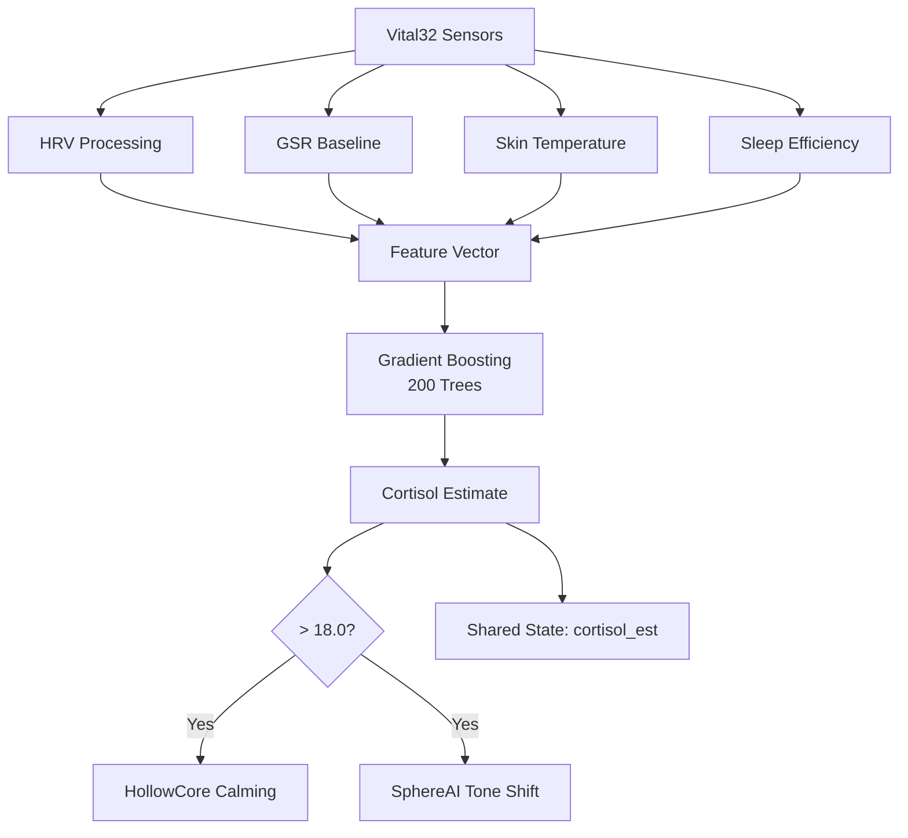

The cortisol estimator predicts a user's stress hormone level from wearable biomarkers, enabling LifeSphere to calm the environment before conscious distress is even expressed.

## What It Answers

The model answers: "What is the user's estimated cortisol level right now, based on the last 15 minutes of cardiac, skin conductance, temperature, and sleep data?" The output is labeled in the source as "ng/dL est." (nanograms per deciliter, a common blood concentration unit). This is an estimate, not a blood test. It cannot be used for clinical diagnosis.

## Inputs

The estimator draws on four feature categories:

| Input | Source | What It Tells the Model |
| --- | --- | --- |
| RMSSD | Vital32 HRV processing | Parasympathetic nervous system tone; lower RMSSD often correlates with higher stress |
| GSR baseline | Vital32 galvanic skin response | Sympathetic nervous system activity; skin conductance rises with arousal |
| Skin temperature | Vital32 MLX90614 sensor | Peripheral temperature drops during stress due to vasoconstriction |
| Sleep efficiency | Vital32 HRV + accelerometer immobility | Poor sleep predicts elevated cortisol the following day |

In general, cortisol is a steroid hormone released by the adrenal cortex in response to stress. Blood tests measure it directly. Wearable devices cannot measure blood chemistry, so they infer it from proxies. The relationship between HRV, skin conductance, and cortisol is well documented in stress physiology literature, but it is noisy and individual. This is why the model learns a personal baseline rather than applying a population formula.

## Model Type

The estimator uses a Gradient Boosting ensemble with 200 trees. Gradient Boosting is a machine learning technique that builds a sequence of small decision trees, each correcting the errors of the previous ones. In general, this approach tends to capture complex nonlinear relationships, such as the interaction between sleep debt and skin temperature changes, better than a single regression line.

The specific gradient boosting library and hyperparameters beyond tree count are not specified.

## Output and Thresholds

The model produces a single estimated value every 15 minutes.

| Estimated Value | Action |
| --- | --- |
| Normal range | No environmental change |
| \> 18.0 | HollowCore triggers warm dim lighting and lowers AC temperature; SphereAI may offer calming conversation or adhkar |

Threshold 18.0 is a design choice, not a clinically validated cortisol cutoff. The source does not specify how this number was selected.

## Why Personal Baseline Matters

Cortisol follows a circadian rhythm: it peaks shortly after waking and falls through the day. A population model might flag the morning peak as abnormal. By learning the user's own diurnal curve, the estimator recognizes deviation from personal rhythm, not deviation from an average of strangers. A user whose cortisol estimate spikes at midnight, relative to their own history, receives intervention. A user whose morning peak is large but normal for them does not.

## Integration Flow

## Why This Matters

Chronic stress accelerates cardiovascular disease, suppresses immune function, and worsens cognitive decline in elderly people. By the time a person notices they are stressed, cortisol has already been elevated for hours. A system that estimates cortisol from silent biomarkers can intervene earlier: dimming harsh lights, lowering room temperature, playing calming audio, or simply quieting the home before the user asks.

LifeSphere's stated principle is that technology should respond to biology, not require the user to interact with it. The cortisol estimator is a concrete embodiment of that idea.

## How It Connects to the Rest of LifeSphere

- **Vital32** supplies all four input features on medium and long cycles
- **HollowCore** subscribes to `cortisol_est` and maps values above 18.0 to lighting and climate rules
- **SphereAI** uses cortisol as a biology agent input to the emotional classifier; high cortisol shifts classifier weights toward biology
- **HollowRover** may be dispatched for stress-relief protocol if cortisol remains elevated alongside high anomaly scores

## Limits

- This is an estimate, not a laboratory measurement; it cannot replace blood tests for adrenal disorders
- The training data are not specified; the model may or may not generalize across ethnic groups, climates, or medication regimes
- Threshold 18.0 is not clinically validated
- No accuracy or correlation with serum cortisol is reported
- Sleep efficiency itself is inferred from HRV and motion, adding a second layer of estimation error

## Related Pages

<CardGroup cols={2}>
  <Card title="AI Overview" icon="brain" href="/ai/overview">
    All six models and the three inference timescales.
  </Card>

  <Card title="Emotional Classifier" icon="masks-theater" href="/ai/emotional-classifier">
    How cortisol feeds the trimodal emotional state model.
  </Card>

  <Card title="HollowCore Biometric Mapping" icon="house-signal" href="/hollowcore/biometric-mapping">
    How cortisol estimates become lighting and climate actions.
  </Card>

  <Card title="Honest Limits" icon="triangle-exclamation" href="/status/honest-limits">
    What the project acknowledges about unvalidated predictive claims.
  </Card>
</CardGroup>
