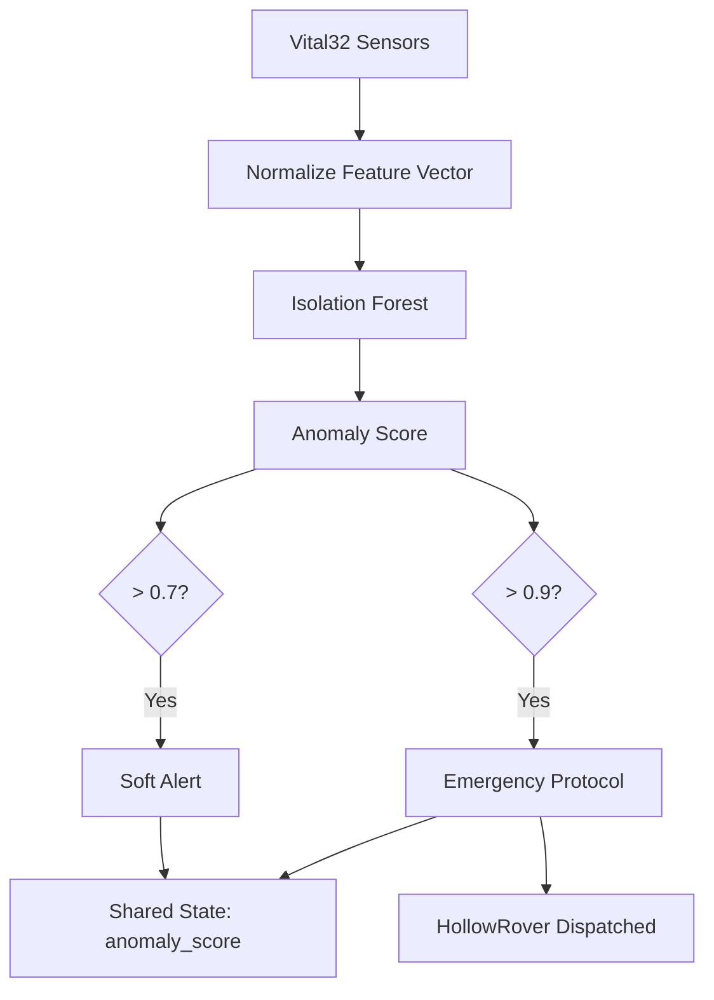

LifeSphere's primary real-time safety model is an Isolation Forest that learns what normal looks like for a single wearer, then scores every new sensor reading by how unusual it is relative to that personal baseline.

## What It Answers

The Isolation Forest answers one question: "How surprising is this moment's biometric snapshot, given everything I have learned about this person?" A low score means the reading fits the user's established pattern. A high score means the combination of heart rate, HRV, skin temperature, GSR, motion, and other signals is rare for this individual.

## How Isolation Forest Works

Isolation Forest is an unsupervised machine learning algorithm. Instead of learning what "bad" looks like, it learns what "normal" looks like by building many random decision trees on the user's baseline data.

<AccordionGroup>
  <Accordion title="Random trees isolate points">
    Each tree randomly selects a feature and a split value, partitioning the data until each point is alone in its own leaf. Normal points, which are dense in the center of the distribution, require many splits to isolate. Anomalous points, which sit far from the center, are isolated in very few splits.
  </Accordion>

  <Accordion title="Average path length becomes the score">
    For a new data point, the algorithm measures the average number of splits across all trees before the point is isolated. The shorter the average path, the more anomalous the point.
  </Accordion>

  <Accordion title="Normalization to 0-to-1 score">
    The raw path length is normalized against the expected path for a random point, producing an anomaly score between 0 and 1.
  </Accordion>
</AccordionGroup>

The isolation logic is expressed mathematically as:

$$
s(x, n) = 2^{-\frac{E[h(x)]}{c(n)}}
$$

where $$E[h(x)]$$ is the average path length for point $$x$$ across all trees, and $$c(n)$$ is a normalizing constant for a dataset of size $$n$$:

$$
c(n) = 2H(n-1) - \frac{2(n-1)}{n}
$$

$$H(n)$$ is the $$n$$-th harmonic number, approximated by:

$$
H(n) = \ln(n) + 0.5772
$$

In plain terms, the exponent measures how much shorter the point's path is than the expected path for a random point. If the average path is tiny, the exponent is a large negative number, $$s(x,n)$$ approaches 1, and the point is flagged as anomalous.

## Model Configuration

The model is trained on the user's first 30 days of normal Vital32 wear. Key parameters:

| Parameter | Value | Meaning |
| --- | --- | --- |
| Trees | 100 | Number of independent isolation trees voting on each point |
| Contamination | 0.05 | Assumes roughly 5% of baseline data may be anomalous, guiding the internal threshold calibration |
| Features | Multi-sensor fusion | Normalized biometric feature vector from Vital32 |
| Update frequency | Every 30 seconds | Short-cycle inference |

## Alert Thresholds

| Score Range | Action |
| --- | --- |
| 0.0 to 0.7 | Normal; no action |
| \> 0.7 | Soft alert; logged in shared state, may trigger environmental comfort |
| \> 0.9 | Emergency protocol; HollowRover dispatched for fall or health response |

The anomaly detector uses Isolation Forest with 100 trees and contamination 0.05, trained on the user's first 30 days of data. The source does not describe any additional model paired with the Isolation Forest for anomaly scoring.

## Pipeline Integration

## Why a Personal Baseline Is Essential Here

Isolation Forest is unsupervised, so it requires a clean representation of normal. If the baseline were drawn from a population, the model would isolate the wearer themselves, not their unusual moments. By training on 30 days of the user's own routine, the model learns the correlations that define their healthy state: perhaps their GSR runs higher than average but always tracks with temperature, or their HRV dips after meals in a predictable way. The model then recognizes only the combinations that break those personal patterns.

## How It Connects to the Rest of LifeSphere

- **Vital32** supplies the normalized feature vector every 30 seconds
- **HollowRover** listens to `anomaly_score` and dispatches when the score exceeds 0.9
- **HollowCore** may dim lights or lower temperature on elevated scores below the emergency threshold
- **SphereAI** can adjust conversational tone if the anomaly score trends upward, even before an emergency threshold is hit

## Limits

- The model assumes the first 30 days are representative of health; illness during initialization would contaminate the baseline
- Contamination is fixed at 0.05; the source does not describe how this is chosen per user
- No AUC, precision, recall, or validation results are reported
- The source does not describe any additional model architecture paired with the Isolation Forest
- Online retraining is not described; the model may become stale if the user's health changes gradually

## Related Pages

<CardGroup cols={2}>
  <Card title="AI Overview" icon="brain" href="/ai/overview">
    All six models and the three inference timescales.
  </Card>

  <Card title="Thresholds and Alerts" icon="bell" href="/ai/thresholds-and-alerts">
    How scores translate to system-wide actions.
  </Card>

  <Card title="Anomaly Scoring" icon="shield-halved" href="/vital32/predictions/anomaly-scoring">
    How Vital32 detects acute biometric anomalies using Isolation Forest
  </Card>

  <Card title="Personal Baselines" icon="user" href="/ai/personal-baselines">
    Why the first 30 days define everything the model knows about normal.
  </Card>
</CardGroup>
