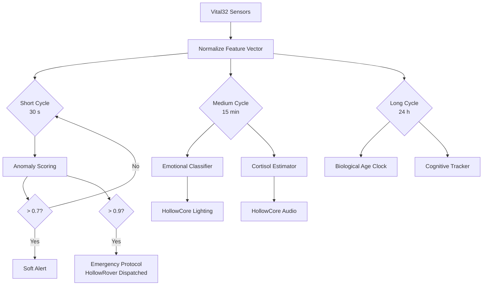

LifeSphere's intelligence layer is a set of six predictive models that run across three timescales, each trained on the user's own data rather than generic population averages.

## The Six Models

<CardGroup cols={2}>
  <Card title="Personal Baselines" icon="user" href="/ai/personal-baselines">
    Why the system learns _your_ normal instead of comparing you to everyone else.
  </Card>

  <Card title="Isolation Forest" icon="magnifying-glass-chart" href="/ai/isolation-forest">
    Real-time anomaly detection trained on the first 30 days of normal use.
  </Card>

  <Card title="Pre-Seizure LSTM" icon="heart-pulse" href="/ai/pre-seizure-lstm">
    Seizure probability estimation up to 30 minutes before onset.
  </Card>

  <Card title="Emotional Classifier" icon="masks-theater" href="/ai/emotional-classifier">
    Trimodal fusion of language, voice, and biology for emotional state.
  </Card>

  <Card title="Cortisol Estimator" icon="bolt" href="/ai/cortisol-estimator">
    Stress hormone estimation from HRV, GSR, temperature, and sleep.
  </Card>

  <Card title="Biological Age Clock" icon="hourglass-half" href="/ai/biological-age-clock">
    Daily biological age estimate from multi-sensor fusion.
  </Card>
</CardGroup>

## Three Timescales

LifeSphere does not treat all inference the same. Different health signals change at different speeds, so the AI runs on three distinct cycles.

| Timescale | Cycle | What Runs |
| --- | --- | --- |
| Short | 30 seconds | Normalized biometric feature vector, acute anomaly detection |
| Medium | 15 minutes | Emotional state update, cortisol estimation |
| Long | 24 hours | Biological age clock, cognitive baseline deviation score, personalized circadian rhythm model (30-day rolling window) |

<Warning>
  These are design targets. Predictive claims, such as immune activation detection 24 to 48 hours before symptoms or pre-seizure estimation 30 minutes before onset, are goals, not validated clinical results. Longitudinal user studies are planned for future work.
</Warning>

## Why Personal Baselines Matter

Most health devices compare your readings to population tables. A 70-year-old in Dhaka is compared to the same threshold as a 70-year-old in Helsinki, even though diet, climate, activity, and genetics differ.

LifeSphere takes the opposite approach. Each model learns what is normal _for this specific user_ by observing them over time. The anomaly detector watches the first 30 days of routine wear to establish a personal distribution. The cortisol estimator builds a personal GSR baseline. The cognitive tracker records the user's own vocabulary patterns and topic repetition rates.

This means:

- A naturally low resting heart rate is not flagged as abnormal
- Seasonal humidity changes in Bangladesh do not trigger false VOC alerts
- A user who speaks slowly is not scored for cognitive decline on speech pace alone

The source document describes this as "democratizing predictive healthcare" by removing the assumption that one threshold fits all.

## Who Triggers Whom

The short cycle feeds immediate safety decisions. The medium cycle drives environmental comfort and emotional support. The long cycle builds the deep baseline that makes the other two cycles meaningful.

## Why This Matters

Population thresholds create two kinds of harm: false alarms that desensitize families, and missed signals that arrive too late. By learning individual baselines, LifeSphere attempts to make each alert specific to the person wearing the device. In the project's stated philosophy, the system exists to lower the signal-to-noise ratio of caregiving, not to add more beeps to an already noisy home.

## How It Connects to the Rest of LifeSphere

- **Vital32** supplies raw sensor streams to all models
- **SphereAI** consumes emotional state, cortisol level, and cognitive score to adjust tone and companionship
- **HollowCore** reacts to cortisol and SpO2 thresholds with lighting, climate, and audio
- **HollowRover** receives anomaly and seizure probabilities to trigger physical protocols
- **EntryGuard** does not directly consume AI outputs, but its threat classification feeds the shared state that SphereAI may reference during conversation

## Limits

- No accuracy, AUC, or performance results are reported for any model
- The seizure LSTM is trained on EEG datasets, not the wearable's actual signals; this gap is noted but not resolved
- The immune activation model is a design goal without specified features or threshold
- All models are trained offline; online adaptation is not described
- Real-world validation in homes in Bangladesh is future work

## Related Pages

<CardGroup cols={2}>
  <Card title="Personal Baselines" icon="user" href="/ai/personal-baselines">
    How the system learns what normal means for one person.
  </Card>

  <Card title="Isolation Forest" icon="magnifying-glass-chart" href="/ai/isolation-forest">
    Real-time anomaly scoring and alert thresholds.
  </Card>

  <Card title="Pre-Seizure LSTM" icon="heart-pulse" href="/ai/pre-seizure-lstm">
    Architecture, inputs, and the validation gap.
  </Card>

  <Card title="Cortisol Estimator" icon="bolt" href="/ai/cortisol-estimator">
    Stress estimation from wearable biomarkers.
  </Card>
</CardGroup>
