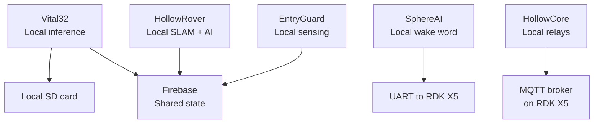

LifeSphere is designed so that no single hardware failure leaves the user unmonitored. Instead of centralizing all computation in one powerful computer that everything else depends on, the system distributes intelligence across five autonomous nodes. Each node performs local processing, maintains its own operational continuity, and contributes to the shared biological state without requiring permission from a master controller.

## What distributed intelligence means

In a centralized system, a wearable sensor might stream raw data to a home server, which then runs all the algorithms, makes all decisions, and commands all actuators. If that server fails, the entire system goes dark. The wearable keeps measuring, but nobody listens. The lights stay on, the rover stays parked, and the AI companion goes silent.

LifeSphere avoids this by giving each subsystem its own local compute and its own reason to exist independently. Vital32 runs signal processing and anomaly detection on its ESP32 microcontroller. HollowRover runs SLAM navigation and AI inference on its dedicated NPU. SphereAI runs wake-word detection on an ESP32-S3 and speech processing on the rover's main computer. EntryGuard nodes each contain their own ESP32 and sensors. HollowCore listens to MQTT and controls relays with its own microcontroller.

This means that if HollowRover is charging in its dock, Vital32 continues monitoring. If one EntryGuard node loses power, the other nodes and the wearable continue operating. If the internet drops, the rover becomes a local Wi-Fi hotspot so Vital32 can still transmit to local subscribers.

## Local processing at each node

<AccordionGroup>
  <Accordion title="Vital32 local autonomy">
    The wearable performs all signal processing onboard: HRV computation, fall detection, anomaly scoring, and the 30-second biometric upload cycle. Even without cloud connectivity, it buffers 24 hours of data on an SD card and continues all inference pipelines.
  </Accordion>

  <Accordion title="HollowRover local autonomy">
    The RDK X5 runs ROS2 Humble with SLAM Toolbox and Nav2 entirely onboard. The dedicated NPU handles speech-to-text, sentiment analysis, and face recognition without CPU contention. The rover maintains its own occupancy maps, UWB localization, and floor discrimination. It can navigate, dispense medication, and respond to emergencies without internet access.
  </Accordion>

  <Accordion title="SphereAI local autonomy">
    The ESP32-S3 runs the ESP-SR wake-word model locally, always listening without cloud connectivity or main CPU involvement. On wake-word detection, it signals the RDK X5 over UART to activate full Whisper processing. Emotional classification runs on the rover's compute, but the wake-word trigger is fully independent.
  </Accordion>

  <Accordion title="EntryGuard local autonomy">
    Each EntryGuard node is a self-contained unit with its own ESP32, PIR sensor, ultrasonic distance sensor, fire sensor, gas sensor, UWB module, and barometric sensor. A node can detect motion, fire, or gas and trigger its local buzzer independently of the central database.
  </Accordion>

  <Accordion title="HollowCore local autonomy">
    The ESP32 relay controller listens to the local MQTT broker on the RDK X5. It maps shared-state fields to relay outputs without depending on Firebase cloud connectivity. If the MQTT broker is local, lighting and climate responses continue during internet outages.
  </Accordion>
</AccordionGroup>

## The shared state as coordination layer, not control center

The Firebase Realtime Database is described as the "central nervous system," but it is important to understand what that metaphor means and what it does not mean. The database does not issue commands. It does not tell Vital32 when to measure or HollowRover where to go. Instead, it is a shared visibility layer: each node publishes what it knows and subscribes to what it needs.

This distinction matters for fault tolerance. If Firebase becomes unreachable, the nodes do not freeze waiting for instructions. They continue their local loops. HollowRover can still navigate using its local maps. Vital32 still buffers data. EntryGuard still triggers local alarms. The system degrades gracefully rather than catastrophically.

## Watchdog timers and reconnection

All five subsystems have independent watchdog timers. If a node becomes unresponsive, the watchdog triggers reconnection attempts and notifies guardians. This applies to the wearable, the rover, the entry nodes, and the home controller. No external monitor is required because each node monitors itself.

## Graceful degradation scenarios

<Tabs>
  <Tab title="Rover charging">
    When HollowRover is docked and charging, it does not monitor the home or deliver medication. However, Vital32 continues biosensing, EntryGuard continues perimeter monitoring, HollowCore continues environmental automation, and SphereAI continues listening via the ESP32-S3. The monitoring chain remains intact.
  </Tab>
  <Tab title="Wi-Fi outage">
    During a Wi-Fi outage, the rover activates its local hotspot so Vital32 can continue transmitting to local subscribers. GSM via the SIM800L module provides a fallback channel for guardians. Some cloud-dependent features degrade, but core monitoring and emergency alerts persist.
  </Tab>
  <Tab title="Firebase unreachable">
    If Firebase becomes unreachable, nodes fall back to local operation. Vital32 buffers to SD card. HollowRover uses its local maps and MQTT broker. EntryGuard triggers local alarms. The ecosystem continues at reduced coordination.
  </Tab>
</Tabs>

## Why this matters

For an elderly person living alone, a system that fails completely when one component breaks is worse than no system at all because it creates false confidence. Distributed intelligence ensures that the user remains covered by overlapping monitoring layers. The wearable, the home sensors, the rover, and the perimeter nodes each provide independent safety nets.

## How it connects to the rest of LifeSphere

<AccordionGroup>
  <Accordion title="Fault tolerance">
    Specific watchdog, backup power, and data buffering mechanisms are detailed in <a href="/core/fault-tolerance">Fault Tolerance and Graceful Degradation</a>.
  </Accordion>

  <Accordion title="Communication channels">
    The dual-channel model that enables local fallback is explained in <a href="/core/communication-channels">Communication Channels</a>.
  </Accordion>

  <Accordion title="System architecture">
    The publish-subscribe topology is covered in <a href="/core/system-architecture">System Architecture</a>.
  </Accordion>
</AccordionGroup>

## Limits

Distributed intelligence increases hardware cost and complexity compared to a centralized hub. The source does not specify how conflicts are resolved when two nodes publish contradictory field values simultaneously. Full coordination during multi-subsystem emergency protocols (such as a fall followed by an intruder alert) may degrade if multiple channels are stressed.

## Related pages

<CardGroup cols={2}>
  <Card title="Fault Tolerance" icon="shield-halved" href="/core/fault-tolerance">
    Watchdog timers, backup power, and graceful degradation details.
  </Card>

  <Card title="Communication Channels" icon="wifi" href="/core/communication-channels">
    How data moves when the cloud is unavailable.
  </Card>

  <Card title="System Architecture" icon="layer-group" href="/core/system-architecture">
    The publish-subscribe topology that enables distribution.
  </Card>

  <Card title="Zero-Interaction Principle" icon="hand" href="/core/zero-interaction-principle">
    Why the user never needs to know a node has failed.
  </Card>
</CardGroup>
