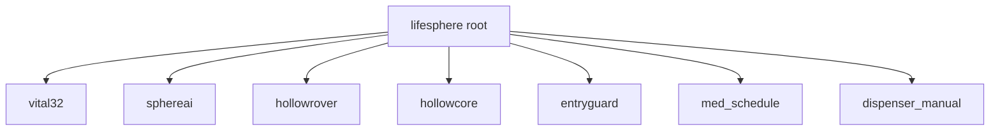

LifeSphere's five subsystems do not communicate through direct messages or private APIs. Instead, they share a single real-time JSON tree in Firebase Realtime Database, rooted at `lifesphere`. This shared biological state is the common language that lets a wearable sensor on the wrist trigger a home lighting change, a rover dispatch, and a conversational shift simultaneously without any subsystem knowing the others exist.

## The root structure

The state tree has a flat top level with keys for each subsystem, plus medication-related paths that cross subsystem boundaries. Every field is live: when Vital32 writes a new heart rate, all subscribers see the update propagate within the target latency window.

## Vital32 fields (the biosensing layer)

Vital32 owns the most frequently updated branch. It writes raw and processed biometric data that drives nearly every other subsystem's behavior.

<AccordionGroup>
  <Accordion title="Vital32 field reference">
    | Field | Example | Meaning |
    | --- | --- | --- |
    | heart_rate | 72 | Beats per minute from cardiac signals |
    | spo2 | 98.2 | Blood oxygen saturation percentage from pulse-based sensing |
    | skin_temp | 36.4 | Skin surface temperature in degrees Celsius |
    | hrv_rmssd | 42.1 | RMSSD: root mean square of successive RR interval differences, a heart-rate variability metric |
    | hrv_lf_hf | 1.8 | Ratio of low-frequency to high-frequency HRV power, indicating sympathetic vs parasympathetic balance |
    | gsr | 0.34 | Galvanic skin response: electrical conductance of the skin, rising with sympathetic nervous system activation |
    | bio_age | 68.4 | Biological age estimate in years, derived from multi-sensor fusion |
    | anomaly_score | 0.12 | Real-time anomaly score from 0 to 1; trained on the user's own baseline |
    | seizure_prob | 0.03 | Pre-seizure probability from 0 to 1, updated via LSTM sequential modeling |
    | cortisol_est | 14.2 | Estimated cortisol level, used by SphereAI and HollowCore for stress response |
    | fall_detected | false | Boolean flag set when fall-detection algorithm triggers |
    | immune_alert | false | Boolean flag for immune-activation anomaly (design goal, not validated) |
    | timestamp | 1720000000000 | Milliseconds since epoch, indicating freshness of the reading |
  </Accordion>
</AccordionGroup>

**Who writes this:** Vital32, every 30 seconds. **Who reads this:** SphereAI (for emotional classification), HollowCore (for environmental response), HollowRover (for protocol triggers), and the anomaly scoring pipeline.

## SphereAI fields (the affective layer)

SphereAI publishes emotional and cognitive assessments derived from speech, voice, and live biomarkers.

<AccordionGroup>
  <Accordion title="SphereAI field reference">
    | Field | Example | Meaning |
    | --- | --- | --- |
    | emotional_state | "calm" | Dominant emotional category from the trimodal classifier: calm, stressed, grief, isolated, or cognitive |
    | stress_level | 0.21 | Normalized stress indicator, updated every 15 minutes |
    | loneliness_index | 0.15 | Estimated loneliness severity, updated every 15 minutes |
    | cognitive_score | 0.94 | Cognitive health indicator derived from linguistic patterns |
  </Accordion>
</AccordionGroup>

**Who writes this:** SphereAI, on a 15-minute medium cycle. **Who reads this:** the source does not specify exactly which subsystems consume SphereAI fields; HollowCore's rules act on biomarker fields directly rather than on emotional state classifications.

## HollowRover fields (the physical layer)

HollowRover publishes its operational status so other subsystems know when physical assistance is available.

<AccordionGroup>
  <Accordion title="HollowRover field reference">
    | Field | Example | Meaning |
    | --- | --- | --- |
    | status | "idle" | Current rover state: idle, navigating, dispensing, responding, charging |
    | battery | 87 | Remaining battery percentage |
  </Accordion>
</AccordionGroup>

**Who writes this:** HollowRover's main controller. **Who reads this:** the source does not specify exactly which subsystems subscribe to HollowRover's status fieldsthe source does not specify exactly which subsystems subscribe to HollowRover's status fields.

## HollowCore fields (the home layer)

HollowCore publishes the current home environment state and reads biometrics to drive automation rules.

<AccordionGroup>
  <Accordion title="HollowCore field reference">
    | Field | Example | Meaning |
    | --- | --- | --- |
    | ac_temp | 24 | Current air conditioning set temperature in Celsius |
    | fan | false | Fan active state |
  </Accordion>
</AccordionGroup>

**Who writes this:** HollowCore microcontroller, in response to sensor data and scheduled rules. **Who reads this:** the source does not specify which subsystems read HollowCore's published state.

HollowCore also consumes fields it does not own directly. It reads `cortisol_est` to trigger lighting changes, `gsr` to request calming audio, `spo2` to activate the air purifier, and sleep state from Vital32's HRV and accelerometer data to lock the door and turn off lights.

## EntryGuard fields (the security layer)

EntryGuard publishes alert metadata so the rover and guardians can respond to threats with floor and zone awareness.

<AccordionGroup>
  <Accordion title="EntryGuard field reference">
    | Field | Example | Meaning |
    | --- | --- | --- |
    | mode | "passive" | Current security mode: passive, active, alert |
    | intruder_detected | false | Boolean flag set when an unregistered person is detected |
  </Accordion>
</AccordionGroup>

**Who writes this:** EntryGuard nodes at protected entry points. **Who reads this:** HollowRover (for autonomous patrol and response dispatch), guardian push notifications.

EntryGuard alert payloads carry additional transient data not stored in the persistent tree: alert type (motion, fire, gas), sensor value, node identity, UWB zone reference, and floor pressure reference.

## Medication paths (cross-subsystem)

Two paths under the root tie the medication subsystem to both the dispenser hardware and the broader ecosystem:

<AccordionGroup>
  <Accordion title="Medication field reference">
    | Path | Example content | Meaning |
    | --- | --- | --- |
    | med_schedule | Structured JSON | Prescription-extracted schedule: medicine names, dosages, frequencies, durations |
    | dispenser_manual | Structured JSON | Touchscreen-entered fallback schedules when prescription OCR is unavailable |
  </Accordion>
</AccordionGroup>

**Who writes this:** The companion mobile app after prescription review (`med_schedule`), or the ESP32 touchscreen UI (`dispenser_manual`). **Who reads this:** HollowRover populates its local dispenser schedule from these paths. Reminders are delivered through Firebase listeners.

## Why this matters

The shared state pattern transforms five separate hardware devices into one coherent caregiving organism. Because every subsystem reads the same fields, a change in the user's biology propagates through the home automatically. Elevated cortisol does not just live in a database; it becomes dimmer lights, cooler air, calming audio, and a gentler conversational tone from the AI companion.

## How it connects to the rest of LifeSphere

<AccordionGroup>
  <Accordion title="Communication channels">
    The underlying transport layers that move this data are described in <a href="/core/communication-channels">Communication Channels</a>.
  </Accordion>

  <Accordion title="System architecture">
    The publish-subscribe topology is detailed in <a href="/core/system-architecture">System Architecture</a>.
  </Accordion>

  <Accordion title="Multi-timescale inference">
    Different fields update at different rates: 30 seconds for biometrics, 15 minutes for emotion, 24 hours for biological age. See <a href="/core/multi-timescale-inference">Multi-Timescale Inference</a>.
  </Accordion>
</AccordionGroup>

## Limits

Field ranges and units are not fully specified beyond the example values above. The JSON tree structure, while flexible, requires disciplined naming because microcontrollers parse it with limited memory. The source does not specify retention policies or how historical data is archived from the real-time database.

## Related pages

<CardGroup cols={2}>
  <Card title="System Architecture" icon="layer-group" href="/core/system-architecture">
    How the five nodes connect through publish-subscribe topology.
  </Card>

  <Card title="Communication Channels" icon="wifi" href="/core/communication-channels">
    Firebase, MQTT, serial, UART, and GSM transport details.
  </Card>

  <Card title="Multi-Timescale Inference" icon="wave-square" href="/core/multi-timescale-inference">
    Why different fields update at different rates.
  </Card>

  <Card title="Zero-Interaction Principle" icon="hand" href="/core/zero-interaction-principle">
    The philosophy that makes shared state invisible to the user.
  </Card>
</CardGroup>
