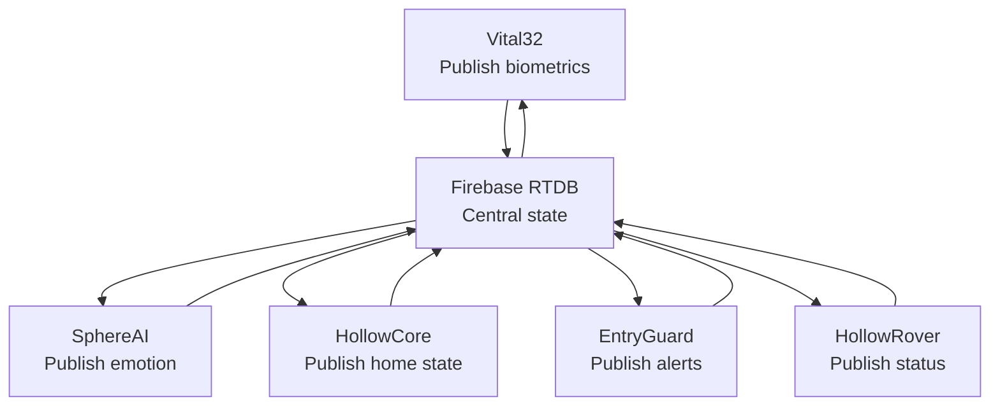

LifeSphere is not a collection of separate devices. It is a single distributed intelligence stretched across five hardware nodes, each contributing to and consuming from one shared biological state. A publish-subscribe communication model keeps all subsystems synchronized with a target latency of 150 milliseconds, so that a change in the user's body can trigger a physical response almost as quickly as a reflex.

## The five subsystems

<CardGroup cols={2}>
  <Card title="Vital32" icon="heart-pulse" href="/vital32/overview">
    The wearable biosensing layer. Worn on the body, it continuously captures cardiac signals, motion, temperature, perspiration, and environmental exposure. It writes biometric data into the shared state every 30 seconds.
  </Card>

  <Card title="HollowRover" icon="robot" href="/hollowrover/overview">
    The autonomous physical response unit. A ROS2-based rover that navigates the home, delivers medication, responds to falls, and acts as a physical bridge between digital alerts and physical action.
  </Card>

  <Card title="SphereAI" icon="brain" href="/sphereai/overview">
    The affective computing layer. Processes speech, voice prosody, and live biomarkers to estimate emotional state, stress, loneliness, and cognitive trajectory.
  </Card>

  <Card title="EntryGuard" icon="shield-halved" href="/entryguard/overview">
    The perimeter security layer. Monitors entry points for motion, fire, gas, and unregistered persons, providing floor-aware threat localization.
  </Card>

  <Card title="HollowCore" icon="wifi" href="/hollowcore/overview">
    The biology-responsive home and financial automation layer. Adjusts lighting, climate, and air quality based on biometric cues, and monitors financial transactions for anomalies.
  </Card>
</CardGroup>

These five nodes do not operate in isolation. They function as what the project describes as "a single organism sharing one biological state backbone."

## Publish-subscribe topology

The architecture uses a publish-subscribe pattern rather than direct request-response chains. Each subsystem publishes updates to the shared state and subscribes only to the fields relevant to its function.

In this model, Vital32 continuously writes sensor readings while the other four subsystems listen for changes. When the anomaly score crosses a threshold, HollowRover receives the update and initiates its emergency protocol without Vital32 needing to know the rover exists.

This decoupling is what makes the system extensible. A new subsystem could subscribe to the same state fields without altering any existing node.

## The central nervous system: Firebase Realtime Database

Firebase Realtime Database serves as the central synchronization layer, described in the project documentation as the "central nervous system" of the ecosystem. All five subsystems read from and write to a single JSON tree rooted at `lifesphere`.

The database does not merely store historical data. It is a living state representation updated in real time. When Vital32 writes a new heart rate value, Firebase propagates that change to all listening clients within the target latency window. This is what enables HollowCore to dim the lights within seconds of detecting a cortisol spike in the user's physiology.

## Target latency and responsiveness

The system targets 150 milliseconds end-to-end latency from a biometric event to a subscriber response. This is not a hard real-time guarantee but a design target that shapes hardware selection, network topology, and data structure choices.

For actions requiring faster response, such as motor commands and wake-word activation, LifeSphere uses secondary channels. A direct serial bridge between HollowRover's main computer and its ESP32 motor controllers provides sub-10 millisecond command latency for obstacle avoidance and actuator control. MQTT over local Wi-Fi handles hardware-to-hardware commands that need to bypass the cloud round trip.

## Data flow example

Consider a stress escalation scenario:

<Steps>
  <Step title="Biometric shift">
    Vital32 detects elevated galvanic skin response and a rising cortisol estimate. It publishes these values to the shared state.
  </Step>
  <Step title="Emotional update">
    SphereAI, subscribed to the biomarker fields, adjusts its meta-classifier weights toward biology dominance and updates the emotional state to "stressed."
  </Step>
  <Step title="Home response">
    HollowCore sees the cortisol estimate exceed its threshold. It publishes MQTT commands to warm and dim the lights, lower the air conditioning temperature, and trigger calming audio playback.
  </Step>
  <Step title="Physical presence">
    HollowRover, monitoring the same fields, prepares a stress-relief protocol and may navigate to the user's location if the state persists.
  </Step>
</Steps>

None of these subsystems directly message each other. They all interact through the shared state, which is why the architecture can be described as a single intelligence distributed across five bodies.

## Why this matters

A caregiving system that requires explicit integration between every pair of devices becomes fragile as it grows. The publish-subscribe model ensures that adding a new capability, such as a new sensor modality or a new response protocol, only requires subscribing to the relevant state fields. The existing subsystems need no modification.

## How it connects to the rest of LifeSphere

<AccordionGroup>
  <Accordion title="Shared biological state">
    The JSON tree structure and field groupings are detailed in <a href="/core/shared-biological-state">Shared Biological State</a>.
  </Accordion>

  <Accordion title="Communication channels">
    The dual-channel model, MQTT, serial bridge, and GSM fallback are explained in <a href="/core/communication-channels">Communication Channels</a>.
  </Accordion>

  <Accordion title="Distributed intelligence">
    How each node maintains local autonomy while contributing to the whole is covered in <a href="/core/distributed-intelligence">Distributed Intelligence</a>.
  </Accordion>
</AccordionGroup>

## Limits

The 150 ms target depends on Wi-Fi connectivity. During outages, GSM fallback has higher latency, and local MQTT routing bypasses Firebase entirely. The Firebase JSON tree structure also implies that deeply nested fields require careful design to avoid excessive listener overhead on microcontrollers with limited memory.

## Related pages

<CardGroup cols={2}>
  <Card title="Shared Biological State" icon="layer-group" href="/core/shared-biological-state">
    Every field in the shared JSON tree, explained.
  </Card>

  <Card title="Communication Channels" icon="wifi" href="/core/communication-channels">
    Firebase, MQTT, serial bridge, UART, and GSM fallback.
  </Card>

  <Card title="Distributed Intelligence" icon="brain" href="/core/distributed-intelligence">
    How failure in one node does not stop the others.
  </Card>

  <Card title="Zero-Interaction Principle" icon="hand" href="/core/zero-interaction-principle">
    The design philosophy that shaped this architecture.
  </Card>
</CardGroup>
