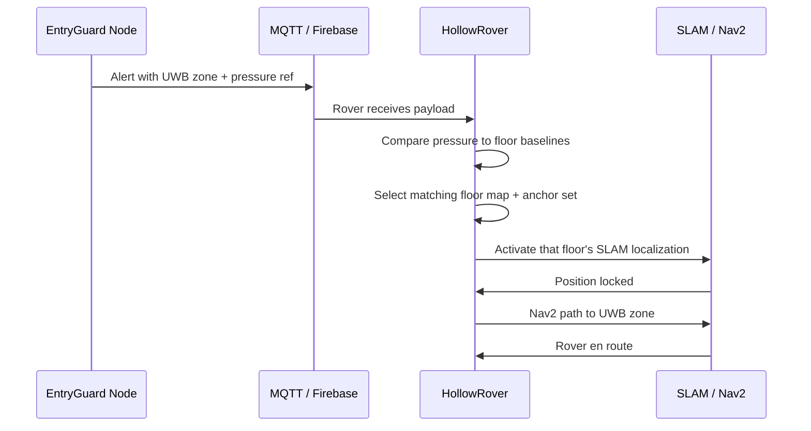

A security alert is only useful if the responder knows where to go. In a multi-floor home, knowing that "a motion sensor triggered" is not enough. EntryGuard solves this by embedding two location references into every alert payload: a horizontal zone reference from ultra-wideband ranging, and a vertical floor reference from barometric pressure. Together, these let the rover navigate to the exact origin of the alert.

## The Two Location Signals

Every EntryGuard node carries two positioning sensors that serve different purposes:

- **UWB module (DW1000 family)** provides a zone-level reference within the floor. Because the node is fixed at a known position among the three UWB anchors on that floor, its zone ID tells the rover which horizontal area to aim for.
- **Barometric pressure sensor** provides the floor-level reference. Atmospheric pressure decreases with altitude. Each registered floor stores a calibrated pressure baseline. The node's pressure reading lets the rover determine which floor the alert came from.

Barometric pressure identifies the vertical floor context. Three-anchor UWB resolves the precise horizontal position. This pairing is the core of floor-aware dispatch.

## How Dispatch Works

When an alert fires, the following sequence occurs:

1. The EntryGuard node detects a threat and builds the alert payload.
2. The payload is published to Firebase and the local MQTT broker.
3. The rover receives the payload and extracts the barometric pressure reference.
4. The rover compares this reference to its own barometric reading and to the calibrated baselines stored for each registered floor.
5. The rover selects the floor whose baseline is closest.
6. Only then does the rover activate that floor's SLAM map and UWB anchor set.
7. The rover localizes its own horizontal position using UWB trilateration against the three anchors.
8. Nav2 plans and executes a path to the UWB zone associated with the alerting node.

This sequence ensures the rover never tries to navigate using the wrong floor's map, which would lead to localization failure or dangerous behavior near stairs.

## Why This Matters

In Bangladesh and many other regions, multi-generational homes often span multiple floors. A fire on the second floor and a fire on the ground floor demand completely different responses. By giving every alert a precise three-dimensional address, EntryGuard removes the ambiguity that delays emergency response. The rover can move directly to the correct floor and zone without human guidance.

## How It Connects to the Rest of LifeSphere

- **HollowRover** executes the entire dispatch sequence: floor selection, map activation, UWB localization, and path planning.
- **HollowCore** may trigger floor-specific actions, such as activating lights or relays only on the affected floor.
- **Vital32** continues monitoring the resident's biometric signals during the event, letting the system correlate physical stress with the alert location.
- **SphereAI** can tailor verbal guidance based on which floor the resident should move toward or away from.

## Limits

The rover is wheeled and does not climb stairs. Moving between floors requires an accessible path such as a lift, ramp, or manual relocation. If the pressure difference between floors is small or the weather causes significant barometric drift, floor discrimination may become less reliable. The source does not specify how many floors can be registered or how floor baselines are maintained over time.

## Related Pages

<CardGroup cols={2}>
  <Card title="Intrusion Detection" icon="user-secret" href="/entryguard/intrusion-detection">
    How motion alerts include location references.
  </Card>

  <Card title="Fire and Gas" icon="fire" href="/entryguard/fire-and-gas">
    How environmental alerts carry the same floor and zone data.
  </Card>

  <Card title="Components" icon="microchip" href="/entryguard/components">
    The UWB and barometric sensors that make dispatch possible.
  </Card>

  <Card title="Threat Classification" icon="circle-question" href="/entryguard/threat-classification">
    How the system interprets and prioritizes different alert types.
  </Card>
</CardGroup>
