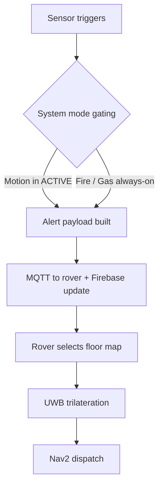

EntryGuard is the always-on perimeter layer of LifeSphere. It watches every protected doorway and hallway for three distinct threats: unauthorized motion, fire, and gas. Unlike a traditional alarm that only sounds a siren, EntryGuard ties each alert to a physical location. When a threat is real, it notifies the rover so the system can move to the exact floor and zone, and it can stream live annotated video to a guardian's phone.

## What EntryGuard Does

EntryGuard nodes sit at the edges of the home: front doors, back doors, hallways to sensitive rooms, or any chokepoint the caregiver chooses to monitor. Each node runs independently on its own microcontroller and sensor set. The nodes operate twenty-four hours a day, but they only alert on genuine threats. A motion event, for example, is gated by the system mode; the node will not cry wolf every time a registered resident walks past.

The subsystem contributes to the shared biological state through two key fields: `entryguard.mode` and `entryguard.intruder_detected`. Other subsystems read these fields and decide how to act.

## Threat Types

EntryGuard handles three alert categories.

<CardGroup cols={2}>
  <Card title="Intrusion Detection" icon="user-secret" href="/entryguard/intrusion-detection">
    PIR motion and ultrasonic distance check for unexpected movement at a monitored entry point.
  </Card>

  <Card title="Fire Detection" icon="fire" href="/entryguard/fire-and-gas">
    Flame sensor readings trigger fire alerts when heat signatures exceed a calibrated threshold.
  </Card>

  <Card title="Gas Detection" icon="wind" href="/entryguard/fire-and-gas">
    Air quality sensor readings trigger gas alerts when combustible or harmful vapors are detected.
  </Card>

  <Card title="Face Recognition" icon="eye" href="/entryguard/face-recognition">
    InsightFace classifies people as registered or unregistered at monitored chokepoints.
  </Card>
</CardGroup>

## How Alerts Flow

When a node detects a threat, it builds an alert payload. The payload carries the alert type, the sensor value that triggered it, the node's identity, a UWB zone reference, and a barometric floor reference. Because the payload already contains location tags, the rover can select the correct floor map, localize against the right anchor set, and navigate to the zone independently.

## Safety and Authorization

EntryGuard is designed as an invisible layer. It does not require the elderly resident to arm or disarm it. The face recognition pipeline runs locally on the rover, and face profile data never leaves the home. If an unregistered person is detected, the response includes a mandatory human authorization step before any defensive action, such as the arm blocking a pathway. The resident never needs to interact with a keypad or phone.

## Why This Matters

For an elderly person living alone, the gap between sensing danger and responding to it is often fatal. A smoke detector beeps, but no one is there to hear it. A door sensor logs an event, but no one knows which floor. EntryGuard closes that gap by making every alert spatially precise and by pairing sensing with a physical response unit that can move, block, and notify.

## How It Connects to the Rest of LifeSphere

EntryGuard sits at the boundary, but it is tightly coupled to the interior subsystems.

- **HollowRover** consumes every alert payload. It uses the UWB zone and floor reference to navigate autonomously to the threat location. The rover's face recognition pipeline also uses EntryGuard camera feeds at chokepoints to distinguish residents from strangers.
- **SphereAI** can adjust verbal alerts based on the emotional state of the resident when an intrusion or fire event occurs.
- **HollowCore** reads `entryguard.intruder_detected` and may toggle lights.
- **Vital32** continues biometric monitoring during the event, providing physiological context.

## Limits

The source does not specify exact numerical thresholds for fire or gas activation. Face recognition is constrained by lighting conditions and camera placement. EntryGuard nodes do not climb stairs; the multi-floor capability depends entirely on the rover's floor-discrimination logic and the availability of an accessible path between floors.

## Related Pages

<CardGroup cols={2}>
  <Card title="Intrusion Detection" icon="user-secret" href="/entryguard/intrusion-detection">
    How PIR and ultrasonic sensors work together to detect unexpected motion.
  </Card>

  <Card title="Face Recognition" icon="eye" href="/entryguard/face-recognition">
    The InsightFace pipeline that tells a resident from a stranger.
  </Card>

  <Card title="Floor-Aware Dispatch" icon="layer-group" href="/entryguard/floor-aware-dispatch">
    How alerts carry floor and zone IDs for precise rover navigation.
  </Card>

  <Card title="Threat Classification" icon="circle-question" href="/entryguard/threat-classification">
    What the system knows about each threat type and what it infers.
  </Card>
</CardGroup>
