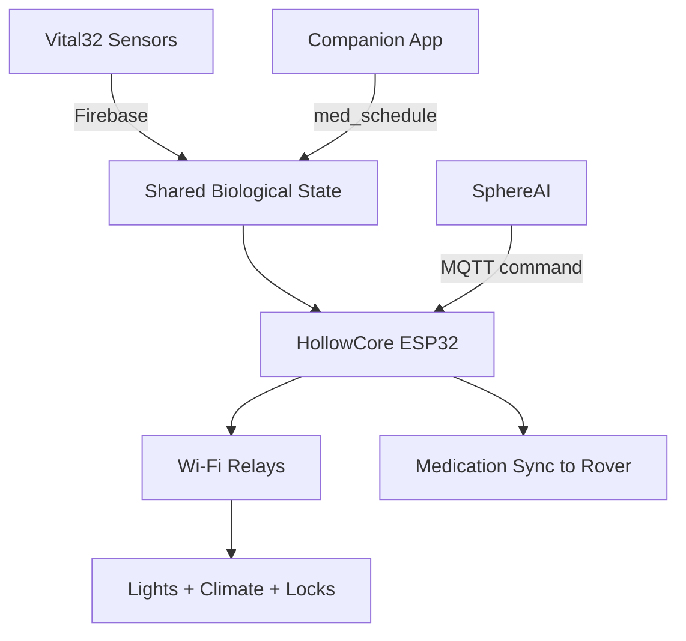

HollowCore's physical layer consists of an ESP32 microcontroller, Wi-Fi relay modules for home appliance control, and an MQTT messaging layer that connects everything to the broader LifeSphere ecosystem. This page describes each component, what it does, and how the pieces fit together.

## ESP32 Microcontroller

The ESP32 is a low-cost, low-power microcontroller with built-in Wi-Fi and Bluetooth. In HollowCore, the ESP32 runs the firmware that listens to biometric data from Firebase Realtime Database and commands from the local MQTT broker, then actuates relays to control lights, climate, locks, and other home devices.

The ESP32 handles the real-time logic that maps biometric triggers to relay outputs. For example, when the shared state field `cortisol_est` exceeds 18.0, the ESP32 activates the warm dim lighting relay and signals the AC relay to lower temperature. When `sleep detected` arrives from Vital32, it switches off the living room and bedroom light relays and energizes the door lock solenoid.

Because the ESP32 operates independently, HollowCore continues to function even if other subsystems temporarily lose connectivity, provided the local MQTT broker on HollowRover remains available.

## Wi-Fi Relay Modules

HollowCore controls home appliances through Wi-Fi relay modules. A relay is an electrically operated switch: the ESP32 sends a low-voltage control signal, and the relay opens or closes the high-voltage circuit powering the actual device. This lets the low-power microcontroller safely control household AC devices.

### Named Relays

The following relays are specifically named in the source:

| Relay | Device Controlled |
| --- | --- |
| Living room light | Main area lighting |
| Bedroom light | Bedroom lighting |
| AC / fan | Climate control unit |
| TV power | Television outlet |
| Main door lock | Solenoid door lock |
| Air purifier | Air quality device |

The source does not specify relay voltage ratings, AC current limits, or wiring safety certifications.

## MQTT Communication

HollowCore uses MQTT (Message Queuing Telemetry Transport), a lightweight publish-subscribe messaging protocol designed for IoT devices. The Mosquitto MQTT broker runs on HollowRover's RDK X5, creating a local messaging hub that does not depend on cloud connectivity.

### MQTT Commands

HollowCore listens to the topic `lifesphere/hollowcore/command` for direct device commands. The payload structure contains a device name and a desired state. For example, a payload might specify `light_1` with value `true` to turn on the living room light. This allows other subsystems, especially SphereAI during conversational interactions, to request specific HollowCore actions.

### Firebase Realtime Database

In parallel with MQTT, the ESP32 subscribes to relevant fields in Firebase Realtime Database, the central biological state synchronization layer. This cloud-mediated channel provides the biometric data that drives HollowCore's automated rules. The two-channel model means HollowCore can respond both to direct commands via MQTT and to autonomous biometric triggers via Firebase.

## Medicine Dispenser HMI Role

HollowCore coordinates with the medication management subsystem through shared state paths. The dispenser itself contains a touchscreen interface driven directly by an ESP32 microcontroller. This touchscreen lets users or caregivers enter medication schedules manually when prescription scanning is unavailable. Touch inputs are mapped to on-screen buttons by polling the resistive touch controller, and confirmed schedules write to `lifesphere/hollowcore/dispenser_manual` in Firebase.

For details on the touchscreen hardware and interaction model, see the Medication subsystem documentation.

## How It Connects to the Rest of LifeSphere

HollowCore sits in the middle of the data flow. It reads biometric states from Vital32 via Firebase and executes physical changes in the home. It also receives direct commands from SphereAI via MQTT and forwards medication schedules to HollowRover for autonomous dispensing.

## Why This Matters

The choice of an ESP32 with Wi-Fi relays rather than a centralized home automation hub reflects LifeSphere's distributed intelligence philosophy. Each subsystem keeps local processing capability. Even if the cloud connection drops, the local MQTT broker on HollowRover allows SphereAI and HollowCore to continue coordinating. The ESP32's low cost and wide availability also make the system achievable at an accessible price point, which is critical for deployment in resource-limited settings.

## Related Pages

<CardGroup cols={2}>
  <Card title="Biometric Mapping" icon="heart-pulse" href="/hollowcore/biometric-mapping">
    The five rules that map biometric triggers to relay actions.
  </Card>

  <Card title="Medication Touchscreen Fallback" icon="pills" href="/medication/touchscreen-fallback">
    The manual dispenser interface for medication entry without a phone.
  </Card>

  <Card title="Shared Biological State" icon="wifi" href="/core/shared-biological-state">
    How all five subsystems synchronize through one Firebase data tree.
  </Card>

  <Card title="Communication Channels" icon="route" href="/core/communication-channels">
    Firebase cloud mediation and MQTT local commands, latency targets, and fallback channels.
  </Card>
</CardGroup>
