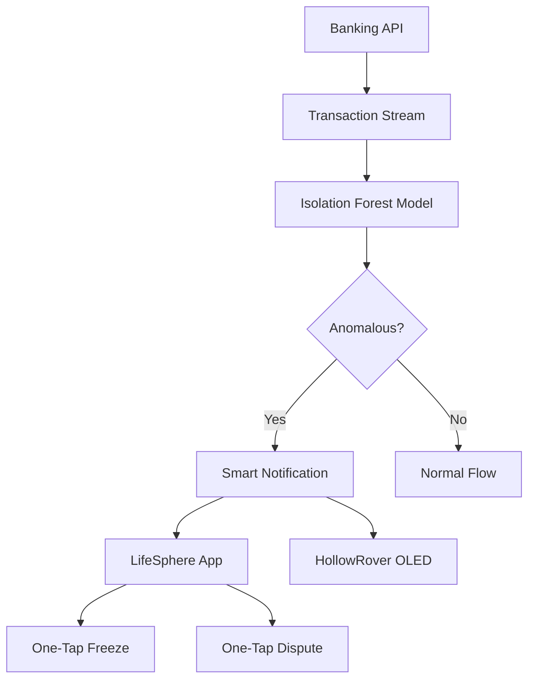

HollowCore integrates with the user's banking and subscription services to scan incoming transactions and recurring payments in real time. An Isolation Forest model, trained on the user's own historical spending data, flags transactions that deviate from established personal patterns. This shifts fraud detection from generic population rules to individualized behavioral baselines.

## How Monitoring Works

HollowCore connects to banking and subscription services through secure APIs. The source does not name specific API providers, banking partners, or integration protocols. Once connected, the system receives transaction data including amount, merchant, time, and recurrence status.

Each new transaction is evaluated against the user's personal spending model. The model has learned what normal looks like for this specific individual: typical transaction sizes, preferred merchants, geographic patterns, temporal rhythms, and subscription renewal cycles. A transaction that breaks multiple patterns simultaneously, such as an unusually large purchase at an unfamiliar merchant during an atypical hour, receives a higher anomaly score.

## Isolation Forest Model

The anomaly detector uses Isolation Forest with 100 trees and a contamination parameter of 0.05. This configuration assumes approximately 5% of baseline data may be anomalous. The model is trained on the user's own transaction history from the first 30 days of use.

The anomaly score formula is:

$$s(x,n) = 2^{-\frac{E[h(x)]}{c(n)}}$$

where $$E[h(x)]$$ is the average path length for data point $$x$$ across all trees, and $$c(n)$$ is a normalization constant for sample size $$n$$:

$$c(n) = 2H(n-1) - \frac{2(n-1)}{n}$$

where $$H(n)$$ is the harmonic number approximated by $$\ln(n) + 0.5772$$.

In plain language: Isolation Forest works by randomly partitioning the feature space. Normal data points, which cluster together, require many partitions to isolate. Anomalous points, which sit far from clusters, are isolated quickly. The shorter the average path to isolation, the more anomalous the point.

The output is an anomaly score from 0 to 1, though the financial monitoring thresholds differ from the biometric anomaly detector. For biometrics, scores above 0.7 trigger a soft alert and above 0.9 trigger emergency protocol dispatch. For financial anomalies, the source does not specify explicit thresholds or automatic actions like card freezing.

## User Notification

The user receives a smart notification through two channels: the LifeSphere companion app and the HollowRover OLED display. The notification includes transaction details, the anomaly context, and two one-tap actions: freeze card and dispute transaction.

This dual-channel delivery ensures the user or guardian sees the alert even if one device is unavailable. The OLED on HollowRover is particularly important for elderly users who may not check smartphones frequently.

## Why Personal Baselines Matter

Conventional fraud detection uses population-level rules: flag transactions above a certain amount, or in certain countries, or at certain merchant categories. These rules generate false positives for individuals with unusual but legitimate patterns, and false negatives for fraud that mimics normal behavior.

HollowCore's personal baseline approach, shared across all its AI models, compares the user to their own history rather than a generic population. A retiree who shops only at local markets and pays modest utility bills will have a very different baseline from a business traveler with international transactions. Personalization reduces both false alarms and missed fraud.

## How It Connects to the Rest of LifeSphere

Financial anomaly detection operates as an independent HollowCore service but shares the system's design philosophy of learning individual baselines. The user's face recognition profile from EntryGuard and HollowRover supports biometric transaction authorization for high-risk activities. Vital32 proximity confirmation adds a third factor for sensitive operations. SphereAI can verbally notify the user of anomalies and guide them through dispute actions conversationally.

## Limits

Banking API integration assumes third-party service availability and consent. The source does not name API providers, describe authentication mechanisms, or specify data retention policies for financial records. Thresholds for what constitutes "high-risk" requiring biometric authorization are not defined. The model requires sufficient transaction history for meaningful baseline learning; early deployment may have reduced accuracy.

## Related Pages

<CardGroup cols={2}>
  <Card title="Transaction Authorization" icon="lock" href="/hollowcore/transaction-authorization">
    Three-factor biometric authorization for high-risk financial actions.
  </Card>

  <Card title="Isolation Forest" icon="brain" href="/ai/isolation-forest">
    Technical details of the Isolation Forest anomaly detection model.
  </Card>

  <Card title="HollowCore Overview" icon="layer-group" href="/hollowcore/overview">
    How financial protection fits within the broader HollowCore automation system.
  </Card>

  <Card title="Personal Baselines" icon="heart-pulse" href="/ai/personal-baselines">
    Why LifeSphere trains all models on individual history rather than population averages.
  </Card>
</CardGroup>
