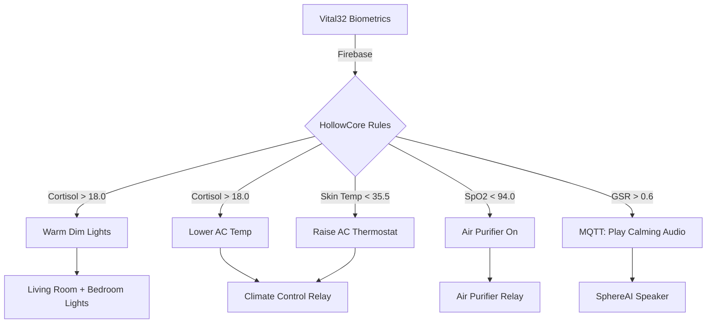

HollowCore changes four environmental variables in response to biological state: lighting warmth and brightness, room temperature, air purification, and calming audio playback. Each response connects to a specific Vital32 biometric threshold. No user command, app interaction, or voice prompt is required.

## Warm Dim Lighting and Cooling for Stress

When Vital32's cortisol estimator reports a value above 18.0, HollowCore activates two environmental changes simultaneously: warm dim lighting and a lowered AC temperature.

Warm dim lighting reduces exposure to blue-rich light spectra. In general lighting design, blue-enriched light is associated with increased alertness and suppressed melatonin production. Warm light, by contrast, promotes parasympathetic dominance, the branch of the nervous system associated with rest and digestion. Dimming reduces overall visual stimulation, which can help lower physiological arousal in stress states.

Lowering the AC temperature provides a mild cooling effect. The source does not specify the target temperature reduction or how it is calculated from the cortisol value. The interaction between stress, sweating, and thermal comfort is well-documented in environmental psychology: cooler ambient temperatures can attenuate subjective stress experiences.

These two responses are coupled to a single trigger. There is no published mechanism for partial activation, graduated response, or threshold hysteresis.

## Air Purifier for Low Oxygen Saturation

When pulse oximetry shows SpO2 below 94.0%, HollowCore turns on the air purifier relay. SpO2 (oxygen saturation) measures how much of the hemoglobin in blood is carrying oxygen. Normal values are typically 95% or higher. Readings below 94% can indicate respiratory compromise, environmental irritants, or sensor placement issues.

The source does not describe the air purifier type, filter technology, room coverage, or expected time to improve SpO2 readings. HollowCore does not turn the purifier off automatically based on SpO2 recovery. The off-trigger logic is not specified.

In general, air purifiers reduce particulate matter and volatile organic compounds that can irritate airways. For elderly individuals with reduced lung capacity or chronic respiratory conditions, cleaner air may support more stable oxygen saturation.

## Calming Audio for Elevated Skin Conductance

When galvanic skin response (GSR) exceeds 0.6, HollowCore publishes a command to SphereAI to play calming audio. Unlike the other three environmental responses, this does not control a relay directly. Instead, it uses the MQTT topic `sphereai/command` with payload `play_calming_audio`.

GSR measures skin electrical conductance, which increases with sweat gland activity driven by sympathetic nervous system arousal. Elevated GSR correlates with stress, anxiety, or emotional activation. Calming audio is intended to interrupt this arousal cascade through auditory relaxation.

SphereAI's audio output runs through a MAX98357A I2S Class D amplifier driving a 3 W 4 ohm speaker. The source does not specify what audio content plays, how it is selected, or whether it adapts to the user's preferences or cultural background.

## Temperature Adjustment for Cold Skin

When skin temperature falls below 35.5, described in the source as below baseline, HollowCore raises the AC thermostat. This is the inverse of the cortisol response: instead of cooling, the system warms.

Low skin temperature can indicate cold environments, reduced circulation, hypothermia risk, or simply that the sensor has temporarily lost good contact with skin. MLX90614 is a non-contact infrared sensor, so it does not require skin contact, but its reading depends on the angle of measurement and ambient radiation.

Raising the thermostat increases room temperature to support thermal comfort and reduce hypothermia risk. The source does not specify the temperature increase amount, whether it considers outdoor weather, or how the baseline is personalized to the individual.

## How It Connects to the Rest of LifeSphere

All four responses depend on Vital32 providing valid biometric data. If sensor readings drop out, if the Firebase connection fails, or if values fall outside plausibility bounds and are filtered by the plausibility-checking layer, HollowCore will not trigger a response. This is a designed safety behavior: the system prefers no action over potentially incorrect action based on invalid data.

## Limits

The source does not specify relay switching speeds, HVAC compatibility requirements, lighting fixture types, or whether responses consider multiple simultaneous triggers. For example, if cortisol is high and skin temperature is low simultaneously, both the cooling and warming AC commands would conflict. The priority resolution logic for conflicting triggers is not described.

## Related Pages

<CardGroup cols={2}>
  <Card title="Biometric Mapping" icon="heart-pulse" href="/hollowcore/biometric-mapping">
    The complete table of all five biometric triggers and their actions.
  </Card>

  <Card title="Sleep Protocol" icon="moon" href="/hollowcore/sleep-protocol">
    How sleep detection controls lights and security at night.
  </Card>

  <Card title="Cortisol Estimator" icon="brain" href="/ai/cortisol-estimator">
    The Gradient Boosting model producing the cortisol estimate.
  </Card>

  <Card title="SphereAI Voice Hardware" icon="wave-square" href="/sphereai/hardware/voice-hardware">
    The microphone, amplifier, and speaker that deliver calming audio.
  </Card>
</CardGroup>
