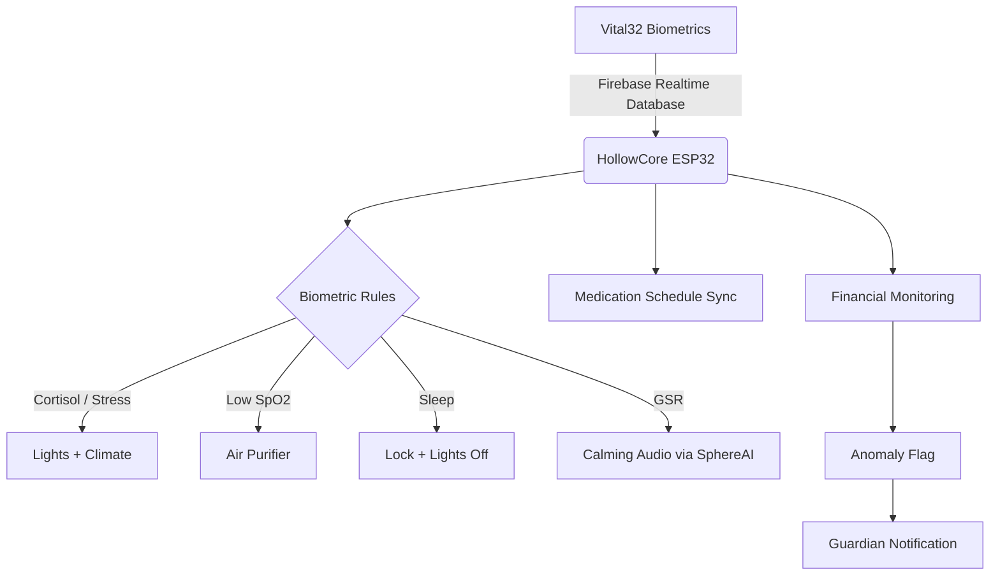

HollowCore is the biology-responsive home automation and financial protection layer of LifeSphere. It listens to your body signals through the shared biological state backbone and translates them into home environment changes, medication scheduling, and real-time financial safeguards, all without requiring you to touch a switch or give a command.

## What HollowCore Does

HollowCore sits at the intersection of four caregiving dimensions: medical, physical, emotional, and environmental. While Vital32 gathers your biological data and SphereAI interprets your emotional state, HollowCore is the subsystem that physically changes your surroundings to support your wellbeing. It controls lights, climate, air quality, and door locks based on real-time biometrics. It manages medication schedules extracted from prescriptions and delivered by HollowRover. It monitors your financial transactions for anomalies and applies multi-factor biometric authorization to protect against fraud.

The architecture reflects LifeSphere's core design philosophy: the system responds to your biology, not the other way around. You do not adjust the thermostat when you feel cold. The system detects your skin temperature falling below baseline and raises the AC thermostat automatically. You do not remember to lock the door at bedtime. The system detects sleep through heart rate variability and accelerometer immobility, then locks the door and dims the lights.

## Why This Matters

For elderly individuals living alone, especially in contexts like Bangladesh where over 15 million elderly citizens remain at home with limited healthcare access, the gap between detection and action is critical. Many smart devices can measure. Few can act. HollowCore closes that loop by making the home itself an active participant in caregiving rather than a passive container. When cortisol rises, the environment calms. When oxygen saturation drops, the air purifier activates. When sleep begins, security engages.

This matters because the most vulnerable users should not need to learn complex interfaces to receive care. HollowCore embodies the principle that technology must respond to the user's biology, not require the user to interact with technology.

## How It Connects to the Rest of LifeSphere

HollowCore consumes data from the shared biological state tree in Firebase Realtime Database and publishes commands to other subsystems via MQTT topics. The Mosquitto MQTT broker runs on HollowRover's RDK X5, enabling low-latency hardware-to-hardware communication over local Wi-Fi.

**Upstream dependencies:**

- **Vital32** provides the raw biometrics: heart rate, SpO2, skin temperature, GSR, HRV, sleep state, cortisol estimate, and anomaly score.
- **SphereAI** provides emotional state and stress level that influence tone and urgency of outputs.
- **EntryGuard** provides intruder detection status that HollowCore considers in sleep and security protocols.
- **HollowRover** hosts the MQTT broker, delivers medications physically, and displays financial alerts on its OLED.

**Downstream actions:**

- Biometric triggers map to relay commands for lights, AC, fan, air purifier, and door lock.
- Medication schedules sync to HollowRover for autonomous dispensing.
- Financial anomalies trigger smart notifications with one-tap freeze or dispute options.

## The Five Biometric Rules

HollowCore applies five published biometric-to-environment mapping rules, each with a specific trigger threshold and automated response:

1. **Cortisol spike:** When cortisol estimate exceeds 18.0, warm dim lighting activates and AC temperature lowers to promote calm.
2. **High GSR:** When galvanic skin response exceeds 0.6, HollowCore publishes a command to SphereAI to play calming audio.
3. **Low SpO2:** When oxygen saturation drops below 94.0%, the air purifier turns on.
4. **Sleep detected:** When HRV combined with accelerometer immobility indicates sleep, living room and bedroom lights turn off and the main door locks.
5. **Low skin temperature:** When skin temperature falls below 35.5 (described in the source as below baseline), the AC thermostat raises to warm the room.

These rules are hardcoded responses within the ESP32 firmware, listening continuously to the shared state and executing within the target 150 ms system latency.

## Financial Protection

HollowCore integrates with banking and subscription services via secure APIs to scan transactions in real time. An Isolation Forest model trained on your historical spending patterns flags unrecognized or out-of-pattern transactions. When a suspicious transaction occurs, you receive a smart notification through the LifeSphere app and HollowRover's OLED, with transaction details and one-tap options to freeze the card or initiate a dispute.

For new high-risk transactions or subscriptions, HollowCore enforces biometric transaction authorization requiring three independent factors: facial recognition through EntryGuard or HollowRover's camera, a fingerprint scan, and proximity confirmation from the Vital32 wearable. The specific thresholds for "high-risk" are not defined in the source.

## Medication Management

HollowCore coordinates medication schedules across the ecosystem. Prescriptions photographed through the companion app pass through OCR and large language model extraction, producing structured schedules written to `lifesphere/hollowcore/med_schedule`. HollowRover subscribes to this path and populates its local dispenser schedule for autonomous delivery. A manual touchscreen interface on the dispenser itself, driven by an ESP32 microcontroller, allows direct entry when a phone is unavailable, writing to `lifesphere/hollowcore/dispenser_manual`.

## Relay Infrastructure

HollowCore controls home devices through Wi-Fi relay modules. The ESP32 microcontroller listens to the local Mosquitto MQTT broker and maps shared-state fields or direct MQTT payloads to specific relay outputs. Named relays include living room light, bedroom light, AC/fan control, TV power, main door lock solenoid, and air purifier.

## Limits

The source does not specify relay ratings, AC wiring interfaces, or electrical safety certifications. Banking API integration assumes third-party service availability. Fingerprint hardware is referenced but not specified. The threshold definitions for "high-risk" transactions are not provided. Override protocols for sleep-state door locking, such as emergency egress, are not described in the source.

## Related Pages

<CardGroup cols={2}>
  <Card title="Components" icon="microchip" href="/hollowcore/components">
    The ESP32, Wi-Fi relays, MQTT broker, and named outputs that make HollowCore physical.
  </Card>

  <Card title="Biometric Mapping" icon="heart-pulse" href="/hollowcore/biometric-mapping">
    How each biological signal maps to a specific home automation response.
  </Card>

  <Card title="Lighting and Climate" icon="sun" href="/hollowcore/lighting-and-climate">
    Cortisol-driven dimming, temperature adjustments, air purifier triggers, and calming audio.
  </Card>

  <Card title="Sleep Protocol" icon="moon" href="/hollowcore/sleep-protocol">
    How sleep detection automates security and lighting at bedtime.
  </Card>

  <Card title="Financial Anomaly Detection" icon="scale-balanced" href="/hollowcore/financial-anomaly-detection">
    Real-time spending monitoring with Isolation Forest anomaly detection.
  </Card>

  <Card title="Transaction Authorization" icon="lock" href="/hollowcore/transaction-authorization">
    Three-factor biometric authorization for high-risk financial actions.
  </Card>

  <Card title="Design Decisions" icon="gears" href="/hollowcore/design-decisions">
    Why HollowCore uses an ESP32, MQTT relay control, and cloud biometric sync.
  </Card>

  <Card title="Limits and Ethics" icon="shield-halved" href="/hollowcore/limits-and-ethics">
    Honest boundaries on banking integration, fingerprint hardware, and autonomy trade-offs.
  </Card>

  <Card title="Medication Touchscreen Fallback" icon="pills" href="/medication/touchscreen-fallback">
    The manual dispenser interface when prescriptions are not available through the app.
  </Card>
</CardGroup>
