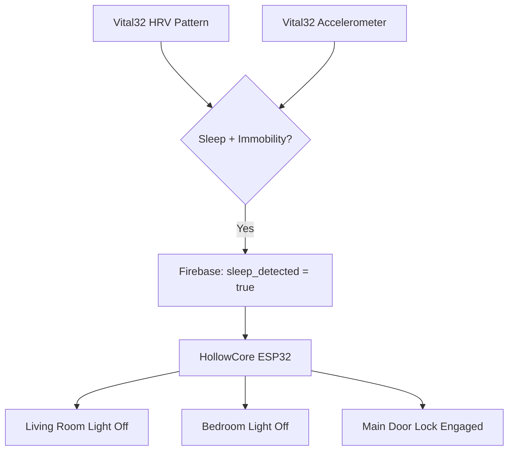

HollowCore's sleep protocol automates home security and lighting based on biological sleep detection. When Vital32 determines the user has fallen asleep, HollowCore turns off the living room and bedroom lights, and engages the main door lock solenoid. No phone, voice command, or physical switch interaction is needed.

## How Sleep Is Detected

Sleep detection relies on two concurrent signals from Vital32. First, heart rate variability (HRV) shifts into patterns associated with sleep states. Second, the MPU6050 accelerometer and gyroscope register immobility consistent with lying still.

HRV refers to the variation in time between consecutive heartbeats, measured as RR intervals. During sleep, HRV typically increases relative to awake rest due to parasympathetic dominance. The system combines this cardiac signature with physical stillness from the motion sensor to reduce false positives. Someone sitting motionless and reading would produce immobility but not sleep HRV patterns. Someone shifting in bed would produce motion but, if still in light sleep, might maintain near-sleep HRV.

The source does not specify exact HRV thresholds for sleep state, the immobility duration required, or whether the system distinguishes sleep stages such as light sleep, deep sleep, or REM.

## Automated Responses

Upon confirmed sleep detection, HollowCore executes three actions through Wi-Fi relay modules:

1. **Living room light off:** Conserves energy and reduces ambient light exposure that could disrupt circadian rhythm if the user awakens.
2. **Bedroom light off:** Completes the darkness transition for the sleep environment.
3. **Main door lock engaged:** Secures the home during the most vulnerable period when the resident is unconscious and unresponsive.

These actions are triggered together as a single protocol. The source does not describe partial activation, gradual dimming sequences, or time-delayed locking.

## Why This Matters

For elderly individuals living alone, forgetting to lock doors or turn off lights before bed is a common concern. Cognitive decline can exacerbate this. Family members may worry about parental safety at night. The sleep protocol removes this burden entirely: the system watches for biological sleep and handles security automatically.

This is particularly important in contexts with limited emergency response infrastructure. If an intruder or hazard occurs during sleep, the locked door provides a physical barrier while EntryGuard sensors continue monitoring for fire, gas, or motion alerts.

## How It Connects to the Rest of LifeSphere

Sleep detection on Vital32 runs on the wearable itself, analyzing HRV and accelerometer data locally before writing sleep state to the shared Firebase tree. HollowCore subscribes to that field and responds. SphereAI may moderate its behavior knowing the user is asleep: voice volume reduction, deferred non-urgent notifications, or altered wake-word sensitivity. EntryGuard remains active and can dispatch the rover on its floor-aware alert pipeline if danger is detected.

## Limits

The source does not specify any override mechanism for the sleep protocol. If the user wakes and needs to leave the house, there is no published description of how the door unlocks. Options could include manual override switches, biometric re-authentication, automatic unlock on Vital32 detecting wakefulness, or app-based remote unlock. These alternatives are reasonable inferences but not confirmed by the source.

The door lock is a solenoid-driven mechanism. The source does not describe its physical type (deadbolt, latch, magnetic), power requirements, or behavior during power outages. The ethics of automatically locking a cognitively declining adult inside their home deserve careful consideration by deployers, even though the source does not address them.

## Related Pages

<CardGroup cols={2}>
  <Card title="Heart Rate Variability" icon="heart-pulse" href="/vital32/sensing/heart-rate-variability">
    How HRV is computed from cardiac signals for sleep and stress inference.
  </Card>

  <Card title="Biometric Mapping" icon="layer-group" href="/hollowcore/biometric-mapping">
    The full table of biometric triggers including sleep detection.
  </Card>

  <Card title="EntryGuard Overview" icon="shield-halved" href="/entryguard/overview">
    How perimeter security continues monitoring while the user sleeps.
  </Card>

  <Card title="HollowCore Limits and Ethics" icon="circle-question" href="/hollowcore/limits-and-ethics">
    Honest discussion of door-lock autonomy, overrides, and safety trade-offs.
  </Card>
</CardGroup>
