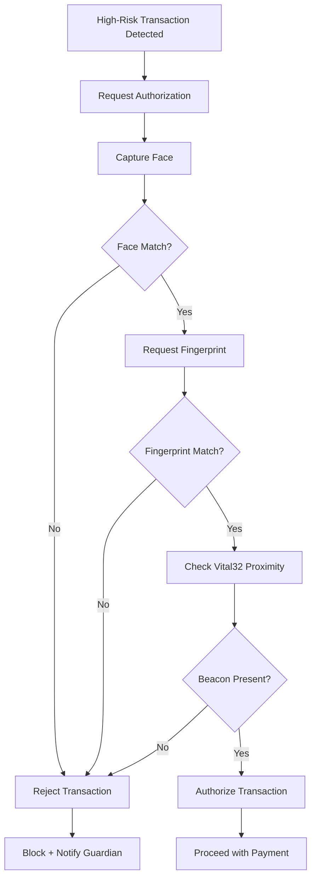

HollowCore enforces multi-factor biometric authorization for new high-risk transactions and subscription sign-ups. Instead of passwords or PINs that can be forgotten, stolen, or guessed, the system requires three independent proofs of identity tied to the user's biology and physical presence.

## The Three Factors

The three authentication factors are:

1. **Facial recognition** through the EntryGuard or HollowRover camera
2. **Fingerprint scan** through an unspecified fingerprint reader
3. **Proximity confirmation** from the Vital32 wearable

All three must succeed for the transaction to proceed. This is defense in depth: compromising one factor, such as stealing the wearable, is insufficient without the user's face and fingerprint.

## Factor One: Facial Recognition

Face recognition in LifeSphere uses an InsightFace service with the buffalo_sc model pack and MediaPipe, running on ONNX Runtime. The service is built as a FastAPI application, a Python web framework for APIs. Face profiles are stored locally on HollowRover and never transmitted to external servers, preserving privacy.

For transaction authorization, the user presents their face to the EntryGuard or HollowRover camera. The system matches the live capture against the enrolled profile. Since profiles remain on-device, facial data does not traverse the internet during authentication.

The source does not specify false acceptance or false rejection rates, enrollment process duration, or behavior in poor lighting conditions.

## Factor Two: Fingerprint Scan

The source references fingerprint scanning as the second factor but does not specify the fingerprint hardware module, sensor technology, placement in the home, or enrollment procedure. This is a known gap in the documentation.

Fingerprint sensors in general work by capturing the ridge and valley pattern of a finger, either optically or capacitively, and comparing it to an enrolled template. The specific implementation for LifeSphere is not described.

## Factor Three: Vital32 Proximity Confirmation

The third factor proves physical presence through the Vital32 wearable. The wearable acts as a BLE (Bluetooth Low Energy) beacon. The system confirms the wearable is within proximity of the transaction authorization point, ensuring the legitimate user is physically present and not being remotely impersonated.

The source does not specify the proximity range required, whether this uses BLE RSSI measurement, or how the system handles cases where the wearable is charging or temporarily removed.

## Authorization Flow

If any factor fails, the transaction is blocked and a notification is sent to the guardian. The source does not describe retry limits, alternative authentication paths if a sensor fails, or escalation procedures.

## Why Three Factors

Single-factor authentication, even with biometrics, carries risk. A face can be photographed. A fingerprint can be lifted. A wearable can be stolen. Requiring all three factors significantly raises the bar for successful fraud:

- An attacker with a photo of the user's face still lacks the fingerprint and wearable.
- An attacker with a lifted fingerprint still lacks the face and wearable.
- An attacker with a stolen wearable still lacks the face and fingerprint.

This aligns with LifeSphere's security principle: all biometric and personal data uses TLS encryption in transit, face profiles never leave the local device, and sensor readings are validated against physical plausibility before entering any decision pipeline.

## Limits

The source does not define what constitutes "high-risk." Thresholds for triggering biometric authorization are unspecified. Fingerprint hardware is not described. There is no documented fallback for users whose biometric factors become unreliable due to skin conditions, injury, or sensor degradation. The authorization flow requires the user to be physically present and capable of interacting with the sensors, which may not be possible during medical emergencies or severe cognitive decline.

## Related Pages

<CardGroup cols={2}>
  <Card title="Financial Anomaly Detection" icon="scale-balanced" href="/hollowcore/financial-anomaly-detection">
    How Isolation Forest flags suspicious transactions before authorization is needed.
  </Card>

  <Card title="Face Recognition" icon="eye" href="/entryguard/face-recognition">
    How InsightFace identifies registered users and detects intruders.
  </Card>

  <Card title="Vital32 Overview" icon="heart-pulse" href="/vital32/overview">
    How the wearable provides proximity confirmation and continuous biometric monitoring.
  </Card>

  <Card title="Security and Data Integrity" icon="shield-halved" href="/core/security-and-data-integrity">
    TLS encryption, local storage, and authentication design across LifeSphere.
  </Card>
</CardGroup>
