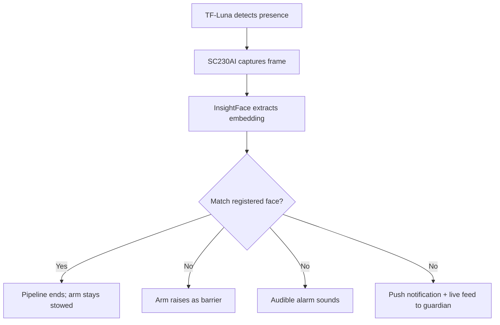

The trigger pipeline is the sequence of sensing, recognition, and decision that decides whether HollowRover's arm remains stowed or moves into passive barrier mode. It runs entirely on the rover and its connectedEntryGuard nodes, with no cloud dependency for the recognition step. The pipeline is designed to minimize false barrier deployments while ensuring that genuine intrusions generate alerts within seconds.

## Stage one: presence detection with TF-Luna

The TF-Luna is a single-point time-of-flight sensor mounted on the arm wrist. In security monitoring mode, it points toward the chokepoint passage and measures distance continuously. When an object enters the monitored zone, the distance reading drops below a threshold. This is the first trigger: the sensor detects that something has physically entered the space. At this stage, the system does not know whether the object is a person, a pet, or a moving curtain; it only knows that the zone is no longer empty. The Manipulator controller reads the TF-Luna over a serial interface and forwards a presence event to the RDK X5.

## Stage two: camera capture

On receiving the presence event, the RDK X5 activates the SC230AI stereo depth camera, the rover's main front camera with night-vision capability via an IR fill light. The camera captures a frame of the zone and feeds it into the face recognition pipeline. The source does not specify whether frames are captured once or streamed continuously while presence persists; in general, a single high-resolution frame is sufficient for face detection, while continuous streaming increases processing load without proportional benefit.

## Stage three: InsightFace verification

The captured frame is sent to the InsightFace service, a FastAPI application running on the rover's compute platform. InsightFace uses the buffalo_sc model pack with MediaPipe, executed on ONNX Runtime. The service attempts to detect a face in the image, extract an embedding (a compact numerical representation of facial features), and compare it against the locally stored profiles of registered occupants. Face profile data never leaves the rover; it is stored locally and never transmitted to external servers.

If the embedding matches a registered profile within a similarity threshold, the person is recognized as an occupant. The pipeline terminates, the arm stays stowed, and no alert is sent. If there is no face, if the face is too small or occluded, or if the embedding does not match any registered profile, the outcome is unmatched. This is the critical branch that leads to barrier deployment.

## Stage four: three simultaneous responses

When InsightFace returns unmatched, the autonomous protocol executes three actions in parallel:

1. The Manipulator controller raises the arm into the barrier pose across the chokepoint.
2. The audible alarm sounds through the MAX98357A amplifier and 3 W speaker.
3. A push notification carrying a live camera feed is sent to the guardian's phone.

All three are automatic and require no human action to initiate. They are also non-escalating: the alarm is loud but not injurious, the barrier is static, and the notification is informational.

## Pipeline diagram

## Why this ordering matters

Placing the inexpensive ToF sensor first means the camera and NPU are powered up only when something is actually present. This saves energy and reduces false face-recognition runs caused by lighting changes or empty shadows. Using InsightFace locally rather than in the cloud removes network latency from the recognition step and keeps biometric data on the device, aligning with the privacy-by-design principle. The final three responses are parallel rather than sequential so that even if one fails (for example, the alarm could be muted by fault), the others still execute.

## How it connects to the rest of LifeSphere

EntryGuard perimeter nodes provide an independent layer of motion and distance sensing at the home's outer boundary. If an EntryGuard node detects an intrusion before the rover's TF-Luna does, the rover may already be navigating toward the chokepoint by the time the local pipeline triggers. UWB positioning from the floor anchor set tells the rover which chokepoint to guard; barometric floor detection ensures it loads the correct floor's map and anchor geometry. The live camera feed in the guardian notification is the same MJPEG stream produced by the InsightFace service, annotated with bounding boxes and match status.

## Limits

The source does not specify the presence distance threshold, the face similarity threshold, or the latency budget for each stage. InsightFace accuracy in low light depends on the unresolved IR fill light; without it, night recognition may degrade. The pipeline also assumes the registered face database is current; if a caregiver's face is not enrolled, they will trigger an unmatched response. There is no mention of liveness detection, so a high-quality photograph of a registered face could theoretically pass recognition. The source notes that these are design decisions still subject to refinement.

## Related pages

<CardGroup cols={2}>
  <Card title="Passive Barrier" icon="shield-halved" href="/hollowrover/arm/passive-barrier">
    How the arm physically blocks a chokepoint and why the response remains non-contact.
  </Card>

  <Card title="Safety Rules" icon="scale-balanced" href="/hollowrover/arm/safety-rules">
    Constraints on autonomous decisions and the human authorization boundary.
  </Card>

  <Card title="Face Recognition" icon="eye" href="/entryguard/face-recognition">
    Details of the InsightFace service, the buffalo_sc model, and local storage of face profiles.
  </Card>

  <Card title="LiDAR Occlusion" icon="eye" href="/hollowrover/arm/lidar-occlusion">
    Why the arm and LiDAR scan plane must remain mutually exclusive during operation.
  </Card>
</CardGroup>
