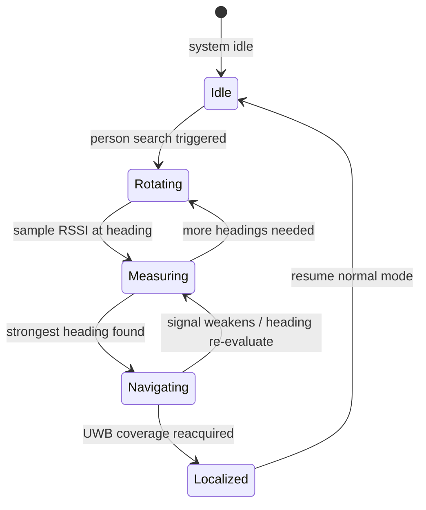

When the user moves outside the range of the floor's UWB anchors or into an unmapped area, HollowRover switches to BLE person-finding. It measures the received signal strength (RSSI) from the Vital32 wearable's BLE beacon, samples that strength at multiple headings, estimates the strongest direction, and navigates toward it.

## What BLE RSSI means

BLE stands for Bluetooth Low Energy, a short-range wireless protocol designed for low power consumption. RSSI stands for received signal strength indicator, a number that represents how strong the radio signal is at the receiver. In general, stronger RSSI means the transmitter is closer, but the relationship is noisy: walls, body shadowing, and multipath reflections can weaken or strengthen the signal unpredictably.

BLE RSSI is not accurate enough for room-level positioning. It is, however, significantly longer range than UWB in many indoor environments, and it requires no fixed infrastructure. This makes it a useful fallback when the UWB anchor network cannot see the wearable.

## How the rover searches

The state diagram above shows the process. When a search is triggered, the rover rotates in place, taking RSSI readings at multiple headings. After sampling, it identifies the heading with the highest average RSSI and begins driving in that direction. While navigating, it continues to monitor the signal. If the signal weakens or a new heading becomes stronger, it may re-evaluate. Once the wearable re-enters UWB coverage, the rover switches back to precise trilateration and normal navigation.

## Why rotation matters

A single RSSI reading at one heading only tells the rover that the user is somewhere in an arc around the antenna. By rotating and sampling at several bearings, the rover can compare readings and infer a likely direction. This is a coarse bearing estimate, not a position fix. The method works because the rover can control its own orientation and because BLE beacons transmit continuously.

## Why this matters

An elderly person may wander beyond the UWB anchor boundaries, or the anchors may be occluded by furniture or walls. Without a fallback, the rover would lose the person entirely during an emergency. BLE person-finding extends the search range at the cost of precision, ensuring the rover can still approach the general area and then resume accurate localization once UWB coverage returns.

## How it connects to the rest of LifeSphere

The Vital32 wearable acts as the BLE beacon source. It already carries the UWB tag for precise ranging, so the two localization modes share the same device on the user's body. When BLE search succeeds and UWB resumes, the rover's position and the wearable's position share the same floor coordinate frame.

BLE person-finding feeds into Nav2 goal setting. The rover does not plan a precise path during BLE search; it moves in the inferred direction until UWB recovers, at which point Nav2 takes over with full path planning and obstacle avoidance. See [Path Planning and Safety](/hollowrover/navigation/path-planning) for details on the Nav2 safety parameters.

## Limits

BLE RSSI is much coarser than UWB. It cannot distinguish whether the user is in an adjacent room or behind a wall. The source does not specify how many heading samples the rover takes, what rotation speed is used, or how it handles symmetric environments where two directions yield similar RSSI.

Body shadowing can create false minima. If the user turns so their body blocks the BLE antenna, RSSI drops even when distance has not increased. The system does not specify whether it averages multiple readings or uses any filtering to suppress these artifacts.

## Related pages

<CardGroup cols={2}>
  <Card title="UWB Positioning" icon="location-dot" href="/hollowrover/navigation/uwb-positioning">
    Precise 2D trilateration within 10 cm when the wearable is inside anchor coverage.
  </Card>

  <Card title="Multi-Floor Map Switching" icon="layer-group" href="/hollowrover/navigation/multi-floor-maps">
    How the rover selects the correct floor map and anchor set before searching.
  </Card>

  <Card title="Path Planning and Safety" icon="route" href="/hollowrover/navigation/path-planning">
    Nav2 safety layers that take over once UWB localization resumes.
  </Card>

  <Card title="Vital32 Overview" icon="heart-pulse" href="/vital32/overview">
    The wearable that carries both the UWB tag and the BLE beacon for person-finding.
  </Card>
</CardGroup>
