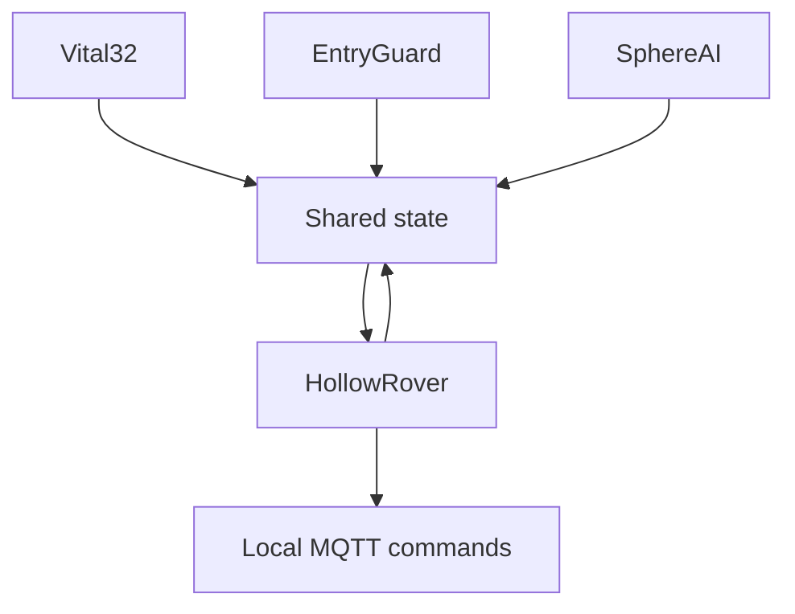

HollowRover is the autonomous ground robot that turns LifeSphere's biological awareness into physical care. When Vital32 detects a fall, stress biomarkers spike, or EntryGuard flags an intruder, HollowRover is the subsystem that actually moves through the home, brings medication, blocks a hallway, or positions itself beside the user.

If you think of LifeSphere as "a single organism sharing one biological state backbone," HollowRover is the body. It does not merely receive alerts. It navigates autonomously, manipulates objects with a 6-degree-of-freedom (6-DOF) arm, gives SphereAI a physical voice, and keeps its own local intelligence so it can act even when cloud links are strained.

## Where HollowRover sits in the ecosystem

HollowRover reads from the shared biological state, carries its own compute and sensors, and publishes its status back into the same state tree. Because it is the only mobile node, it can go where static sensors cannot.

The diagram is simplified. In practice every subsystem both writes and reads, and HollowRover also hosts the local MQTT broker, so low-latency hardware commands never need to round-trip through the cloud.

## Core capabilities

HollowRover performs caregiving tasks that no stationary screen or speaker can:

- **Medication delivery:** carries the 20-slot carousel dispenser and its arm hands medication and water to the user at an accessible height, so the user does not need to bend or reach.
- **Fall response:** when Vital32 confirms a fall, the rover dispatches its fall protocol and provides a physical presence while guardians are alerted.
- **Pre-seizure cushioning:** if seizure probability crosses 0.85, the rover runs a cushioning protocol. The physical form of the cushioning is not specified in the source, and the seizure model is an unvalidated design.
- **Cortisol de-escalation:** when a cortisol spike is estimated, the rover prepares a stress-relief protocol alongside SphereAI and HollowCore. The rover's exact actions are not specified.
- **Security patrol and passive barrier:** patrols the home and, at a monitored chokepoint, swings its arm to block an unregistered person without ever making contact.
- **BLE person-finding:** if the user is outside UWB coverage, the rover uses Bluetooth signal strength to estimate the user's direction and search.
- **Object retrieval:** the arm picks up dropped items from the floor and hands them to the user.

## Why this matters

Digital alerts help no one if no one is there to answer them. In Bangladesh, where millions of elderly people stay home while family members work full-time, a phone notification that a parent has fallen is only the start of the problem. HollowRover is designed to be the responder already in the home. The source describes it as bridging "the gap between digital alerts and physical action" and ensuring that no one remains on the floor after a fall.

## How it connects to the rest of LifeSphere

- **Vital32:** provides the biometrics that trigger rover protocols (`fall_detected`, `anomaly_score` above 0.9, `seizure_prob` above 0.85).
- **SphereAI:** speech recognition, sentiment analysis, and face recognition run on the rover's dedicated NPU (neural processing unit), so SphereAI's heavy processing lives on the rover.
- **EntryGuard:** alerts include a floor and zone reference. The rover loads that floor's map, localizes, and navigates to the alert zone.
- **HollowCore:** listens to the MQTT broker that runs on the rover's RDK X5 computer.

Because LifeSphere is distributed, the rover is not a single point of failure for monitoring: if HollowRover is charging, Vital32 still monitors.

## Limits

HollowRover is a wheeled platform and cannot climb stairs, so moving between floors needs a lift, ramp, or manual relocation. Each floor must be registered with its own UWB anchor set and barometric baseline. Night vision for the front stereo depth camera needs a separate infrared fill light, which is still unresolved. Predictive protocols such as pre-seizure cushioning are design goals that have not been validated in real deployment.

## Related pages

<CardGroup cols={2}>
  <Card title="Compute and NPU" icon="microchip" href="/hollowrover/components/compute-and-npu">
    ROS2, SLAM, and AI inference on dedicated silicon.
  </Card>

  <Card title="Wheel Engineering" icon="gears" href="/hollowrover/wheels/overview">
    The printed S-curve wheels and how they were developed.
  </Card>

  <Card title="Navigation" icon="location-dot" href="/hollowrover/navigation/mapping-and-slam">
    SLAM mapping, UWB positioning, floor detection, and BLE search.
  </Card>

  <Card title="Robotic Arm" icon="hand" href="/hollowrover/arm/overview">
    Caregiving assist and the passive security barrier.
  </Card>
</CardGroup>
