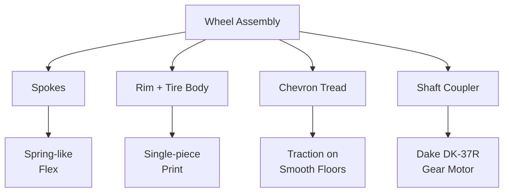

HollowRover rolls on custom-designed wheels that are 3D-printed from a single piece of PLA+ plastic. The wheel combines a two-part sinusoidal S-curve spoke design, a chevron tread pattern, and a dedicated printed shaft coupler into one cost-optimized unit built specifically for indoor caregiving environments.

## What Makes These Wheels Different

Most small indoor robots use either small caster wheels, rubber O-ring tires on plastic hubs, or off-the-shelf hobby wheels. HollowRover's wheels are purpose-designed for a robot that weighs several kilograms, carries a medication dispenser, and must traverse threshold lips, doorway transitions, and slightly uneven tile floors without jarring its cargo or losing odometry accuracy.

The wheel is 5.6 inches in diameter, a size chosen to provide enough ground clearance for indoor obstacles while keeping the center of gravity low for stability. The key functional elements are:

- **S-curve spoke geometry:** Two-part sinusoidal spokes that act like leaf springs, absorbing bumps and spreading load across the wheel structure.
- **Unified rim and tire body:** Printed as one continuous piece, eliminating the need for a separate tire assembly process.
- **Chevron tread lugs:** Angled grip patterns that improve traction on smooth indoor floors and help the robot climb small threshold lips.
- **Printed shaft coupler:** A dedicated adapter with M4 printed threads that joins each wheel directly to its Dake DK-37R gear motor.

## Why Custom Wheels Matter for Caregiving

In a caregiving context, wheel performance has direct consequences for the robot's reliability. A robot that loses traction on a polished floor may drift during navigation, corrupting its SLAM pose estimate. A wheel that is too rigid will transfer every floor imperfection into the chassis, potentially disturbing the medication dispenser or making the robot appear alarming to the user. A wheel that is too soft will introduce oscillation and delay in encoder-based speed control.

The HollowRover wheel design strikes a balance between these competing requirements. The spokes provide enough compliance to absorb doorway lips without excessive chassis vibration. The tread pattern grips dry indoor floors without marking them. The single-piece print eliminates tire slippage on the rim, a common source of odometry error in low-cost robots. The cost, approximately 905 Bangladeshi taka per wheel, aligns with LifeSphere's goal of accessible hardware built from commercially available components and open-source software.

## The Design Iteration Story

The wheel design went through more than eight geometry iterations. The source document does not detail what changed in each iteration, but iterative development of a 3D-printed wheel typically explores variables such as spoke thickness, spoke count, rim wall thickness, tread lug height, and overall diameter. Each iteration is printed, mounted, and tested under load. The final design settled on the two-part sinusoidal spoke geometry, the single-piece rim-tire body, and the chevron tread pattern.

The iteration count itself is significant: it signals that the wheel was not a casual afterthought but a systematically refined component. For a robot that must operate silently and reliably in a person's home, wheel refinement directly affects user trust.

## Connection to the Rest of HollowRover

The wheels connect to the broader rover design through several interfaces:

- **Drive motors:** Each wheel is driven by its own Dake DK-37R gear motor with an encoder. The encoder counts wheel revolutions, which the rover fuses with IMU data for SLAM localization. If the wheel slips relative to the motor shaft, the encoder reports phantom motion, corrupting the pose estimate. The printed shaft coupler is designed to prevent this slippage.
- **Suspension:** The passive rocker suspension system keeps all four wheels in contact with the ground. The wheel's spoke compliance adds a secondary layer of shock absorption to the suspension's spring-loaded rocker arms. Together, the rocker arms and the flexible spokes smooth out floor irregularities.
- **Navigation:** Nav2 plans paths at up to 0.3 m/s with a safety inflation radius of 0.35 m around obstacles. Consistent wheel traction ensures that the rover follows these planned paths predictably, without lateral drift that would cause the controller to overcorrect.

The wheel is therefore not an isolated part. It is the interface between the rover's mechanical and navigational systems and the physical floor of the user's home.

## Why This Matters

Custom wheels demonstrate a core philosophy of LifeSphere: every component is designed for the specific user and environment, not borrowed from unrelated hobby robotics. An elderly user living alone cannot repair a robot with obscure, imported parts. A wheel that can be printed locally, replaced individually, and tested for strength before installation is a wheel that supports long-term deployment.

The accessible cost point, the single-piece printability, and the systematic iteration all serve the same goal: a caregiving robot that can be maintained, replaced, and trusted over years of operation.

## Limits

The source does not specify test loads, print settings, or detailed geometry dimensions beyond the information given here. The spokes flex slightly under heavy pressure but hold; the exact load at which flex becomes excessive is not stated. The tread pattern is optimized for dry indoor floors and may perform differently on wet, oily, or carpeted surfaces. Wheel replacement requires some mechanical disassembly, though the printed coupler simplifies service compared to press-fit or keyed hubs.

## Related Pages

<CardGroup cols={2}>
  <Card title="S-Curve Spokes" icon="wave-square" href="/hollowrover/wheels/s-curve-spokes">
    How the two-part sinusoidal spoke geometry adds compliance and spreads load.
  </Card>

  <Card title="Chevron Tread" icon="shoe-prints" href="/hollowrover/wheels/chevron-tread">
    Why angled lugs improve indoor traction and threshold climbing.
  </Card>

  <Card title="Cost Optimization" icon="scale-balanced" href="/hollowrover/wheels/cost-optimization">
    How the 905 taka per wheel target supports accessible caregiving hardware.
  </Card>

  <Card title="Stress Testing" icon="shield-halved" href="/hollowrover/wheels/stress-testing">
    What is known about load testing and why structural integrity matters.
  </Card>
</CardGroup>
