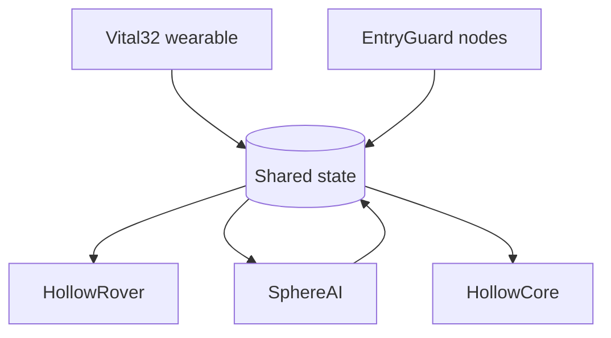

LifeSphere is an AI-powered caregiving ecosystem that looks after an elderly person living alone by responding to their body, so they never have to operate any technology themselves.

<Info>
  **The core principle:** "LifeSphere does not require the user to interact with technology. It requires technology to respond to the user's biology."
</Info>

## What LifeSphere is

LifeSphere is five connected subsystems that behave like one organism. Each has its own hardware and its own local processing. All five read from and write to one shared, continuously updated record of the person's condition, called the **shared biological state**.

Because everything shares that one record, a single change in the body can produce a coordinated response across the whole home. The system covers four dimensions at the same time: **medical, physical, emotional, and environmental**.

The project was researched and built by Faiyaz Bin Iqbal of Team Fälschen, Birshreshtha Munshi Abdur Rouf Public College, Bangladesh.

## The five subsystems

<CardGroup cols={2}>
  <Card title="Vital32" icon="heart-pulse" href="/vital32/overview">
    The wearable that reads the body: cardiac signals, oxygen, temperature, motion, skin conductance, and hydration.
  </Card>

  <Card title="HollowRover" icon="robot" href="/hollowrover/overview">
    The home robot that turns alerts into physical help: falls, medication, person-finding, and a passive barrier.
  </Card>

  <Card title="SphereAI" icon="comments" href="/sphereai/overview">
    The voice companion that reads emotion from words, voice, and biology, with Islamic integration.
  </Card>

  <Card title="EntryGuard" icon="shield-halved" href="/entryguard/overview">
    Entry-point nodes for intrusion, fire, and gas, with floor-aware alerts that guide the rover.
  </Card>

  <Card title="HollowCore" icon="house-signal" href="/hollowcore/overview">
    Home and financial automation that adapts lights, climate, locks, and payments to the body.
  </Card>

  <Card title="Medication" icon="pills" href="/medication/overview">
    One-photo prescription reading and a 20-slot carousel dispenser carried by the rover.
  </Card>
</CardGroup>

## How the parts fit together

Vital32 writes body readings into the shared state. EntryGuard writes security and hazard alerts. HollowRover, SphereAI, and HollowCore listen for the fields they care about and act, with a target response time of 150 milliseconds.

## Why this matters

Most smart devices work alone: a watch tracks heart rate, a speaker sets reminders, a camera records video. None of them can act on what another one noticed. LifeSphere is built around the idea that care only works when sensing, decisions, and physical action are joined up, and when the person being cared for does not need to learn any interface.

<Note>
  Predictive features on this site, such as early immune activation detection, pre-seizure estimation, and biological age, are **design goals**. They have not been validated on real users. See [Unvalidated Claims](/status/unvalidated-claims).
</Note>

## Where to go next

<CardGroup cols={2}>
  <Card title="How to Read These Docs" icon="book-open" href="/start/how-to-read">
    Five-minute, twenty-minute, and deep-dive reading paths.
  </Card>

  <Card title="Why LifeSphere Exists" icon="heart" href="/start/why-lifesphere-exists">
    The problem, the gap, and the hypothesis.
  </Card>

  <Card title="System Architecture" icon="sitemap" href="/core/system-architecture">
    How the five subsystems share one backbone.
  </Card>

  <Card title="Scenarios" icon="route" href="/scenarios/fall">
    Step-by-step stories of the subsystems working together.
  </Card>
</CardGroup>
