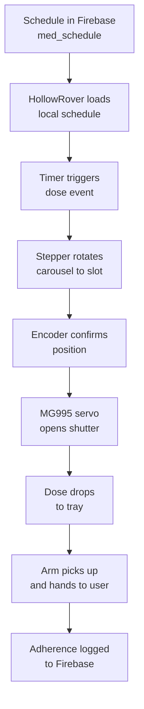

LifeSphere turns a confirmed medication schedule into a physical dose delivered to the user's hand without requiring the user to remember, measure, or handle bottles. The dispenser mechanism is a closed-loop electromechanical assembly that stores up to 20 medications in indexed slots, rotates the requested slot into position under a release shutter, opens the shutter, and then hands the dispensed item to the user via the HollowRover robotic arm. This page explains how each component participates in that sequence and how the system ensures the correct slot is always aligned.

## Why this matters

Missed medication is one of the most common preventable health risks for elderly people living alone. Many existing dispensers are small, manually loaded devices with only a few slots and no physical delivery capability. The LifeSphere dispenser is designed to hold a meaningful inventory of medications, remain accurate over thousands of cycles, and coordinate with the rest of the ecosystem so the user never has to approach the device. It replaced an earlier smaller servo-based design that lacked the capacity and positional precision needed for autonomous long-term care.

## How a single dose moves from schedule to release

The dispenser does not operate in isolation. It receives its instructions from the same shared biological state that every LifeSphere subsystem reads and writes.

### Receiving the schedule

The medication schedule originates either from the prescription OCR pipeline or from manual entries made on the dispenser's touchscreen. In both cases the confirmed schedule is written to `lifesphere/hollowcore/med_schedule` in Firebase. HollowRover subscribes to this path and transfers the schedule into its local execution queue. Because Firebase is the central synchronization layer, a caregiver can update timing or dosages remotely and the dispenser will follow the new instructions at the next cycle.

### Indexing and storage

The dispenser stores medications in a 20-slot carousel. Each slot is mechanically separated by 18 degrees of rotation, so the stepper motor can address any slot unambiguously by moving an integer multiple of that angle. The large number of slots lets the system manage multiple medications with different frequencies without running out of positions in a typical weekly loading cycle.

### Rotation and positioning

A NEMA17 stepper motor drives the carousel through a 100-tooth ring gear that provides a 5:1 reduction. The motor itself is controlled by a TMC2209 stepper driver. The gear reduction does two things at once: it increases the effective torque available to turn a loaded carousel, and it increases the positional resolution of the motor so that each slot step corresponds to a controlled, repeatable fraction of a motor revolution. The arithmetic works out to 50 motor steps per slot, which matches the standard 200 full steps per revolution of a typical NEMA17 multiplied by the 5:1 reduction and divided by 20 slots.

### Position confirmation

Because the system is designed to run unattended for weeks at a time, it cannot rely on step counting alone. An AS5600 magnetic encoder reads the angular position of the carousel directly and reports it back to the controller. After every rotation command the firmware compares the encoder reading against the expected slot angle. If the carousel has not reached the target, the controller issues a correction step. This closed-loop behavior prevents dose misalignment caused by missed steps, mechanical backlash, or slight slot-to-slot variation in load.

### Release

Once the correct slot is confirmed under the discharge chute, an MG995 servo opens the shutter to release the dose. The servo is a proven metal-gear actuator with enough torque to operate a small shutter reliably. After a brief dwell time to guarantee the dose has fallen through, the shutter closes to protect remaining medications from moisture and dust.

### Delivery

The dispensed dose lands in a small collection tray on the HollowRover chassis. The 6-degree-of-freedom robotic arm then retrieves the item and presents it to the user at a comfortable, accessible height. The arm can also bring a cup of water if that has been configured for the dose. This physical handoff is the final bridge between the digital schedule and the user's actual intake.

## How it connects to the rest of LifeSphere

The dispenser is tightly bound to three other subsystems:

- **HollowCore** writes the schedule into Firebase and can trigger immediate manual doses through MQTT commands.
- **SphereAI** delivers verbal reminders when a dose is due and confirms adherence after handoff.
- **Vital32** provides proximity confirmation and, in the future, may correlate biometric patterns with adherence timing.

The dispenser also supports a manual touchscreen fallback so a caregiver or the user can request an unscheduled dose when needed.

## Limits

The source does not specify the physical dimensions of each slot, maximum pill size, or whether the mechanism can handle non-solid forms such as liquids or inhalers. Microstepping settings for the TMC2209 are not stated, so the exact step resolution at the driver level is not documented. The custom PCB layout and power-rail voltages are referenced but not described in detail. The source notes that dispensing and dosage mechanisms were rigorously tested and validated, but no quantitative performance figures are provided.

## Related pages

<CardGroup cols={2}>
  <Card title="The 20-Slot Carousel" icon="circle-notch" href="/medication/carousel">
    How 20 indexed positions turn a full rotation into precise, repeatable slot addresses.
  </Card>

  <Card title="Gear Reduction and Positioning" icon="gears" href="/medication/gear-reduction">
    Why a 100-tooth ring gear and 5:1 reduction matter for torque and step accuracy.
  </Card>

  <Card title="Closed-Loop Encoder Feedback" icon="wave-square" href="/medication/encoder-feedback">
    How the AS5600 magnetic encoder catches missed steps and guarantees alignment.
  </Card>

  <Card title="Shutter and Release" icon="lock" href="/medication/shutter-and-release">
    The MG995 servo shutter that opens for the exact dose and seals the rest.
  </Card>
</CardGroup>
