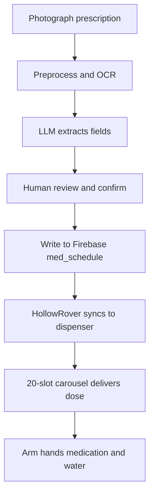

LifeSphere removes the setup burden that stops many families from using smart medication dispensers. Instead of typing every drug name, dosage, and timing by hand, you photograph the prescription once. LifeSphere reads the handwriting through OCR, a language model extracts structured fields, you review and confirm, and the system builds the schedule automatically. A 20-slot carousel then delivers the right dose on time, and a touchscreen remains available for caregivers who prefer manual entry.

## Why medication management matters

Missed or incorrect doses are among the most common preventable health risks for elderly people living alone. Current devices often fail because the initial setup is tedious, one mistake in timing cascades into weeks of incorrect alerts, and the user must still remember to walk to the device and take the pill. LifeSphere treats medication as a pipeline: capture, verify, schedule, deliver, track. Every step reduces the risk of human error and the need for human effort.

The system also records adherence patterns over time. This data feeds back into the shared biological state, so SphereAI can adjust its emotional tone when adherence drops, and HollowCore can alter lighting to cue memory. Medication becomes a connected subsystem, not an isolated alarm clock.

## The full flow from prescription to dose

A single medication schedule typically moves through five stages before the user ever touches a pill.

### Capture

You open the LifeSphere companion mobile app and photograph the prescription. The source does not specify exact capture guidance, but the image is sent to phone-side preprocessing before any cloud or server stage.

### Preprocessing and OCR

The image is converted to grayscale, then adaptive Gaussian thresholding separates dark ink from light paper. Tesseract OCR reads the text. This stage is described in the [Prescription Reading](/medication/prescription-reading) page.

### Context extraction

Raw OCR is unreliable with doctor handwriting. A large language model interprets the context to extract structured fields: medicine name, dosage amount, frequency, duration, and special instructions. The specific model is not named; it may run on the phone or in the cloud. See [Language-Model Extraction](/medication/llm-extraction).

### Review and confirmation

You see every extracted field in the app, editable before confirmation. This human-in-the-loop step is mandatory. You can also enter everything manually if the prescription is damaged or the OCR stage fails. See [Review and Confirmation](/medication/review-and-confirmation).

### Scheduling and delivery

Once confirmed, the schedule is written to `lifesphere/hollowcore/med_schedule` in Firebase. HollowRover syncs this to its local dispenser, and the 20-slot carousel begins autonomous delivery. A NEMA17 stepper motor rotates the carousel, an AS5600 magnetic encoder confirms position, and an MG995 servo opens a shutter to release the dose. See [Dispenser Overview](/medication/dispenser-overview) and [Carousel](/medication/carousel).

If a phone is unavailable, the caregiver or user can enter medications directly on the dispenser's touchscreen, which writes to `dispenser_manual`. See [Touchscreen Fallback](/medication/touchscreen-fallback).

## Reminders and adherence tracking

Reminders travel through Firebase to multiple channels at once. You may hear SphereAI speak the reminder and see a notification on the HollowRover OLED. When a dose is due, HollowRover navigates to you and the arm presents the medication and a small water container at an accessible height, reducing the need to bend or reach.Reminders travel through Firebase to multiple channels at once. You may hear SphereAI speak the reminder and see a notification on the HollowRover OLED. When a dose is due, HollowRover navigates to you and the arm presents the medication and a small water container at an accessible height, reducing the need to bend or reach.Reminders travel through Firebase to multiple channels at once. You may hear SphereAI speak the reminder and see a notification on the HollowRover OLED. When a dose is due, HollowRover navigates to you and the arm presents the medication and a small water container at an accessible height, reducing the need to bend or reach.

Adherence is tracked through a running entropy score. High entropy means irregular timing; low entropy means consistent habits. The metric is described in [Adherence Entropy](/medication/adherence-entropy). The source does not specify what happens after a missed dose beyond continued logging.

## Why this matters

For a busy family member working full-time, verifying that an elderly parent took their morning dose usually requires a phone call or a visit. LifeSphere replaces that uncertainty with a closed loop: the prescription becomes a schedule, the schedule becomes a physical dose, and the dose becomes a logged event. The caregiver sees confirmation without interrupting the user's day.

For the user, the experience is nearly invisible after the first photograph. The system does not ask for taps, swipes, or voice commands at every dose. It simply arrives.

## How it connects to the rest of LifeSphere

- **Vital32**: biomarker trends inform whether medication timing should shift. A cortisol spike, for example, might delay a stressful medication reminder until the user is calmer.
- **SphereAI**: verbal reminders and companionship during dosing; tone adapts to loneliness index.
- **HollowCore**: lighting and climate cues support the medication routine; sleep detection triggers night-time lockdown and suppression of non-urgent alerts.
- **HollowRover**: the rover is the physical actuator. It carries the dispenser, navigates to the user, and uses its arm to present the dose.
- **EntryGuard**: in an intrusion or hazard event, medication delivery pauses while the rover responds to the higher-priority alert.

## Limits

- The prescription OCR flow works for English text. The source does not describe handling of Bengali script or bilingual prescriptions.
- The LLM stage is not guaranteed to parse every handwriting style; the review step exists because extraction can fail.
- The source does not specify how the system handles medication changes mid-course, over-the-counter additions, or as-needed (PRN) dosing.
- Pill size limits, microstepping settings, and exact carousel diameter are not stated.
- No quantitative accuracy figures are provided for extraction or delivery timing.

## Related pages

<CardGroup cols={2}>
  <Card title="Prescription Reading" icon="file-lines" href="/medication/prescription-reading">
    Grayscale conversion, adaptive thresholding, and Tesseract OCR.
  </Card>

  <Card title="LLM Extraction" icon="brain" href="/medication/llm-extraction">
    Why a language model interprets handwriting and what fields it extracts.
  </Card>

  <Card title="Review and Confirmation" icon="clipboard-check" href="/medication/review-and-confirmation">
    Human-in-the-loop editing, confirmation, and manual entry.
  </Card>

  <Card title="Touchscreen Fallback" icon="hand" href="/medication/touchscreen-fallback">
    The ILI9488 display, resistive touch, and manual schedule entry.
  </Card>

  <Card title="Reminders and Adherence" icon="bell" href="/medication/reminders-and-adherence">
    Firebase reminders, rover delivery, and adherence logging.
  </Card>

  <Card title="Adherence Entropy" icon="calculator" href="/medication/adherence-entropy">
    Measuring schedule regularity with information entropy.
  </Card>
</CardGroup>
