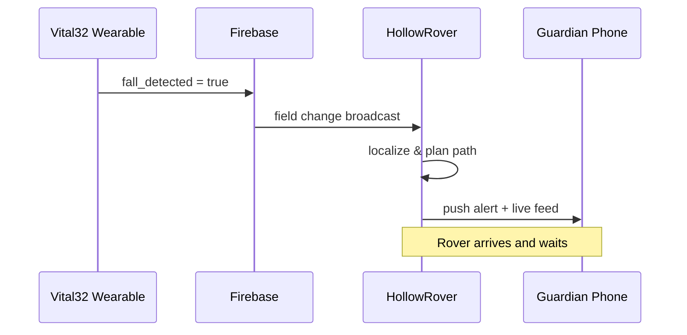

When an elderly person falls and no one is nearby, seconds matter. LifeSphere turns a silent accident into an immediate, coordinated response across Vital32, HollowRover, and the guardian network without requiring the wearer to press any button, speak any command, or interact with a screen.

<Steps>
  <Step title="The fall occurs">
    The wearer loses balance and falls in the bedroom. Vital32's motion layer continuously samples its accelerometer and gyroscope at 50 Hz, meaning it checks motion every 20 milliseconds. The firmware watches for a specific three-stage signature. First, freefall: the total acceleration magnitude drops below 0.4 g. Second, impact: the same magnitude exceeds 2.5 g within 500 milliseconds of the freefall event. Third, near-zero movement persists for three seconds, indicating the person is not getting up. Only when all three stages match does the system set `fall_detected` to true.
  </Step>
  <Step title="Vital32 publishes the alert">
    Within milliseconds of confirmation, the wearable writes `fall_detected: true` into the shared biological state in Firebase Realtime Database under the `lifesphere/vital32` path. A timestamp is attached. At almost the same moment, the display on the wearable's small OLED may show a brief status indicator, but the device is designed for zero interaction, so no tap or confirmation is required from the user.
  </Step>
  <Step title="HollowRover receives the trigger">
    HollowRover subscribes to the `vital32/fall_detected` field and reads the change. Because Firebase listeners target a latency of roughly 150 milliseconds for cloud-mediated signals, the rover typically learns of the event within a small fraction of a second. Its internal state machine transitions from whatever it was doing into fall-response mode.
  </Step>
  <Step title="Rover localizes and navigates">
    If the rover is on the same floor as the wearer, it checks which registered floor map is active. If it is on a different floor, it uses its barometric sensor to compare current pressure against each registered floor baseline, selects the closest match, loads that floor's SLAM map, and begins localizing against the three fixed UWB anchors for that floor. UWB resolves the wearer's horizontal position to within about 10 cm. The rover uses SLAM Toolbox in lifelong mapping mode with Nav2 to plan a safe path, maintaining a safety inflation radius of 0.35 meters around obstacles and a maximum forward speed of 0.3 meters per second. Its LiDAR and ultrasonic sensors provide real-time obstacle awareness as it moves.
  </Step>
  <Step title="Physical arrival and assessment">
    The rover arrives at the fall location. Depending on its state, it may initiate a gentle verbal check through its speaker, or it may simply remain nearby as a visible physical presence while awaiting further instructions. The exact internal steps of the fall protocol, such as whether it attempts to hand medication or water at this stage, are not specified in the source. What is known is that the rover is physically present and that a guardian has been alerted.
  </Step>
  <Step title="Guardian notification reaches the caregiver">
    Simultaneously with rover dispatch, the system triggers a push notification to the guardian's phone. The notification carries the event type, the floor reference, and a live camera feed from the rover or from EntryGuard if applicable. The guardian can see the situation remotely, speak a command, or request emergency services. LifeSphere bridges the gap between detection and human help by ensuring the right person knows immediately.
  </Step>
</Steps>

## Sequence diagram

## What made this possible

Three design choices enable this flow. First, the zero-interaction principle means the most vulnerable user does not need to reach a phone, press a button, or call for help. Second, distributed intelligence ensures Vital32 keeps monitoring even if the rover is charging or elsewhere. Third, the multi-channel communication stack, Firebase for state sync plus MQTT for hardware commands, lets motion data become physical motion in a target window of about 150 milliseconds. The rover does not wait for a server to decide what to do; it subscribes to state and acts.

The fall detection algorithm itself deserves attention. Freefall detection relies on the physics of acceleration. When the wearer is in the air, the accelerometer measures nearly zero because gravity is not pushing the sensor against a supporting surface. During impact, acceleration spikes sharply as the body hits the floor. The post-impact stillness check is a simple but effective filter against false positives such as dropping the device or a mild stumble. The source does not specify a tremor algorithm, so shaking from a condition like Parkinson's disease is not described as explicitly filtered out, though the three-stage sequence already reduces random motion noise.

<Note>
  This page describes designed behavior and how the system is intended to respond. It does not document a recorded clinical trial or real-world deployment result. Predictive and response claims are engineering goals, not validated outcomes.
</Note>

## Limits

The rover cannot climb stairs. If the fall happens on a floor without a lift, ramp, or accessible path, the rover may not be able to reach the wearer. In that case, the guardian alert still fires, but physical arrival depends on manual relocation of the rover or the presence of an elevator. The source does not specify escalation behavior when a rover is on the wrong floor and no accessible path exists. Additionally, the internal steps of what the rover does after arriving, such as whether it attempts any physical assistance beyond presence, are not detailed. Future work includes legged locomotion for true multi-floor navigation.

## Related pages

<CardGroup cols={2}>
  <Card title="Vital32 Overview" icon="heart-pulse" href="/vital32/overview">
    How the wearable biosensing layer continuously monitors the wearer.
  </Card>

  <Card title="Fall Detection" icon="wave-square" href="/vital32/sensing/fall-detection">
    The three-stage algorithm that distinguishes a genuine fall from daily motion.
  </Card>

  <Card title="HollowRover Overview" icon="robot" href="/hollowrover/overview">
    The autonomous physical response unit that turns alerts into action.
  </Card>

  <Card title="HollowRover Protocols" icon="route" href="/hollowrover/protocols/biomarker-triggered">
    How the rover translates shared-state triggers into physical protocols.
  </Card>
</CardGroup>
