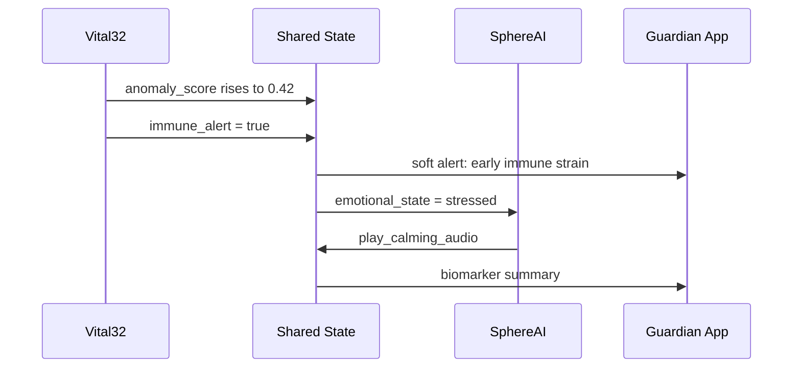

LifeSphere's immune activation alert is a design goal that illustrates how multi-timescale inference and personalized baselines can shift elderly care from reactive treatment to early prevention.

<Note>
  This scenario describes designed system behavior and theoretical response pathways. It is not a record of a validated clinical trial or real-world deployment.
</Note>

## The situation

Mrs. Rahman is 74 years old and lives alone in a third-floor apartment in Dhaka. Her family works full-time and visits on weekends. She wears Vital32 continuously and has been using LifeSphere for six weeks, so the system has already built a personalized baseline of her cardiac, thermal, and autonomic patterns.

On Tuesday morning, Vital32 begins registering subtle deviations: her heart rhythm variability is drifting lower than her personal norm, her skin temperature is slightly elevated against her circadian baseline, and her galvanic skin response (GSR, a measure of sympathetic nervous system activity) shows sustained elevation. None of these changes are enough to trigger an emergency, but together they form a quiet signature that the system's long-cycle model recognizes as early physiological stress.

## How the alert unfolds

<Steps>
  <Step title="Baseline comparison detects divergence">
    Vital32's 24-hour inference cycle compares Mrs. Rahman's current multi-sensor profile against her 30-day rolling baseline. The anomaly detector computes an anomaly score using Isolation Forest, which learns her normal patterns rather than relying on generic population thresholds. Her score rises from a typical 0.08 to 0.42, still below the soft alert threshold of 0.7, but the upward trend is logged.
  </Step>
  <Step title="Long-cycle model flags immune strain">
    Over the next cycle, the biological state model integrates HRV trend, GSR persistence, skin temperature deviation, and sleep efficiency into a composite immune strain signal. The system sets the shared state field `immune_alert` to `true`. This is a design goal: the system aims to detect immune activation 24 to 48 hours before the person would normally notice symptoms such as fatigue, fever, or malaise.
  </Step>
  <Step title="Soft alert reaches the family">
    Because the anomaly score remains below 0.7, no emergency protocol is triggered. Instead, LifeSphere generates a soft alert: a notification is sent to her daughter's phone through the LifeSphere app, explaining that the system has detected early physiological changes and recommending a wellness check or a conversation with a clinician. The alert includes a brief summary of which biomarkers shifted and by how much relative to Mrs. Rahman's baseline.
  </Step>
  <Step title="SphereAI adjusts emotional tone">
    SphereAI reads the elevated stress indicators and shifts its interaction style. When Mrs. Rahman speaks to the rover later that day, the trimodal emotional classifier weights the biology agent more heavily (0.5 weight in stressed state, up from 0.3 in calm state). The system detects "stressed" as her emotional state and responds with a calmer, slower verbal pace, offering companionship without demanding interaction.
  </Step>
  <Step title="HollowCore adapts the environment">
    HollowCore reads her elevated cortisol estimate and GSR. It dims the lights in her living room to a warmer spectrum and slightly lowers the air conditioning temperature. These are environmental de-escalation cues designed to promote physiological calm without requiring Mrs. Rahman to operate any controls.
  </Step>
  <Step title="Family intervenes early">
    Her daughter calls that evening. Because the alert came early, she arranges a telemedicine consultation for Wednesday morning. Mrs. Rahman begins rest and hydration. By Thursday, her biomarkers are stabilizing. The episode never escalates to a crisis.
  </Step>
</Steps>

## Sequence of events

## What made this possible

Three architectural choices enable this early warning pattern.

First, **personalized baselines**. The Isolation Forest model is trained on Mrs. Rahman's own first 30 days of normal data. It compares her to her own healthy state, not to a generic elderly population. This means the system can catch subtle, individually specific deviations that population thresholds would miss.

Second, **multi-timescale inference**. The short cycle (30 seconds) catches acute anomalies. The medium cycle (15 minutes) tracks emotional and cortisol trends. The long cycle (24 hours) powers the immune activation model and the biological age clock. The immune alert emerges from the long cycle, where slow drift across multiple biomarkers becomes visible.

Third, **distributed intelligence**. Vital32 continues monitoring even if HollowRover is charging or EntryGuard is processing an alert elsewhere. No single subsystem failure silences the biological state stream. The shared state backbone ensures that every subsystem that needs to respond sees the same `immune_alert` flag within the target latency of 150 milliseconds.

## Why the response is tiered

LifeSphere uses a graduated response model. An anomaly score above 0.7 triggers a soft alert: caregiver notification and environmental adaptation. An anomaly score above 0.9 triggers an emergency protocol: HollowRover dispatch, possibly with medication or physical proximity. In this scenario, the score never crosses 0.7. The system respected the principle that not every deviation is an emergency, while still ensuring the family had actionable information in time to intervene.

## Limits and honest unknowns

The 24 to 48 hour early detection window is a design goal, not a validated clinical result. The specific features and threshold that define immune activation in the model are not detailed in the source. The training data for the immune activation component is not specified. Longitudinal studies in real elderly households would be needed to measure sensitivity, specificity, and false positive rates. The source does not specify how the system handles common non-immune causes of similar biomarker drift, such as emotional stress or poor sleep.

## Related pages

<CardGroup cols={2}>
  <Card title="Anomaly Scoring" icon="chart-bar" href="/ai/isolation-forest">
    How Isolation Forest learns personal baselines and produces the anomaly score
  </Card>

  <Card title="Multi-Timescale Inference" icon="layer-group" href="/core/multi-timescale-inference">
    The 30-second, 15-minute, and 24-hour inference cycles and what each layer detects
  </Card>

  <Card title="Cortisol Estimation" icon="brain" href="/ai/cortisol-estimator">
    How GSR, HRV, and skin temperature feed the 15-minute cortisol estimate
  </Card>

  <Card title="Shared Biological State" icon="wifi" href="/core/shared-biological-state">
    How the Firebase backbone synchronizes immune_alert across all subsystems
  </Card>
</CardGroup>
