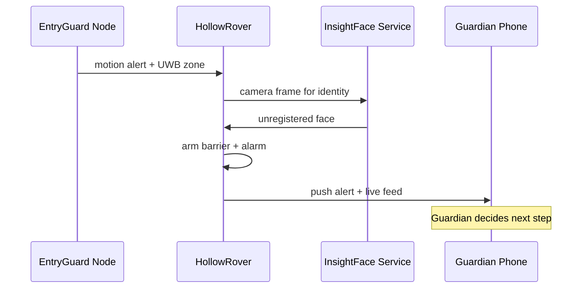

At 2:00 AM the house is dark, the occupant is asleep, and the doors are locked. A figure appears in the hallway leading toward the bedroom. Traditional security systems might trigger a siren and wake everyone. LifeSphere takes a different path: verify, deter, and escalate only with human permission.

<Steps>
  <Step title="Sleep protocol has already locked the house">
    Earlier in the evening, Vital32 detected sleep through a combination of heart rate variability immobility and accelerometer stillness. This confirmed sleep state propagated through the shared biological state to HollowCore, which automatically turned off the living room and bedroom lights and engaged the main door lock solenoid. The home is already in a protected posture before any danger appears.
  </Step>
  <Step title="EntryGuard detects motion">
    An EntryGuard node at the hallway entry point is in ACTIVE mode. Its PIR motion sensor registers body heat movement, and its ultrasonic distance sensor confirms the presence is within the monitored zone. Because the system mode is ACTIVE, this motion is treated as a potential alert rather than background household activity. The node packages an alert payload containing the alert type (motion), a sensor value, its own node identity, a UWB zone reference, and a floor pressure reference.
  </Step>
  <Step title="Face recognition verifies identity">
    The alert triggers the camera feed at the chokepoint to route into the face recognition pipeline. This is a FastAPI service using InsightFace with the buffalo_sc model pack and MediaPipe, running on ONNX Runtime. It compares the detected face against profiles stored locally on HollowRover. These profiles are never transmitted to external servers. The service distinguishes registered occupants from unregistered individuals. In this scenario, the face does not match any registered profile.
  </Step>
  <Step title="The passive barrier deploys">
    Because the face is unregistered and the chokepoint is a monitored pathway, the robotic arm activates. The arm is normally stowed below the LiDAR scan plane during navigation so it does not obstruct the rover's own sensors. In security-response mode, the rover stops and the arm rises to swing across the hallway, forming a physical barrier. This is a passive deterrent only. The arm does not make contact with the person, does not grasp, does not restrain, and does not strike. It simply blocks the path.
  </Step>
  <Step title="Three simultaneous responses fire">
    The system initiates exactly three responses in parallel. First, the arm blocks the pathway. Second, an audible alarm sounds through the SphereAI speaker. Third, an instant push notification reaches the guardian's phone with a live camera feed showing the hallway. These three channels cover physical deterrence, auditory warning, and remote human awareness simultaneously.
  </Step>
  <Step title="Escalation requires human authorization">
    Any action beyond the three automatic responses requires explicit human authorization. The system is architected so that no defensive decision escalates autonomously to contact, pursuit, or further physical action. The guardian, seeing the live feed, can speak through the rover's speaker to address the person, call emergency services, or dismiss the alert if it is a false positive such as a family member whose face was not registered. The mandatory authorization step is a core safety principle, not a configurable option.
  </Step>
</Steps>

## Sequence diagram

## What made this possible

The choreography of this response depends on four architectural commitments. First, the shared biological state and security state live in the same JSON tree, so sleep detection and intrusion detection are not separate silos. Sleep locking the door and detecting hallway motion are simply different branches of the same data structure. Second, the face recognition pipeline is local. Profiles live on HollowRover, inference runs on the device's own NPU, and no biometric data leaves the premises. Third, the robotic arm's dual-purpose design, caregiving assist and passive barrier, means the same hardware that hands medication during the day can protect a hallway at night. Fourth, the mandatory human authorization step prevents algorithmic overreach. A machine may detect and deter, but it may not decide to escalate alone.

The distinction between monitored chokepoints and general open space matters. The passive barrier is not deployed everywhere. It is specifically positioned at chokepoints, such as the hallway to valuables or sensitive rooms, where a physical block carries deterrent value without requiring broad architectural changes to the home. The TF-Luna time-of-flight sensor at the chokepoint detects presence before the camera engages, conserving compute and avoiding unnecessary face recognition on passing shadows.

<Note>
  This page describes designed behavior and how the system is intended to respond. It does not document a recorded clinical trial or real-world deployment result. Predictive and response claims are engineering goals, not validated outcomes.
</Note>

## Limits

The face recognition threshold and false-positive rate are not specified. Unregistered does not necessarily mean hostile; a guest, a caregiver, or a first responder could all trigger the same pipeline. The source does not describe how temporary visitors are handled. The arm is passive and cannot stop a determined intruder by force; it is a deterrent and delay mechanism, not a physical security barrier in the structural sense. If the rover is charging or on another floor, physical barrier deployment may be delayed or impossible. Night vision for the SC230AI stereo depth camera depends on a separate IR fill light that the source lists as still unresolved, so low-light face recognition performance in complete darkness is an unknown. If the guardian does not see the notification promptly, the deterrence phase may lapse without further action.

## Related pages

<CardGroup cols={2}>
  <Card title="EntryGuard Overview" icon="shield-halved" href="/entryguard/overview">
    The perimeter security layer and its node design.
  </Card>

  <Card title="Face Recognition" icon="eye" href="/entryguard/face-recognition">
    How InsightFace verifies occupants locally without transmitting biometrics.
  </Card>

  <Card title="Passive Barrier" icon="hand" href="/hollowrover/arm/passive-barrier">
    The safety rules and mechanical design behind the arm's blocking behavior.
  </Card>

  <Card title="Sleep Protocol" icon="moon" href="/hollowcore/sleep-protocol">
    How the home locks down automatically when the wearer falls asleep.
  </Card>
</CardGroup>
