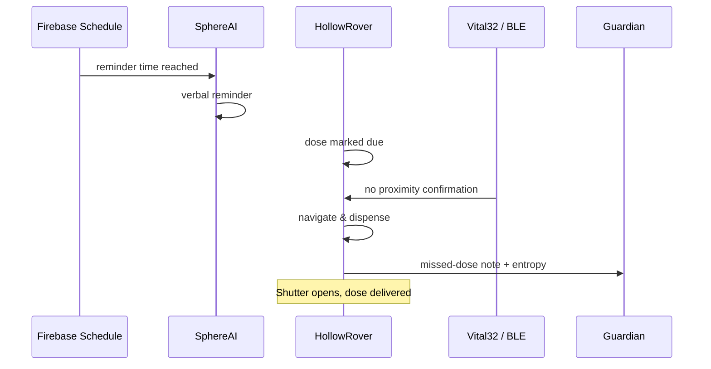

Forgetting a dose is one of the most common and dangerous events in elderly home care. LifeSphere treats medication adherence as a cross-subsystem responsibility: reminders travel through Firebase, the rover delivers the dose physically, and the intelligence layer measures adherence irregularity over time. No one in the chain needs the user to remember on their own.

<Steps>
  <Step title="The schedule originates from a prescription or manual entry">
    The medication schedule begins in one of two ways. In the preferred flow, the caregiver or user photographs a prescription in the companion mobile app. Image preprocessing converts the photo to grayscale and applies adaptive Gaussian thresholding to separate ink from paper. Tesseract OCR reads the English text. A large language model interprets the context to extract medicine name, dosage, frequency, duration, and instructions. The user reviews and edits all extracted data before confirming. The confirmed schedule is written to Firebase under `lifesphere/hollowcore/med_schedule`. Alternatively, a caregiver can enter the schedule directly on the dispenser's 3.5-inch touchscreen, which writes to `lifesphere/hollowcore/dispenser_manual`. The rover populates its local dispenser schedule from whichever source is active.
  </Step>
  <Step title="Firebase delivers a reminder">
    When the scheduled time arrives, the system publishes a reminder through Firebase. Multiple subsystems can observe this event. SphereAI may speak a verbal reminder through its speaker. The rover's local schedule handler notes that a dose is now due. The source specifies that reminders are delivered through Firebase; it does not describe any additional reminder channels such as lighting, climate, or OLED cues.
  </Step>
  <Step title="The user does not take the dose">
    In this scenario, the user does not respond. The source does not specify how the system definitively knows a dose was missed rather than simply delayed. One plausible inference, clearly labeled as such, is that the system may wait for a proximity confirmation window during which the rover's BLE RSSI module or Vital32's wearable beacon would detect the user near the dispenser. If that confirmation does not arrive, the dose is marked missed. The exact rules for this confirmation window are not given. What is known is that the system tracks adherence patterns over time.
  </Step>
  <Step title="HollowRover dispatches for autonomous delivery">
    HollowRover navigates to the wearer's current location using UWB positioning and barometric floor detection. It carries the medication in its 20-slot carousel dispenser. The NEMA17 stepper motor rotates the carousel, and the AS5600 magnetic encoder provides closed-loop position confirmation. At the target slot, an MG995 servo opens the shutter to release the dose. The arm then presents the medication and a small water container to the user at an accessible height. The source does not specify whether autonomous delivery is triggered specifically by a missed-dose determination or occurs at the scheduled time regardless; the architecture supports both interpretations.
  </Step>
  <Step title="Adherence entropy is updated">
    The system computes adherence entropy as

    $$H(X) = -\sum p(x_i) \log_2 p(x_i)$$

    where the probabilities represent the distribution of dosing events within defined time categories. High entropy means irregular timing; low entropy means consistent habits. The source does not specify the exact time categories, bin definitions, or tracking window length.
  </Step>
  <Step title="Caregiver and system respond to the pattern">
    If entropy remains low, the autonomous loop continues with minimal intervention. If entropy rises, the source does not specify any automatic escalation. The missed-dose escalation protocol is not described in the source. Plausible responses, clearly labeled as illustrative, might include SphereAI increasing verbal check-ins or the guardian receiving a periodic summary through the LifeSphere app. The exact thresholds and actions are not provided.
  </Step>
</Steps>

## Sequence diagram

## What made this possible

The design removes the setup barrier through prescription OCR plus LLM interpretation. Manually entering every medicine name, dosage, and timing is error-prone and discouraging adoption. By letting the user photograph a prescription once and review the structured extraction, LifeSphere turns handwritten instructions into a machine-ready schedule.

The 20-slot carousel with closed-loop magnetic encoding provides a precision mechanism scaled to home use. The AS5600 encoder reads the angle of a magnet attached to the carousel shaft, giving contactless position feedback. The 100-tooth ring gear provides a 5:1 reduction, so the NEMA17 stepper's standard 200 full steps per motor revolution multiply to 1000 steps per carousel revolution. Divided across 20 slots, this yields 50 steps per slot and 18 degrees of rotation per slot.

Adherence entropy turns a simple missed-pill counter into a behavioral signal. A user who misses the same dose every Saturday has a different clinical picture than a user who misses randomly. Entropy captures that distinction in a single scalar.

<Note>
  This page describes designed behavior and how the system is intended to respond. It does not document a recorded clinical trial or real-world deployment result. Predictive and response claims are engineering goals, not validated outcomes. Some inferences about missed-dose confirmation and escalation are illustrative and labeled as such.
</Note>

## Limits

The source does not specify missed-dose escalation rules. It is unknown whether the system retries once, multiple times, or escalates to a guardian call. The LLM extraction step runs on the phone or in the cloud, but the source does not specify which, creating a potential privacy and latency question. The touchscreen fallback requires direct ESP32 rendering with the TFT_eSPI library. The source does not specify carousel diameter, pill size limits, or whether the dispenser can handle liquids, split tablets, or variable capsule sizes. Adherence entropy outcome categories and window length are unspecified, so the score is not directly comparable across different users without normalization.

## Related pages

<CardGroup cols={2}>
  <Card title="Prescription Reading" icon="file-lines" href="/medication/prescription-reading">
    How the OCR and LLM pipeline turns a prescription photo into a structured schedule.
  </Card>

  <Card title="Dispenser Overview" icon="pills" href="/medication/dispenser-overview">
    The 20-slot carousel, stepper motor, encoder, and shutter mechanism.
  </Card>

  <Card title="Adherence Entropy" icon="calculator" href="/medication/adherence-entropy">
    How irregular dosing patterns are quantified with information-theoretic entropy.
  </Card>

  <Card title="Medication Overview" icon="pills" href="/medication/overview">
    The cross-subsystem medication management layer and its design philosophy.
  </Card>
</CardGroup>
