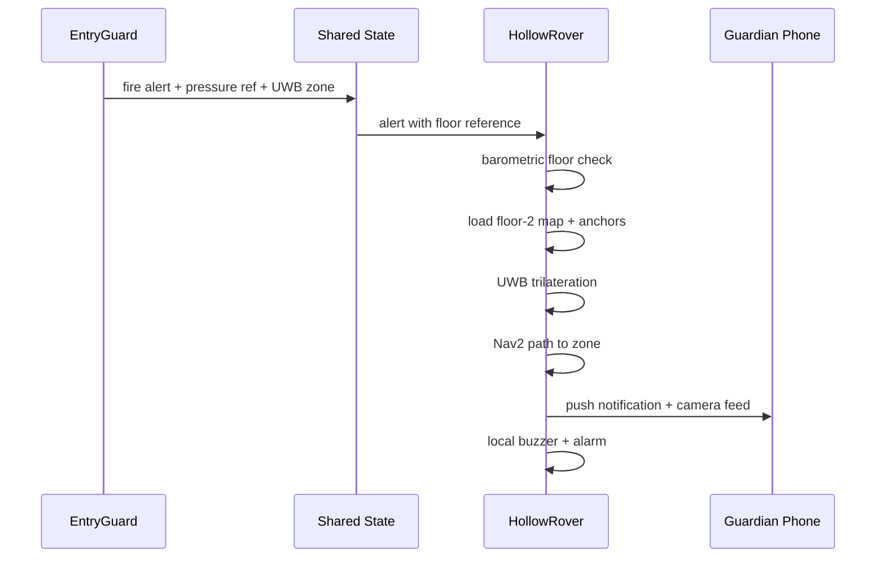

In multi-story homes, a danger event on an upper floor while the elderly resident is on a lower floor creates a critical response challenge. LifeSphere addresses this through combined UWB and barometric floor identification, per-floor SLAM maps, and autonomous rover dispatch.

<Note>
  This scenario describes designed system behavior and theoretical response pathways. It is not a record of a validated clinical trial or real-world deployment.
</Note>

## The situation

Mr. Hossain is 80 years old and lives in a three-story townhouse. He spends most of his day on the ground floor, where his bedroom and the kitchen are located. At 10:47 PM, while he is watching television in the living room, a small electrical fire begins in a second-floor storage room. An EntryGuard node is installed at the stairwell landing, equipped with PIR motion, ultrasonic distance, fire sensor, gas sensor, UWB module, and barometric pressure sensor.

## How the response unfolds

<Steps>
  <Step title="EntryGuard detects the fire">
    The EntryGuard node's KY-026 fire sensor registers a reading above its fire threshold. The node immediately triggers a fire alert. The alert payload includes the alert type (fire), a sensor value, the node identity, the UWB zone reference, and the floor pressure reference. Because EntryGuard operates 24/7 and arms automatically, no human action was required to enable this detection.
  </Step>
  <Step title="Floor identity is resolved from pressure">
    The alert carries a barometric pressure reference. HollowCore and HollowRover both know the calibrated pressure baselines for each registered floor. By comparing the alert's pressure reference to these baselines, the system determines that the event is on the second floor. This is independent of any UWB Z-axis measurement: barometric pressure identifies vertical context, while UWB resolves horizontal position.
  </Step>
  <Step title="Rover selects the correct floor map">
    HollowRover, docked on the ground floor, receives the alert through the shared state. It first runs its own barometric check: its onboard BME688 pressure sensor compares current pressure to the stored floor baselines. It confirms it is on the ground floor and identifies that the target event is on the second floor. It then loads the second floor's pre-built SLAM map and activates that floor's three-anchor UWB set.
  </Step>
  <Step title="Localization begins on the target floor">
    Using the selected UWB anchor geometry, the rover performs true 2D trilateration. Three non-collinear anchors at known fixed positions allow it to solve for (x, y) without relying on a last-known-position heuristic. This resolves the left-right ambiguity that two-anchor geometry would introduce. The rover now knows precisely where it is relative to the second-floor map and where the EntryGuard zone is located.
  </Step>
  <Step title="Navigation to the danger zone">
    HollowRover plans a path using Nav2. The controller runs at 20 Hz with a maximum forward speed of 0.3 m/s and a safety inflation radius of 0.35 meters around obstacles. It navigates to the EntryGuard UWB zone reference, using its STL-19P LiDAR and ultrasonic sensors to avoid furniture and doorways. The arm remains stowed below the LiDAR scan plane during navigation.
  </Step>
  <Step title="Local alarm and guardian notification">
    Upon arrival, the rover triggers three simultaneous responses: the local buzzer sounds, an audible alarm plays through the speaker, and an instant push notification with live camera feed is sent to the guardian's phone. The EntryGuard node itself also sounded its local buzzer at detection time, providing an early warning while the rover was in transit.
  </Step>
  <Step title="Human authorization before escalation">
    The rover's arm does not deploy for fire events: the passive barrier is only for intruder scenarios at monitored chokepoints. For fire or gas, the system relies on alarm and notification. Any escalation beyond sounding the alarm, such as triggering a suppression system, would require explicit human authorization. This respects the principle that LifeSphere initiates no autonomous defensive decision beyond notification and deterrence.
  </Step>
</Steps>

## Sequence of cross-floor dispatch

## What made this possible

Three design elements enable cross-floor response.

First, **barometric floor discrimination**. Each registered floor stores a calibrated pressure baseline. Because atmospheric pressure decreases predictably with altitude, the rover can determine which floor it is on and which floor an alert originated from. The source describes this as: barometric pressure identifies the vertical floor context; three-anchor UWB resolves precise horizontal position. This two-layer identification avoids the ambiguity of relying on UWB alone in a multi-floor building.

Second, **separate maps and anchor sets per floor**. The rover does not attempt to navigate a single merged map. Each floor has its own SLAM map and its own three-anchor UWB geometry. When the floor is identified, the correct map and anchor set are activated. This keeps localization accurate and prevents the rover from attempting to navigate through ceilings or stairwells that are not traversable.

Third, **Ackermann steering and rocker suspension**. The rover's four-wheel independent steering with Ackermann linkage enables precise path following, which is critical in narrow stairwell landings and hallways. The rocker suspension with differential bar keeps the chassis stable when transitioning between floors via ramps or lift thresholds. Without this mechanical stability, the rover might lose traction or tip during a time-critical dispatch.

## Limits and honest unknowns

HollowRover is wheeled and cannot climb stairs. Moving between floors requires an accessible path such as a lift, ramp, or manual relocation. If the only route is a staircase and no lift is available, the rover cannot reach the second floor autonomously. Future work includes legged locomotion for true multi-floor navigation. The source does not specify how the system handles a fire that blocks the rover's accessible route, or whether the guardian is notified of this impasse automatically.

The fire and gas thresholds are referenced but not numerically specified. Guardian notification timing depends on GSM or Wi-Fi availability; in a severe fire, power and network infrastructure may also be compromised. The thermal camera (MLX90640) is listed as part of the rover's sensor fusion suite, but its specific role in fire response is not detailed.

## Related pages

<CardGroup cols={2}>
  <Card title="UWB Positioning" icon="location-dot" href="/hollowrover/navigation/uwb-positioning">
    How three-anchor trilateration achieves 10 cm precision without heuristic assumptions
  </Card>

  <Card title="Barometric Floor Detection" icon="temperature-half" href="/hollowrover/navigation/barometric-floor-detection">
    Pressure baselines, floor selection logic, and how EntryGuard alerts carry floor context
  </Card>

  <Card title="EntryGuard Overview" icon="shield-halved" href="/entryguard/overview">
    The full perimeter security layer: sensors, logic, and 24/7 automatic arming
  </Card>

  <Card title="Multi-Floor Maps" icon="layer-group" href="/hollowrover/navigation/multi-floor-maps">
    Separate SLAM maps, localization references, and the registration process per floor
  </Card>
</CardGroup>
