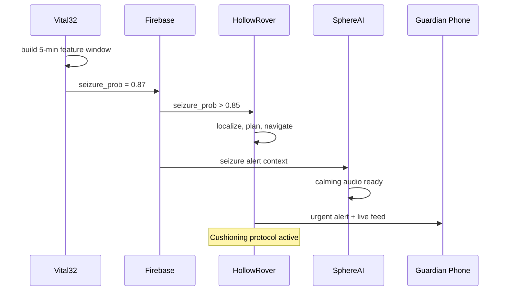

Seizures often arrive without warning and with devastating consequences for an elderly person living alone. LifeSphere's pre-seizure model is designed to estimate probability up to 30 minutes before onset, giving the system time to prepare physical cushioning, alert a guardian, and position the rover nearby. This is a design goal, not a validated clinical result.

<Steps>
  <Step title="Vital32 builds a 5-minute feature window">
    The pre-seizure LSTM consumes a rolling window of 5 minutes, represented as 300 time steps across 5 features. The features are derived from Vital32's multi-sensor array: heart rhythm and variability features, accelerometer motion features, and skin temperature. The system derives heart rhythm and variability from its cardiac signals, including RR intervals and RMSSD over a 2-minute rolling window. These features are fed into the LSTM every time the window advances, producing a continuously updating seizure probability.
  </Step>
  <Step title="LSTM outputs a rising probability">
    The model architecture uses two LSTM layers with 64 and 32 units, dropout of 0.3, a dense layer of 16 units with ReLU activation, and a final dense layer with sigmoid activation producing a probability between 0 and 1. When the probability crosses the alert threshold of 0.85, the shared state field `seizure_prob` is updated and `seizure_alert` logic triggers. The model was trained on public datasets: the CHB-MIT Scalp EEG Dataset and the Epilepsy iEEG Prediction dataset. These are brain-signal recordings, while the wearable inputs are cardiac, motion, and temperature signals. The source explicitly notes that this training-to-deployment gap is not addressed, and the model is unvalidated on real wearable data.
  </Step>
  <Step title="HollowRover receives the trigger and selects the floor">
    HollowRover subscribes to `vital32/seizure_prob`. When the threshold is crossed, the rover determines which floor the wearer is on using barometric pressure comparison against registered floor baselines, then loads that floor's SLAM map and UWB anchor set. It localizes the wearer via true 2D trilateration from three fixed non-collinear DWM1000 UWB anchors. The rover begins navigation toward the user at its maximum safe speed of 0.3 meters per second, with a 0.35-meter safety inflation around obstacles.
  </Step>
  <Step title="Cushioning protocol is initiated">
    The exact physical form of the cushioning deployment is not specified in the source. What is known is that the rover carries a protocol labeled "pre-seizure cushioning." Plausible inferences, clearly labeled as such, include positioning a padded surface near the user, preparing the arm to lower the user gently, or simply stationing the rover body itself as a protective buffer. The source does not detail internal protocol steps, mechanical implements, or success criteria. The protocol is listed alongside fall response and cortisol de-escalation as one of the rover's autonomous behaviors.
  </Step>
  <Step title="SphereAI and HollowCore enter seizure-aware mode">
    Concurrently with rover dispatch, SphereAI may initiate a calming audio loop or reduce ambient stimulation through HollowCore. The specific rules for seizure-aware environment control are not given, but the architecture supports cross-subsystem responses to any biomarker trigger. Lights may be dimmed, the air conditioner set to a steady temperature, and the room quieted to reduce sensory overload during the post-ictal phase.
  </Step>
  <Step title="Guardian receives lead-time alert">
    The guardian's phone receives an urgent push notification with the current seizure probability, a floor reference, and a live camera feed. Unlike a fall alert, which fires after the event, this alert is designed to arrive with up to 30 minutes of lead time. The guardian can call emergency services, speak through the rover's speaker to reassure the wearer, or initiate a video call. The system has done the time-critical work of detection and positioning; the human decides what to do with the warning.
  </Step>
</Steps>

## Sequence diagram

## What made this possible

The pre-seizure model represents the boldest predictive claim in LifeSphere's design. It attempts to generalize from brain-signal datasets to wearable biometric signals, a cross-modality leap that is common in research prototypes but rare in validated medical devices. The source is transparent about this gap, which is why this page treats every threshold and response as a design goal.

The LSTM architecture is intentionally modest: two layers, moderate dropout, a small dense bottleneck. This is consistent with running inference alongside SLAM, face recognition, and speech processing on a dedicated NPU with 10 TOPS of compute. The RDK X5's dedicated NPU eliminates CPU contention, so the seizure model can update in parallel with navigation and other AI tasks without stalling the robot's real-time control loops.

The 30-minute window is chosen to give the rover enough time to reach the user, deploy cushioning, and alert a guardian, even in a multi-floor home. It is not chosen for clinical relevance alone; it is a systems-integration constraint. Shorter windows might be more medically precise but would leave insufficient time for physical preparation.

<Note>
  This page describes designed behavior and how the system is intended to respond. It does not document a recorded clinical trial or real-world deployment result. The pre-seizure model is trained on brain-signal datasets and is explicitly unvalidated on real wearable data. Predictive and response claims are engineering goals, not validated outcomes. Some inferences about cushioning mechanics are illustrative and labeled as such.
</Note>

## Limits

The training-to-deployment gap is the most significant limit. The CHB-MIT and Epilepsy iEEG datasets record electrical brain activity, while Vital32 measures cardiac, motion, and thermal signals. Whether these peripheral signals contain sufficient information to predict seizures 30 minutes in advance is an open research question. The source does not report accuracy, AUC, sensitivity, or specificity for any model. The cushioning protocol's physical implementation is unspecified. The 30-minute lead time is a design target, not a measured mean or median warning interval. Longitudinal user studies to validate predictive model accuracy in real deployment are listed as future work.

## Related pages

<CardGroup cols={2}>
  <Card title="Pre-Seizure LSTM" icon="brain" href="/ai/pre-seizure-lstm">
    The model architecture, training data, and known validation gaps.
  </Card>

  <Card title="Vital32 Predictions" icon="heart-pulse" href="/vital32/predictions/pre-seizure-estimation">
    How the wearable layer supplies features for seizure probability estimation.
  </Card>

  <Card title="HollowRover Protocols" icon="route" href="/hollowrover/protocols/biomarker-triggered">
    How biomarker triggers map to rover emergency and cushioning protocols.
  </Card>

  <Card title="Honest Limits" icon="circle-question" href="/status/honest-limits">
    Which claims are validated, which are goals, and what remains unproven.
  </Card>
</CardGroup>
