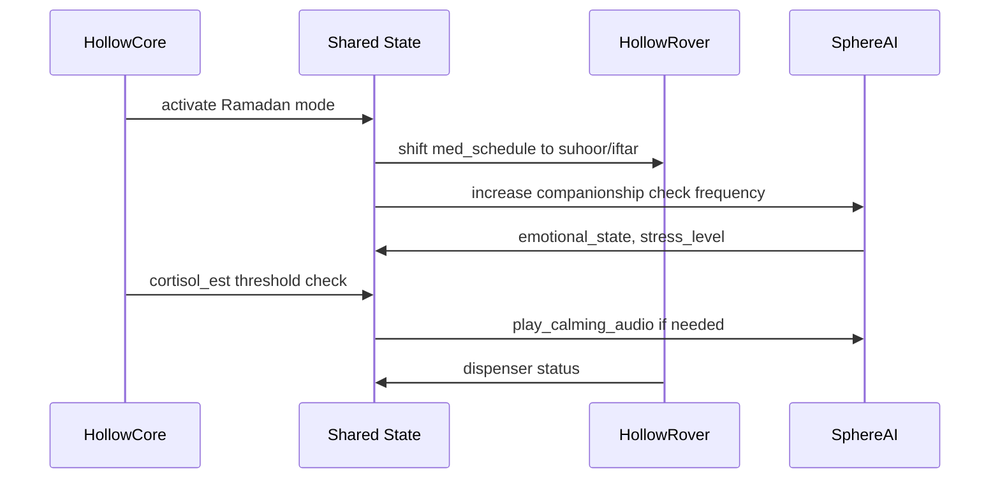

During Ramadan, elderly Muslims who fast face unique health risks: altered medication timing, dehydration, disrupted sleep, and emotional strain. LifeSphere's Ramadan mode is designed to adapt the entire ecosystem to these rhythms automatically.

<Note>
  This scenario describes designed system behavior and theoretical response pathways. It is not a record of a validated clinical trial or real-world deployment.
</Note>

## The situation

Mr. Karim is 71 years old and lives alone. He fasts during Ramadan, taking suhoor (pre-dawn meal) and iftar (sunset meal) as his anchor points. His medication schedule, hydration needs, sleep pattern, and emotional support all shift during this month. In ordinary smart home systems, he or his caregiver would need to manually reprogram reminders and climate settings. LifeSphere's Ramadan mode is designed to restructure these protocols automatically.

## How the day unfolds

<Steps>
  <Step title="Ramadan mode activates">
    HollowCore enters Ramadan mode, which restructures medication and hydration protocols around fasting intervals. The system does not require Mr. Karim to press any button or speak any command. The mode can be set by a caregiver through the shared state or triggered by calendar integration.
  </Step>
  <Step title="Medication timing shifts automatically">
    Mr. Karim's prescription, previously extracted through the OCR and LLM pipeline, includes timing instructions. In Ramadan mode, HollowRover's dispenser schedule is adjusted so that doses that would normally fall during daylight fasting hours are moved to suhoor or iftar windows. The exact shift logic is not specified in the source, but the design intent is to prevent missed doses without breaking the fast.
  </Step>
  <Step title="Hydration protocol adapts">
    Between iftar and suhoor, LifeSphere increases the frequency of gentle hydration reminders. SphereAI delivers these verbally through the rover speaker, adjusting tone based on Mr. Karim's current stress level. During fasting hours, no hydration prompts are issued. The system measures this balance against his Vital32 bioimpedance data, which estimates tissue hydration, to gauge whether post-iftar intake is sufficient.
  </Step>
  <Step title="Salah reminders arrive with context">
    SphereAI provides prayer time reminders. The specific computation method for prayer times is not described, but the integration is designed to align with the five daily salah intervals. These reminders are delivered verbally and are sensitive to Mr. Karim's emotional state: if he is stressed or tired, the reminder is gentler and includes an optional adhkar (remembrance phrase) playback.
  </Step>
  <Step title="Emotional support during long afternoons">
    The afternoons of Ramadan can be isolating, especially for elderly people fasting alone. SphereAI's loneliness index and stress level readings are monitored on the 15-minute cycle. If loneliness or stress rises, the system increases companionship interaction: calm conversation, Quran recitation, or adhkar audio playback through the MAX98357A speaker. The tone is selected by the meta-classifier based on the prior emotional state weights.
  </Step>
  <Step title="Sleep and environment adjust">
    Ramadan often shifts sleep to late night and early morning. Vital32 detects sleep through HRV and accelerometer immobility. HollowCore responds by delaying the automatic light-off and door-lock sleep protocol, keeping the home environment aligned with Mr. Karim's actual rest timing rather than a fixed clock schedule.
  </Step>
  <Step title="Cortisol monitoring for fasting stress">
    Fasting can elevate cortisol, particularly in the elderly. Vital32's 15-minute cortisol estimate, derived from HRV, GSR baseline, skin temperature, and sleep efficiency, is monitored closely. If the estimate crosses the HollowCore threshold of 18.0, the system triggers warm dim lighting, lowers the AC temperature, and may request SphereAI to play calming audio.
  </Step>
</Steps>

## Sequence of adaptation

## What made this possible

Ramadan mode depends on three design layers.

First, **prescription-driven scheduling**. Because Mr. Karim's medication schedule was extracted from a photographed prescription and stored in `lifesphere/hollowcore/med_schedule`, the system knows the names, dosages, and intended frequencies of his medications. Ramadan mode applies a temporal transformation to this structured schedule without requiring manual re-entry.

Second, **emotional context awareness**. SphereAI does not deliver generic reminders. Its trimodal classifier fuses language, voice, and biology with dynamic weights. In a stressed state, the biology agent weight rises to 0.5, meaning the system prioritizes biomarker reality over what Mr. Karim might verbally claim. This prevents the common scenario where an elderly person says "I am fine" while their physiology says otherwise.

Third, **bioresponsive environment**. HollowCore maps biomarker thresholds to physical actuator states: lighting, climate, audio. Mr. Karim never needs to adjust a thermostat or switch. The home environment is designed to be an active participant in his wellbeing, not a passive container.

## Limits and honest unknowns

The specific prayer time computation method, the exact adhkar texts used, and the detailed logic for shifting medication timings are not specified in the source. The system does not provide religious guidance: it provides reminders and emotional support that align with the user's stated practice. Individual medical conditions, such as diabetes or hypertension during fasting, would still require clinician oversight. LifeSphere is a support tool, not a substitute for medical advice during religious observance.

## Related pages

<CardGroup cols={2}>
  <Card title="Prescription Reading" icon="book" href="/medication/prescription-reading">
    How the OCR and LLM pipeline extracts medication schedules from a photographed prescription
  </Card>

  <Card title="Dynamic Weighting" icon="scale-balanced" href="/sphereai/understanding/dynamic-weighting">
    How SphereAI adjusts language, voice, and biology weights by emotional state
  </Card>

  <Card title="Cortisol Estimation" icon="brain" href="/ai/cortisol-estimator">
    How the 15-minute cortisol estimate is computed and why HollowCore responds at > 18.0
  </Card>

  <Card title="Medication Overview" icon="pills" href="/medication/overview">
    The full medication management pipeline from prescription to autonomous delivery
  </Card>
</CardGroup>
