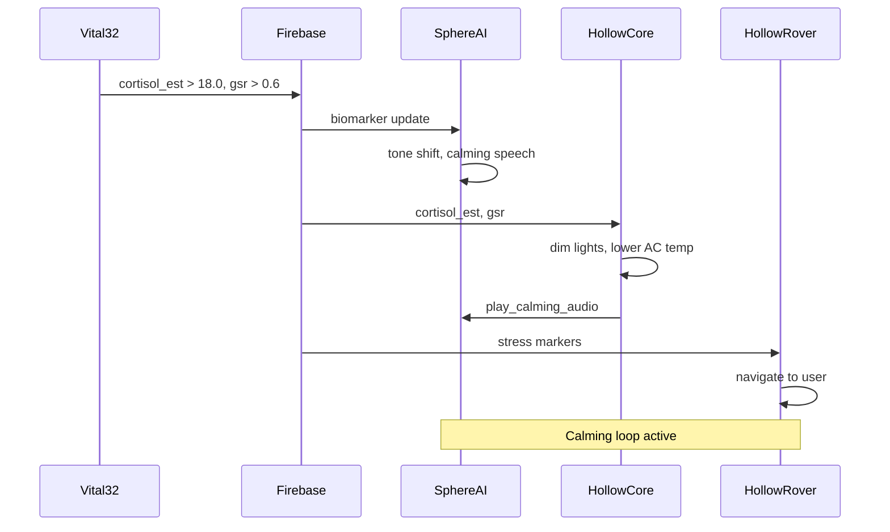

Stress is not always visible. For an elderly person living alone, a quiet physiological spike in cortisol and skin conductance can signal rising distress before anyone, including the wearer, consciously notices. LifeSphere treats this as a system-wide event, coordinating SphereAI, HollowCore, and HollowRover into a synchronized calming response.

<Steps>
  <Step title="Biomarkers cross thresholds">
    Vital32 continuously derives heart rhythm and variability from its cardiac signals, measures galvanic skin response (GSR), reads skin temperature, reads skin temperature, and estimates cortisol through a multi-sensor fusion model. On the medium inference cycle of 15 minutes, the cortisol estimator, a gradient boosting model with 200 trees, updates its output. At some point the shared state shows `cortisol_est` above 18.0 and `gsr` above 0.6. These numbers are example thresholds from the architecture description; the exact calibration for each user is learned during their first 30 days of baseline data collection.
  </Step>
  <Step title="SphereAI adjusts its tone">
    The SphereAI affective computing layer subscribes to `vital32/cortisol_est` and `vital32/gsr`. Its meta-classifier evaluates the emotional context using a dynamic weighted fusion of language, voice, and biology. When the prior state is "stressed," the biology stream receives the highest weight at 0.5, meaning biomarkers dominate the emotional score. The language agent weight drops to 0.2, reflecting that what the user says may matter less right now than what their body reports. SphereAI shifts its conversational tone. If the user has not spoken recently, SphereAI may initiate a gentle verbal presence through the MAX98357A amplifier and 3 W speaker.
  </Step>
  <Step title="HollowCore remaps the home environment">
    HollowCore reads the same biomarker fields through its subscription to the shared state. Two rules fire in parallel. Because `cortisol_est` is above 18.0, HollowCore commands warm dim lighting and a lower air conditioning temperature. Because `gsr` is above 0.6, HollowCore publishes a `play_calming_audio` command to the SphereAI speaker path. The relays controlling the living room light, bedroom light, and AC/fan respond. All of this happens without the wearer touching a switch or speaking a command.
  </Step>
  <Step title="HollowRover prepares stress relief">
    HollowRover listens to shared state and, upon seeing sustained elevated stress markers, initiates its cortisol-spike de-escalation protocol. The rover navigates to the wearer's location using the same UWB plus barometric floor-discrimination pipeline it uses for fall response. It may play additional calming audio through its own speaker, or it may simply position itself nearby as a comforting physical presence. The exact internal choreography of the stress-relief protocol is not specified in the source; what is clear is that the rover becomes a physical manifestation of the system's care.
  </Step>
  <Step title="Guardian receives a soft notification">
    Because this is a soft-alert level event rather than an emergency, the guardian may receive a low-priority notification through the LifeSphere app indicating elevated stress. They can choose to call, speak through the rover's audio system, or simply let the autonomous loop run. The system errs on the side of dignity: a moment of stress does not automatically summon an ambulance, but it does not go ignored either.
  </Step>
  <Step title="Biomarkers normalize">
    Over the next 15 to 30 minutes, the medium-cycle inference updates again. If cortisol and GSR fall below their thresholds, the system gradually reverses the environmental changes. Lights return to normal, the AC resumes its previous setpoint, and SphereAI transitions back to a neutral conversational mood. The entire loop completes without the user ever managing a device.
  </Step>
</Steps>

## Sequence diagram

## What made this possible

The response depends on multi-timescale inference. The 15-minute medium cycle is fast enough to catch a genuine stress episode before it escalates, yet slow enough to avoid jitter from momentary spikes. The architecture section also describes a 30-second short cycle for acute anomaly detection and a 24-hour long cycle for circadian modeling. Both cycles run in parallel; the stress response in this scenario is driven primarily by the medium cycle.

Dynamic weighting in the emotional classifier is the key to SphereAI's adaptability. In a calm prior state, language gets the highest weight at 0.4, reflecting that conversation content is the most informative signal. In a stressed prior state, biology rises to 0.5, so the system listens to the body first. This context-adaptive fusion means SphereAI does not treat every interaction the same way. It responds to the user's actual condition rather than a fixed script.

HollowCore's rule engine is deliberately simple: read a field, cross a threshold, toggle a relay. The intelligence lies in which thresholds are crossed, not in complex home-automation scripting. By tying lighting and climate directly to biological state, the home literally becomes an active participant in caregiving rather than a passive container.an active participant in caregiving rather than a passive container.

<Note>
  This page describes designed behavior and how the system is intended to respond. It does not document a recorded clinical trial or real-world deployment result. Predictive and response claims are engineering goals, not validated outcomes.
</Note>

## Limits

The cortisol estimator is an approximation, not a blood test. Its output is labeled "ng/dL est." in the source, and the model has not been validated against clinical laboratory cortisol assays. The gradient boosting model is trained offline, but the source does not specify its training data or its generalization to elderly Bangladeshi users. Thresholds such as 18.0 for cortisol and 0.6 for GSR are design examples; individual calibration requires longitudinal data collection that the source presents as a goal, not a completed study. The internal choreography of the rover's stress-relief protocol is not specified. Finally, if the Wi-Fi network is down, the system falls back to the local hotspot and MQTT model, but the source does not specify whether all biomarker-triggered rules still execute with full fidelity during an outage.

## Related pages

<CardGroup cols={2}>
  <Card title="Cortisol Estimation" icon="brain" href="/ai/cortisol-estimator">
    How the gradient boosting model approximates stress hormones from wearable data.
  </Card>

  <Card title="Dynamic Weighting" icon="scale-balanced" href="/sphereai/understanding/dynamic-weighting">
    How SphereAI shifts fusion weights based on the wearer's emotional context.
  </Card>

  <Card title="HollowCore Overview" icon="layer-group" href="/hollowcore/overview">
    The biology-responsive home automation layer that ties rooms to biomarkers.
  </Card>

  <Card title="Multi-Timescale Inference" icon="layer-group" href="/core/multi-timescale-inference">
    The 30-second, 15-minute, and 24-hour inference cycles that run in parallel.
  </Card>
</CardGroup>
