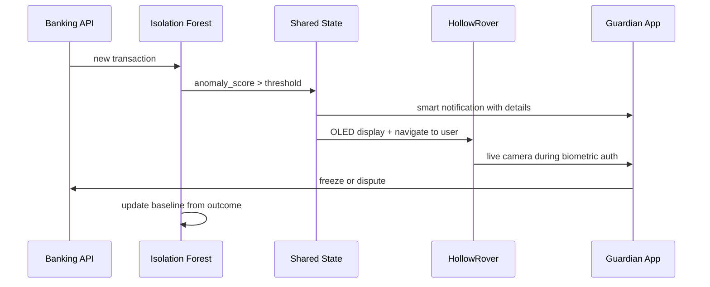

Financial exploitation of elderly people is a growing crisis. LifeSphere's financial monitoring layer uses personalized anomaly detection, multi-factor biometric authorization, and real-time guardian notification to protect users from fraud and unwanted subscriptions.

<Note>
  This scenario describes designed system behavior and theoretical response pathways. It is not a record of a validated clinical trial or real-world deployment.
</Note>

## The situation

Mrs. Islam is 76 years old and lives alone. She has given LifeSphere read-only access to her banking and subscription accounts through secure APIs. The system continuously scans incoming transactions. On a Thursday afternoon, a charge of 18,500 taka appears from an unrecognized merchant. It is significantly larger than her typical transaction pattern and does not match any of her recurring subscriptions.

## How the system responds

<Steps>
  <Step title="Isolation Forest flags the anomaly">
    LifeSphere's financial anomaly detector is an Isolation Forest model trained on Mrs. Islam's historical spending patterns from the first 30 days of use. It learns her typical merchant categories, transaction sizes, frequencies, and temporal patterns. The new transaction scores as an outlier: its path length in the forest is unusually short, indicating it is isolated quickly from her normal behavior cluster. The anomaly score rises above the soft alert threshold.
  </Step>
  <Step title="Smart notification reaches two channels">
    The system generates a smart notification through two channels simultaneously. First, Mrs. Islam's son receives an alert on the LifeSphere app with the transaction details: amount, merchant name, time, and a brief explanation that the transaction is outside his mother's established pattern. Second, HollowRover's OLED displays the same transaction details. The notification includes two one-tap actions: freeze card and dispute transaction.
  </Step>
  <Step title="Biometric gate for high-risk approval">
    If Mrs. Islam or a household member attempts to approve a new high-risk transaction or subscription, LifeSphere blocks it pending biometric authorization. The authorization requires three factors: facial recognition through the EntryGuard or HollowRover camera, a fingerprint scan, and Vital32 proximity confirmation from her wearable. The face recognition service runs on HollowRover using InsightFace with the buffalo_sc model pack on ONNX Runtime. Face profile data is stored locally and never transmitted to external servers.
  </Step>
  <Step title="Proximity confirmation from the wearable">
    Vital32 acts as the third biometric factor by confirming physical proximity. The wearable's BLE beacon and UWB tag signal that Mrs. Islam is physically present near the rover or EntryGuard node during the authorization attempt. This prevents remote attackers from using stolen photos or fingerprint replicas to approve transactions, because the system expects the wearable to be co-located with the biometric capture event.
  </Step>
  <Step title="Human decision, not autonomous blocking">
    LifeSphere does not autonomously freeze the card or reverse the transaction. The notification presents the anomaly, explains why it is flagged, and offers one-tap actions. The final decision to freeze, dispute, or approve rests with Mrs. Islam or her authorized guardian. This respects user agency: the system is a vigilant assistant, not an automatic gatekeeper.
  </Step>
  <Step title="Rover provides in-person explanation">
    If Mrs. Islam is at home when the alert arrives, HollowRover can navigate to her location using UWB positioning and BLE person-finding. SphereAI explains the transaction alert in natural Bengali or English, depending on her preference, and walks her through the options. The rover's speaker and OLED provide both auditory and visual reinforcement, compensating for potential hearing or vision limitations.
  </Step>
  <Step title="Learning continues">
    Whether the transaction is confirmed fraudulent or legitimate, the outcome feeds back into the model. If Mrs. Islam approves it as legitimate, the Isolation Forest gradually adjusts its understanding of her normal range. If it is frozen and disputed, the pattern is reinforced as anomalous. This continuous learning is what makes the model personal rather than generic.
  </Step>
</Steps>

## Sequence of financial protection

## What made this possible

Three design layers protect Mrs. Islam's finances.

First, **personalized anomaly detection**. Generic fraud rules might miss a fraud pattern specific to elderly users in Bangladesh, or might flag normal local behavior as suspicious. By training Isolation Forest on Mrs. Islam's own 30-day history, the system learns what is normal for her, not what is average for a population. This is the same principle as Vital32's biometric anomaly detector, extended to financial behavior.

Second, **multi-factor biometric authorization**. The financial layer enforces what the source describes as biometric transaction authorization for any new high-risk transaction or subscription. This combines something you are (face, fingerprint) with something you have (the Vital32 wearable providing proximity confirmation). The source does not specify the fingerprint hardware, but the three-factor architecture is designed to resist common fraud vectors such as stolen cards, phishing, and remote account takeover.

Third, **multi-channel notification with context**. The guardian receives not just an alert, but a contextual explanation: the amount, the merchant, and why it is anomalous. Mrs. Islam sees the same information on the rover OLED. This parallel notification ensures that if one channel fails or is overlooked, the other still carries the warning. The one-tap freeze and dispute actions reduce friction, which is critical for elderly users who might otherwise struggle with complex banking interfaces.

## Limits and honest unknowns

The specific thresholds that define "high-risk" are not specified in the source. The secure APIs that connect to banking and subscription services are unnamed, and the data access permissions are described in general terms. The fingerprint sensor hardware is not identified. The source does not state how the system handles recurring subscription price increases, which are legal but may be unwanted, or how it distinguishes between fraud and legitimate but unusual behavior such as holiday spending.

The face recognition pipeline is described as running on HollowRover with local storage, but the source does not specify which camera feeds it during EntryGuard financial authorization events. The computational latency of the three-factor authorization chain is not quantified.

## Related pages

<CardGroup cols={2}>
  <Card title="Financial Anomaly Detection" icon="chart-bar" href="/hollowcore/financial-anomaly-detection">
    How Isolation Forest learns spending baselines and flags unrecognized transactions
  </Card>

  <Card title="Transaction Authorization" icon="lock" href="/hollowcore/transaction-authorization">
    The three-factor biometric gate: face, fingerprint, and wearable proximity
  </Card>

  <Card title="Isolation Forest" icon="brain" href="/ai/isolation-forest">
    The mathematical foundation of the anomaly score across both health and finance
  </Card>

  <Card title="Face Recognition" icon="eye" href="/entryguard/face-recognition">
    InsightFace local pipeline, buffalo_sc model, and privacy-preserving storage
  </Card>
</CardGroup>
