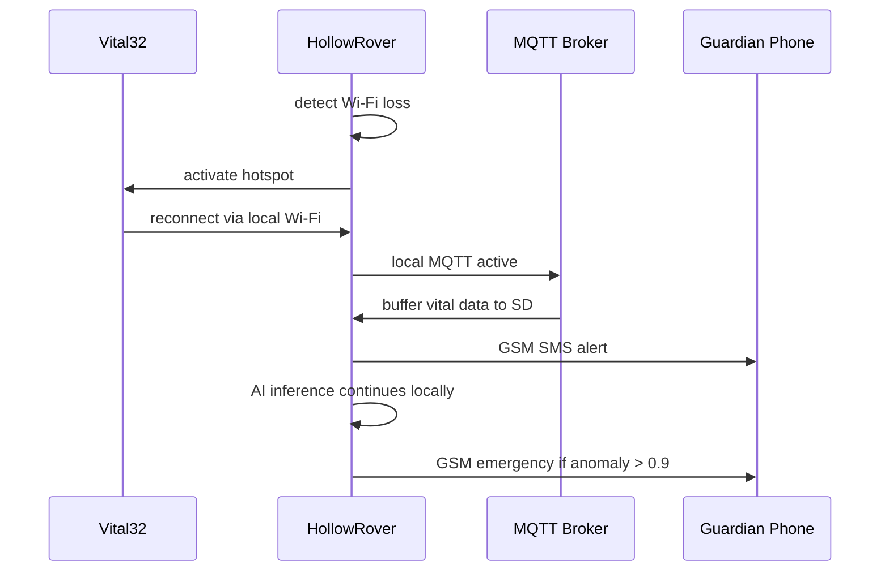

A home Wi-Fi outage does not silence LifeSphere. The system is designed with multiple fallback channels so that elderly users remain monitored and connected to caregivers even when their primary internet link drops.

<Note>
  This scenario describes designed system behavior and theoretical response pathways. It is not a record of a validated clinical trial or real-world deployment.
</Note>

## The situation

Mrs. Begum is 78 years old and lives alone in a two-story house. Her router loses connectivity at 2:15 AM due to a regional ISP outage. At this moment, Vital32 is actively monitoring her heart rate, oxygen saturation, skin temperature, and motion. HollowRover is docked and charging. Her next medication dose is scheduled for 6:00 AM. Her son, who lives in another city, expects to receive alerts if anything is wrong.

## How the system responds

<Steps>
  <Step title="Rover detects Wi-Fi loss">
    HollowRover, which hosts the Mosquitto MQTT broker on its RDK X5 compute board, detects that its upstream internet connection is down. It immediately activates its local Wi-Fi hotspot mode. This creates a local wireless network that Vital32 and other ESP32-based nodes can join.
  </Step>
  <Step title="Vital32 reconnects to local mesh">
    Vital32's Wi-Fi module detects the loss of the home router and scans for the rover's hotspot SSID. It rejoins within seconds. Data flow resumes: biometric readings are transmitted locally to the rover via Wi-Fi, then buffered on the rover's SD card. The system maintains the last 24 hours of vital data in local storage.
  </Step>
  <Step title="GSM fallback activates for guardians">
    The rover carries a SIM800L GSM module. When the internet outage persists, the system switches to GSM for outbound guardian notifications. Mrs. Begum's son receives an SMS at 2:18 AM: "LifeSphere: Home Wi-Fi down. Local monitoring active. GSM fallback enabled." This is not a full data stream: it is a simplified alert channel designed to maintain peace of mind.
  </Step>
  <Step title="Local MQTT keeps subsystems talking">
    HollowCore, which normally listens to MQTT commands from the rover to control lights, AC, and locks, continues operating over the local Wi-Fi hotspot. Its relay modules still respond to `lifesphere/hollowcore/command` payloads. If Mrs. Begum's skin temperature drops below baseline and the sleep protocol triggers, the lights still turn off and the door still locks.
  </Step>
  <Step title="Medication schedule stays on track">
    HollowRover's dispenser holds its medication schedule in local memory. The 6:00 AM dose is not dependent on cloud connectivity. The NEMA17 stepper motor rotates the carousel to the correct slot, the AS5600 encoder confirms position, and the MG995 servo opens the shutter at the programmed time. The rover then navigates to Mrs. Begum's bedside using UWB positioning and SLAM, which also operate locally.
  </Step>
  <Step title="Biomarker inference continues">
    The AI inference pipeline on the RDK X5 runs locally. The Isolation Forest anomaly detector, the cortisol estimator, and the emotional classifier do not require cloud access. The 30-second, 15-minute, and 24-hour cycles continue. If Mrs. Begum's anomaly score crosses 0.9, the rover will still execute the emergency protocol and attempt GSM notification even without Wi-Fi.
  </Step>
  <Step title="Watchdog timers monitor node health">
    Every subsystem has an independent watchdog timer. If Vital32 or HollowCore becomes unresponsive, the rover logs the event and, if GSM is available, sends a guardian notification. This prevents the failure of one node from being hidden by the general communication disruption.
  </Step>
  <Step title="Cloud sync resumes automatically">
    When the ISP restores connectivity, the rover rejoins the home Wi-Fi, deactivates the hotspot, and uploads the buffered 24-hour data to Firebase. The shared state tree is reconciled. No manual intervention is required from Mrs. Begum or her family.
  </Step>
</Steps>

## Sequence of failover

## What made this possible

Three architectural commitments enable this resilience.

First, **local compute on the rover**. The RDK X5's 8-core Cortex-A55 CPU and 10 TOPS NPU run SLAM, navigation, face recognition, speech processing, and biomarker inference entirely onboard. The rover is not a cloud-dependent terminal: it is a self-sufficient mobile server. The dedicated NPU ensures that even during an outage, AI tasks do not contend with the CPU that manages networking and actuation.

Second, **layered communication**. LifeSphere uses a two-channel model by design. Channel one is cloud-mediated Firebase for long-term state synchronization and guardian app updates. Channel two is local MQTT over Wi-Fi for hardware-to-hardware commands. When channel one fails, channel two remains. When both Wi-Fi layers fail, GSM provides a third, minimal channel. This layering means there is no single point of communication failure.

Third, **power independence**. The rover carries a 5000 mAh LiPo battery, described in the source as maintaining critical operations during power outages. Vital32 has its own 1000 mAh LiPo. Even if the home electricity fails alongside the internet, the core monitoring and response subsystems continue operating for a meaningful duration. The TP4056 charging module with protection on Vital32 ensures safe battery management without user intervention.

## Limits and honest unknowns

GSM via SIM800L is a fallback, not a full-bandwidth replacement. The source does not specify the exact SMS format for all alert types, the cost of GSM operation, or the geographic coverage assumptions. Data buffered on SD card is limited to 24 hours; a prolonged multi-day outage would eventually exhaust local storage and require manual recovery. The source does not state whether Firebase reconciliation after a long outage handles conflicting state updates or simply overwrites with the rover's buffered data.

## Related pages

<CardGroup cols={2}>
  <Card title="Fault Tolerance" icon="shield-halved" href="/core/fault-tolerance">
    Watchdog timers, independent node operation, and power backup across all subsystems
  </Card>

  <Card title="Communication Channels" icon="route" href="/core/communication-channels">
    Firebase, MQTT, serial bridges, and GSM: how the two-channel model works
  </Card>

  <Card title="Dispenser Overview" icon="pills" href="/medication/dispenser-overview">
    How the 20-slot carousel and local schedule memory keep medication on time
  </Card>

  <Card title="Security and Data Integrity" icon="lock" href="/core/security-and-data-integrity">
    TLS encryption, local storage, and authentication during normal and degraded operation
  </Card>
</CardGroup>
