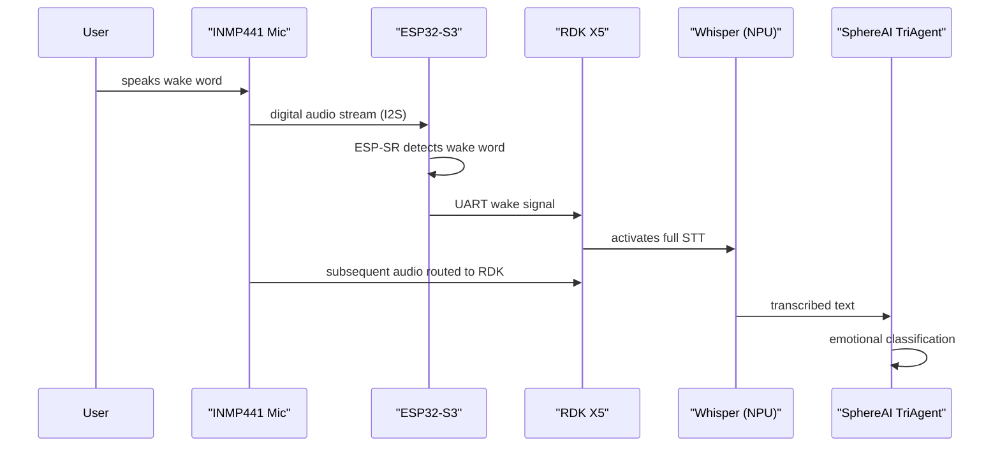

The wake-word engine is SphereAI's always-listening front door. It lets the user summon LifeSphere by voice without pressing a button, touching a screen, or waiting for a cloud connection, and it does so on a low-power ESP32-S3 that never sleeps.

## What a Wake-Word Engine Does

A wake-word engine is a tiny neural network trained to recognize one or a small number of trigger phrases, such as a name or greeting. It runs continuously on the audio stream, discarding everything until the trigger is heard, then signals the larger system to wake up and process what follows. This architecture is common in smart speakers and voice assistants. The key difference in LifeSphere is that the engine runs entirely on the device, not in the cloud, preserving privacy and ensuring that even a Wi-Fi outage does not silence the user's ability to call for help.

## The ESP32-S3 and ESP-SR Framework

The ESP32-S3 is a dual-core microcontroller with a vector instruction unit optimized for neural network inference. It is not powerful enough to run Whisper, the full speech-to-text model, in real time. It is, however, more than sufficient for a lightweight wake-word classifier.

SphereAI uses the ESP-SR framework, a speech recognition SDK maintained by Espressif, the manufacturer of the ESP32 family. ESP-SR provides pre-trained wake-word models and the runtime to deploy them on ESP32 variants. The model runs locally, meaning the microphone audio never leaves the chip until the wake word is confirmed.

## The Handoff to RDK X5

When the wake-word model fires, the ESP32-S3 raises a signal on a UART (universal asynchronous receiver-transmitter) serial line connected to the RDK X5. UART is a simple two-wire protocol that is ideal for single-purpose alerts: it has no packet overhead, no IP addressing, and negligible latency.

The ESP32-S3 does not send audio over UART. It sends only a short activation message. The RDK X5 then takes over the I2S audio bus, captures the following utterance into a buffer, and runs Whisper on its dedicated NPU. This split of labor is deliberate:

| Stage | Hardware | Trigger Mode |
| --- | --- | --- |
| Wake-word detection | ESP32-S3 | Continuous |
| Full speech-to-text | RDK X5 NPU | On demand |
| Sentiment analysis | RDK X5 NPU | After transcription |

By keeping the always-on stage on the low-power microcontroller, SphereAI avoids draining the rover battery or heating the main compute board for idle listening. The source does not specify exact power consumption figures for each stage.

## Privacy Implications of Local Wake-Word Processing

Because the ESP32-S3 processes audio locally, no sound is transmitted to any server while the system is waiting for its name. Only the utterance that follows the wake word may be sent to cloud-based sentiment models, and even that happens after local transcription by Whisper. For users who are concerned about being recorded continuously, this is a meaningful architectural choice. The wake-word engine itself does not store audio; it runs inference frame by frame and discards the buffer.

## Why This Matters

In a caregiving context, the wake word is a lifeline. A person who has fallen, is feeling suddenly unwell, or is experiencing anxiety needs to reach the system without navigating a touchscreen or remembering a sequence of taps. The always-listening wake-word engine makes SphereAI accessible to users with tremors, vision impairment, or cognitive variability. Local processing guarantees that the microphone is never a surveillance device; it is a doorbell that rings only when the user chooses to press it with their voice.

## How It Connects to the Rest of LifeSphere

The wake-word engine sits at the boundary between the user and the entire cognitive pipeline. Without it, the expensive NPU on the RDK X5 would have to remain active at all times, consuming power and generating heat. With it, the system can sleep lightly until summoned, then ramp up to full conversational intelligence within seconds.

After wake-word detection, the chain continues through Whisper, DistilBERT, the meta-classifier, and finally to the shared biological state. If the user's subsequent utterance indicates distress, HollowRover or HollowCore may respond before the conversation even ends.

## Limits

The source does not specify the exact wake-word phrase, the number of supported phrases, or whether the model can be retrained to a custom word. The ESP-SR framework supports limited-vocabulary recognition, so the wake-word stage cannot substitute for full speech understanding. Background noise, television audio, or conversations between other people in the room may produce false activations or missed detections. The source does not quantify false accept or false reject rates.

## Related Pages

<CardGroup cols={2}>
  <Card title="Voice Hardware" icon="microphone" href="/sphereai/hardware/voice-hardware">
    The INMP441 and MAX98357A chips that feed and receive the audio stream.
  </Card>

  <Card title="Display and Output" icon="volume-high" href="/sphereai/hardware/display-and-output">
    How SphereAI responds after the wake word is answered.
  </Card>

  <Card title="Language Agent" icon="comment" href="/sphereai/understanding/language-agent">
    What happens to the speech after the RDK X5 takes over.
  </Card>

  <Card title="ESP32-S3" icon="microchip" href="/sphereai/hardware/wake-word-engine">
    The microcontroller that makes always-listening possible without cloud dependency.
  </Card>
</CardGroup>
