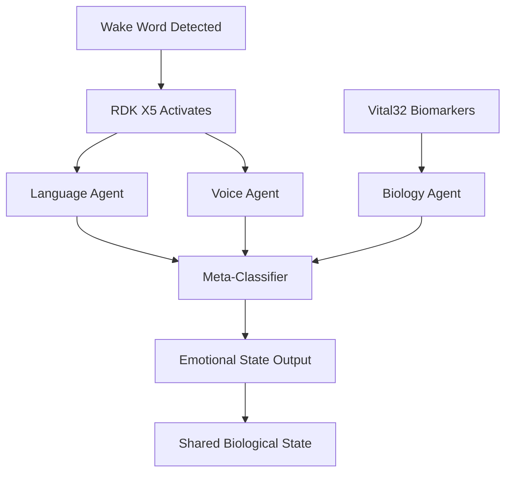

SphereAI is LifeSphere's affective computing layer. It listens, interprets, and responds to the emotional and cognitive state of the person it serves, then shares that understanding across every other subsystem so the whole ecosystem can adapt its tone, lighting, conversation, and physical behavior accordingly.

## What SphereAI Does

While Vital32 reads the body and HollowRover moves through the home, SphereAI interprets what those signals mean in human terms. It runs a three-agent architecture called TriAgent that combines what the person says, how they say it, and what their body is reporting, then fuses those streams into a single emotional classification.

The output is not just a label. SphereAI produces four continuous signals that flow into the shared biological state:

| Signal | Meaning | Update Cycle |
| --- | --- | --- |
| emotional_state | Dominant feeling (calm, stressed, grief, isolated, cognitive) | 15 minutes |
| stress_level | Continuous stress intensity | 15 minutes |
| loneliness_index | Estimated social isolation | 15 minutes |
| cognitive_score | Speech-based cognitive baseline deviation | 15 minutes |

These values are written to Firebase where HollowCore, HollowRover, and Vital32 can all subscribe and respond.

## The TriAgent Architecture

SphereAI does not rely on a single input type. It runs three concurrent analysis agents and feeds their outputs into a dynamic meta-classifier that weights each stream according to the user's current emotional context.

**Language Agent**: Converts speech to text using Whisper, then runs DistilBERT sentiment analysis on the transcript. It measures not only polarity but semantic coherence, unique word ratio, and topic repetition to detect cognitive drift.

**Voice Agent**: Extracts MFCC (mel-frequency cepstral coefficients, a compact representation of vocal timbre), pitch, energy, tempo, and zero-crossing rate from the audio waveform. These features capture vocal prosody, the musical quality of speech that often reveals emotion before words do.

**Biology Agent**: Reads live biomarkers from Vital32, including heart rate variability, galvanic skin response, skin temperature, and sleep state. These physiological correlates are among the most reliable indicators of stress and emotional arousal because they respond faster than conscious self-report.

The meta-classifier applies context-adaptive weights. If the system already believes the user is stressed, it trusts biology more than language because people under stress often deny or understate their condition verbally. If the state is cognitive concern, language becomes the dominant signal.

## Dynamic Weighting Table

The weights below determine how much each agent contributes to the final score for every possible emotional state. The system selects the row matching the prior state, computes a weighted sum for each candidate state, and declares the winner.

| Prior State | Lang / Voice / Bio | Strongest |
| --- | --- | --- |
| calm | 0.4 / 0.3 / 0.3 | Language (tied) |
| stressed | 0.2 / 0.3 / 0.5 | Biology |
| grief | 0.3 / 0.4 / 0.3 | Voice |
| isolated | 0.2 / 0.2 / 0.6 | Biology |
| cognitive | 0.5 / 0.3 / 0.2 | Language |
| unknown | 0.4 / 0.3 / 0.3 | Language (tied) |

The formula for each candidate state is simple: the weighted sum of the three agent scores. The candidate with the highest sum becomes the new emotional_state.

## Why This Matters

Loneliness and stress are not merely unpleasant. In elderly adults, chronic loneliness correlates with faster cognitive decline, weaker immune response, and higher mortality. A system that detects grief before it deepens, or isolation before it becomes entrenched, can intervene while the condition is still reversible.

SphereAI does not replace human companionship. It extends the caregiver's awareness into hours and rooms where no person is present, and it gives the physical subsystems a reason to respond with warmth rather than mere efficiency.

## How It Connects to the Rest of LifeSphere

SphereAI is both a consumer and a producer in the shared biological state.

**Inputs it consumes**:

- Vital32 biomarkers every 15 minutes
- Wake-word events from the ESP32-S3 voice hardware
- HollowCore device state for context

**Outputs it produces**:

- emotional_state, stress_level, loneliness_index, cognitive_score
- Commands such as `play_calming_audio` sent back to HollowCore and the rover speaker
- Personality-informed conversation parameters

When SphereAI detects elevated stress, it can ask HollowCore to dim the lights and lower the temperature, trigger HollowRover to deploy a calming protocol, or play adhkar (Islamic remembrance phrases) through the home speaker system. The response is coordinated, not isolated.

## Limits

The source does not specify how stress_level or loneliness_index are computed beyond the classification framework. The cognitive_score relies on speech patterns, so users with speech impairments or who rarely speak may receive incomplete assessments. All predictive claims, including early cognitive decline detection, are design goals and have not been validated in longitudinal studies.

## Related Pages

<CardGroup cols={2}>
  <Card title="Language Agent" icon="comment" href="/sphereai/understanding/language-agent">
    How Whisper and DistilBERT turn speech into emotional signal.
  </Card>

  <Card title="Voice Agent" icon="wave-square" href="/sphereai/understanding/voice-agent">
    MFCC, pitch, and prosody as windows into emotion.
  </Card>

  <Card title="Biology Agent" icon="heart-pulse" href="/sphereai/understanding/biology-agent">
    Why biomarkers are the hardest to fake and the fastest to respond.
  </Card>

  <Card title="Wake-Word Engine" icon="microphone" href="/sphereai/hardware/wake-word-engine">
    The always-listening ESP32-S3 that starts the pipeline without cloud dependency.
  </Card>
</CardGroup>
