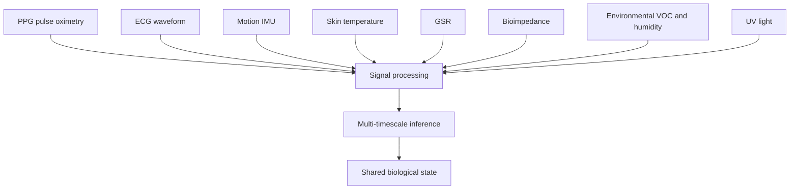

Vital32 is the primary biosensing layer of the LifeSphere ecosystem. It reads biological signals without buttons, screens, or voice commands. The user simply wears it. Low-power ESP32 hardware, sensor fusion, and multi-timescale inference turn raw readings into structured vital signs. These feed the shared biological state tree so other subsystems can decide when to intervene.

The system is designed around a single principle: LifeSphere does not require the user to interact with technology. It requires technology to respond to the user's biology.

## Why this matters

Most elderly care devices stop at measurement. A smartwatch reports heart rate. A pendant detects a fall. The burden of interpretation, follow-up, and emergency contact still falls on the user or a caregiver who may be hours away. Vital32 changes that by feeding real-time biological data into a distributed intelligence that acts autonomously. When anomaly risk climbs, SphereAI adjusts its tone. When a fall is confirmed, HollowRover dispatches. When skin temperature drops, HollowCore warms the room. The wearable is not the product. It is the biological input layer for an organism that watches, predicts, and responds.

## What Vital32 measures

A multi-sensor array reads the body and its surroundings. No single sensor tells the whole story. PPG (photoplethysmography, measuring blood-volume changes with light) tracks pulse and blood oxygen. ECG waveform acquisition captures the electrical rhythm of the heart. An accelerometer and gyroscope detect motion, falls, and tremor. A non-contact infrared thermometer reads skin temperature. A galvanic skin response sensor tracks sympathetic nervous system arousal. Bioelectrical impedance quantifies tissue hydration. Environmental sensors capture VOCs, humidity, and UV. Together they produce a normalized feature vector every 30 seconds.

## How it connects to the rest of LifeSphere

All data flows into the shared biological state tree under `lifesphere/vital32`. Fields include `heart_rate`, `spo2`, `skin_temp`, `hrv_rmssd`, `hrv_lf_hf`, `gsr`, `bio_age`, `anomaly_score`, `seizure_prob`, `cortisol_est`, `fall_detected`, and `immune_alert`. Every other subsystem reads what it needs.

- HollowRover listens for `fall_detected true` to trigger its fall-response protocol.
- HollowCore maps `cortisol_est`, `gsr`, and `skin_temp` to lighting, climate, and air-purifier rules.
- SphereAI's biology agent consumes biomarkers to weight the emotional classifier.
- HollowRover uses the wearable's BLE beacon for person-finding, and HollowCore uses the wearable for proximity confirmation during transaction authorization.

In other words, Vital32 is not a health tracker. It is the heartbeat of a synchronized organism that adapts to the user without conscious interaction.

## Limits

Vital32 does not diagnose disease. It estimates risk and deviation from a personal baseline. Predictive goals such as immune activation 24 to 48 hours before symptoms, pre-seizure warning 30 minutes before onset, and biological age scoring are design objectives, not validated clinical results. The source does not specify the accuracy of any individual sensor or the clinical equivalence of estimated values to laboratory measurements. Longitudinal user studies remain future work.

## Related pages

<CardGroup cols={2}>
  <Card title="Sensor Array" icon="microchip" href="/vital32/components/sensor-array">
    Every sensor in the multi-sensor array and what it contributes
  </Card>

  <Card title="Signal Processing" icon="wave-square" href="/vital32/sensing/signal-processing">
    From raw ADC to normalized feature vectors
  </Card>

  <Card title="Anomaly Scoring" icon="scale-balanced" href="/vital32/predictions/anomaly-scoring">
    How Isolation Forest converts baselines into anomaly risk
  </Card>

  <Card title="Fall Detection" icon="person-falling" href="/vital32/sensing/fall-detection">
    Two-stage accelerometer detection and rover dispatch
  </Card>
</CardGroup>
