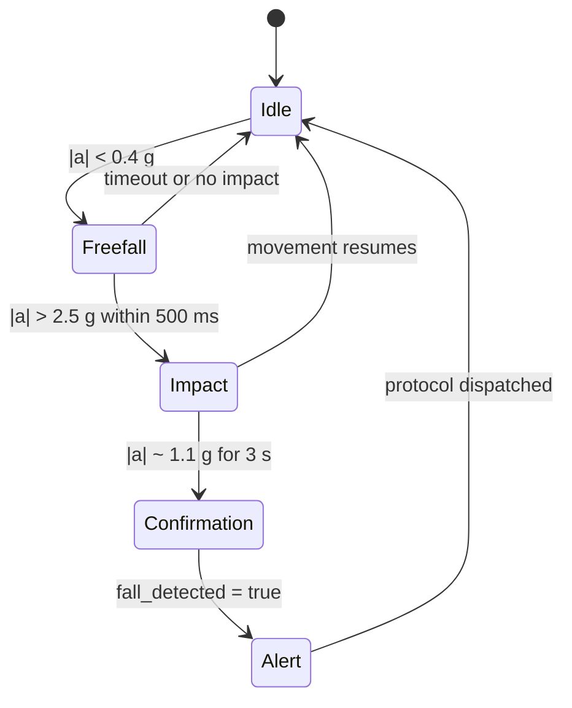

Vital32 uses its MPU6050 accelerometer and gyroscope to watch for one of the most dangerous events an elderly person living alone can experience: a fall. The detection logic is a three-step state machine designed to catch genuine falls while ignoring everyday movements like sitting down quickly or dropping the wristband.

## What the accelerometer measures

An accelerometer measures acceleration along three axes: x, y, and z. When the device is at rest on a table, it reads approximately 1 g of gravity pointing downward. During movement, the total magnitude combines all three axes:

$$
|a| = \sqrt{a_x^2 + a_y^2 + a_z^2}
$$

Freefall briefly removes the normal 1 g sensation because gravity and the device's motion cancel out from the sensor's perspective. Impact restores a sudden high g-force. Resting after impact returns the magnitude to approximately 1 g but with very little variation.

## The three detection stages

### Stage 1: Freefall

The system enters the freefall state when the acceleration magnitude drops below 0.4 g. This indicates the body (and the wristband) is accelerating downward faster than gravity would suggest at rest, which happens during the airborne phase of a collapse.

<Note>
  The 0.4 g threshold is lower than 1 g because the sensor is in freefall: gravity is not pressing against it in the same way it does when stationary.
</Note>

If no impact follows within 500 milliseconds, the state resets to idle. This timeout prevents false triggers from slow bending or lowering the arm.

### Stage 2: Impact

After freefall, the system looks for an impact: acceleration magnitude exceeding 2.5 g within 500 ms of the freefall trigger. This represents the body hitting the floor, furniture, or another surface. A hard sit-down can also produce a spike, so the algorithm does not stop here.

If movement continues after the spike (for example, the person stands up or adjusts position), the system returns to idle. A genuine fall usually leaves the person unable to move immediately.

### Stage 3: Confirmation

The final stage requires near-zero movement for 3 seconds after impact. The source describes this as magnitude staying below about 1.1 g, which means the wrist is resting near normal gravity with very little jostling. In practice, this captures the motionless period after a serious fall better than impact alone.

Only when all three stages complete does Vital32 set `fall_detected` to true in the shared biological state.

## What happens after confirmation

Once `fall_detected` becomes true, every subsystem subscribed to that field responds within the target 150 ms latency:

- **HollowRover** dispatches its fall-response protocol: navigating to the user's last known UWB position
- **SphereAI** may begin verbal reassurance through the rover speaker if the user is conscious
- **HollowCore** can adjust lighting to guide emergency responders if guardians are on their way
- The system may also notify authorized guardians through Firebase listeners

## Why this matters

Falls are the leading cause of injury among elderly people living alone. The longer someone stays on the floor, the worse the outcome. A two-stage-plus-confirmation approach reduces the chance that a dropped wristband or a sudden sit-down triggers a rover dispatch, which preserves trust in the system. When a genuine fall occurs, the confirmation stage ensures the alert is sent quickly enough for the rover to arrive while the user still needs help.

## How it connects to the rest of LifeSphere

- The **MPU6050** also contributes to tremor detection and sleep-state inference when combined with HRV immobility, so the same sensor serves multiple predictions.
- **HollowRover's** fall protocol is triggered directly by the `fall_detected` shared-state flag; the rover does not run its own fall logic.
- **SphereAI** can use the emotional-state and stress-level fields to decide whether to speak calmly or remain silent when it arrives, because a startled user may not respond well to sudden audio.

## Limits

- The MPU6050 is worn on the wrist, so a fall where the arm is protected (for example, caught on furniture) may not show the full freefall signature.
- The source does not specify whether the algorithm adapts to the user's typical movement patterns over time.
- Thresholds are fixed in the description; no calibration procedure for individual users is documented.
- Very slow collapses, such as a gradual slump, may not produce a sharp enough freefall or impact to trigger the stages.

## Related pages

<CardGroup cols={2}>
  <Card title="Signal Processing" icon="wave-square" href="/vital32/sensing/signal-processing">
    How raw ADC data becomes clean features before any alert logic runs
  </Card>

  <Card title="Sensing Cadence" icon="wave-square" href="/vital32/sensing/sensing-cadence">
    How often motion is sampled for fall detection versus other features
  </Card>

  <Card title="Rover Fall Response" icon="robot" href="/hollowrover/protocols/fall-response">
    What HollowRover does once a fall is confirmed
  </Card>

  <Card title="Fault Tolerance" icon="shield-halved" href="/core/fault-tolerance">
    How the system stays reliable when subsystems go offline
  </Card>
</CardGroup>
