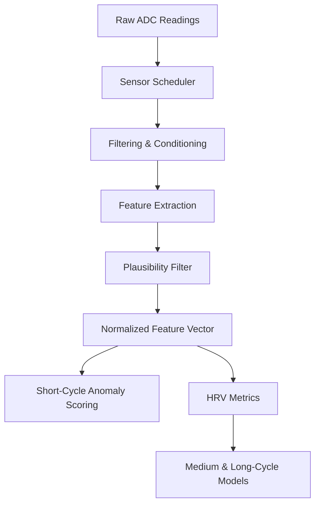

Vital32 sits on the wrist and collects electrical, optical, and mechanical signals from a multi-sensor array. Before any prediction model runs, the firmware must turn raw analog-to-digital converter (ADC) readings into clean, comparable numbers: a normalized biometric feature vector. This page explains how that pipeline works, what HRV means in plain language, and why plausibility filtering matters.

## Why raw data needs work

Sensors do not output "heart rate 72." They output voltage levels, light-intensity counts, or acceleration counts that change with temperature, battery level, skin tone, contact pressure, and electrical noise. Signal processing is the step that recovers the biological information hidden inside those noisy voltages.

In general, wearable biosignal pipelines follow the same pattern no matter the brand: conditioning, feature extraction, normalization, and then quality gating. Vital32 follows this pattern with a scheduler that spreads reads across time so multiple sensors do not fight for the communication bus at once.

## From ADC counts to a feature vector

Vital32 reads its sensors on staggered intervals. The firmware processes each stream, applies filtering, and then assembles a single normalized biometric feature vector.

The exact normalization method is not specified in the source, but typical approaches include:

- **Baseline subtraction**: remove the sensor's resting offset so only changes matter
- **Scaling**: map the signal into a fixed range (for example, zero to one) so a model trained on one person still recognizes patterns in another
- **Differencing**: use the change from the previous sample rather than the absolute value, which reduces the effect of slow drift

This vector is what feeds the real-time anomaly detector and the longer-cycle estimators.

## Heart-rate variability (HRV)

HRV is not your heart rate. It is the tiny variation in time from one heartbeat to the next. A healthy nervous system produces irregular gaps; an exhausted or stressed system becomes more rigid. HRV is therefore one of the best non-invasive windows into autonomic nervous system balance.

Vital32 derives heart rhythm and variability from its cardiac signals. The system measures the RR interval: the milliseconds between successive beats. From a stream of RR intervals it computes two standard metrics.

### RMSSD

RMSSD stands for root mean square of successive differences. It measures short-term HRV and is especially sensitive to parasympathetic (rest-and-digest) activity. The formula is:

$$
\text{RMSSD} = \sqrt{ \frac{1}{N-1} \sum_{i=1}^{N-1} (RR_{i+1} - RR_i)^2 }
$$

In plain language: take the gap between two consecutive heartbeats, subtract it from the next gap, square that difference, average all those squared differences, then take the square root. Vital32 computes RMSSD over a 2-minute rolling window.

### LF/HF ratio

The LF/HF ratio compares two frequency bands in the RR interval series.

- **LF band**: 0.04 to 0.15 Hz
- **HF band**: 0.15 to 0.40 Hz

Welch power spectral density estimation is applied to a 256-sample RR window, and the power in each band is summed. The ratio is:

$$
\text{LF/HF} = \frac{P_{LF}}{P_{HF}}
$$

In general, a higher LF/HF ratio is associated with greater sympathetic (fight-or-flight) dominance, while a lower ratio suggests more parasympathetic tone. Vital32 uses this as one input to its cortisol estimator and stress models.

<Note>
  Welch PSD is a method that splits the signal into overlapping segments, computes a periodogram for each, and averages them. This smooths out random noise and gives a more stable estimate of power at each frequency.
</Note>

## Plausibility filtering

Before any feature enters the AI pipeline, Vital32 validates sensor readings against physical plausibility bounds. If a temperature reading suggests the user is below 20 degrees Celsius while the accelerometer shows active motion, the sample is rejected as a hardware fault rather than a biological event.

The exact bounds are not specified in the source. The purpose of this step is to stop sensor errors, loose contacts, or bus glitches from tricking the inference system into false alerts. It is a safety layer between the hardware and the intelligence.

## Pipeline flow

Steady streams feed HRV computation in parallel with the feature vector assembly, so anomaly detection and rhythm analysis both receive clean data at the same time.

## Why this matters

Without signal processing, a loose electrode or a sudden arm movement could look like a cardiac emergency. Without plausibility filtering, a single bad sample could dispatch the rover. The pipeline is Vital32's immune system: it lets real biology through and blocks hardware noise before any decision is made.

## How it connects to the rest of LifeSphere

- The **normalized feature vector** is uploaded to the shared biological state in Firebase every 30 seconds, where SphereAI reads it for emotional inference and HollowCore reads it for environment adjustments.
- **HRV metrics** feed the cortisol estimator and the pre-seizure LSTM, both of which run on the user's personal baseline.
- The **plausibility filter** protects the integrity of the entire ecosystem, because every downstream subsystem trusts that Vital32 data represents real biology.

## Limits

- The source does not specify the exact normalization algorithm or the numerical plausibility bounds.
- No quantitative validation of the filtering step is reported; it is described as a design safeguard rather than a tested module.
- HRV accuracy depends on beat-detection quality, and the beat-detection method inside the cardiac signal processing is not detailed.

## Related pages

<CardGroup cols={2}>
  <Card title="Fall Detection" icon="person-falling" href="/vital32/sensing/fall-detection">
    How motion data becomes a confirmed fall alert
  </Card>

  <Card title="Heart Rate Variability" icon="heart-pulse" href="/vital32/sensing/heart-rate-variability">
    Deeper look at RMSSD, LF/HF, and what they mean for stress and sleep
  </Card>

  <Card title="Plausibility Filtering" icon="shield-halved" href="/vital32/sensing/plausibility-filtering">
    Why physical bounds are the last line of defense against false alerts
  </Card>

  <Card title="Sensing Cadence" icon="wave-square" href="/vital32/sensing/sensing-cadence">
    How often each sensor is read and how that relates to AI cycle times
  </Card>
</CardGroup>
